# Assignment 7 — Capstone: Deploy a Production-Grade Stack for The EpicBook

Part of the DevOps Micro Internship (DMI) with Agentic AI

---

## Purpose

In this assignment, you will deploy the EpicBook application as a production-oriented Docker Compose stack on a cloud VM. You will use optimized container images, isolated networks, health checks, persistent MySQL storage, a selected reverse proxy, logging, backup and restore testing, and reliability procedures.

---

# Task 0 — App Discovery and Architecture

## Goal

Review the EpicBook repository and design the intended application architecture.

### Evidence

#### Screenshot 1 — EpicBook Project Structure

Add a terminal screenshot showing the EpicBook project structure after cloning the repository.

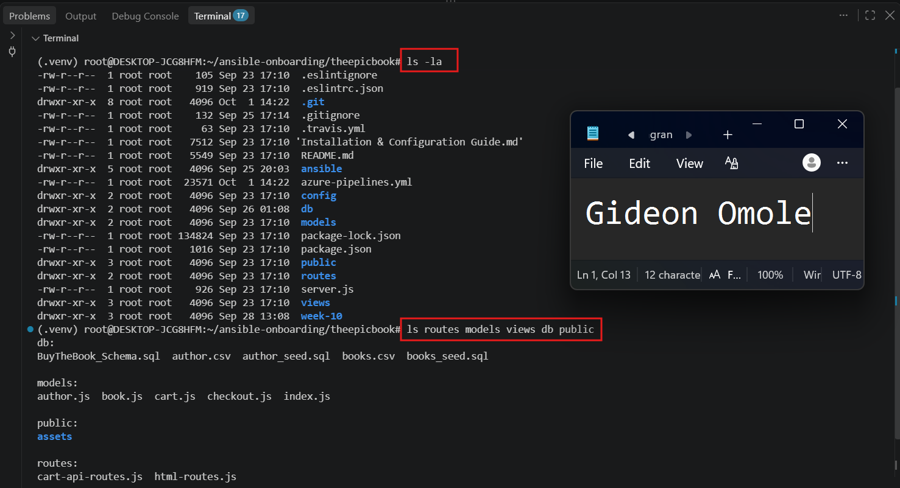

---

#### Screenshot 2 — Architecture Diagram

Add a screenshot of your architecture diagram showing:

- Public user
- Reverse proxy
- Frontend
- Backend
- Database
- Docker networks
- Public and private ports
- Persistent database storage

Add your full name inside the diagram or as a clear caption below it.

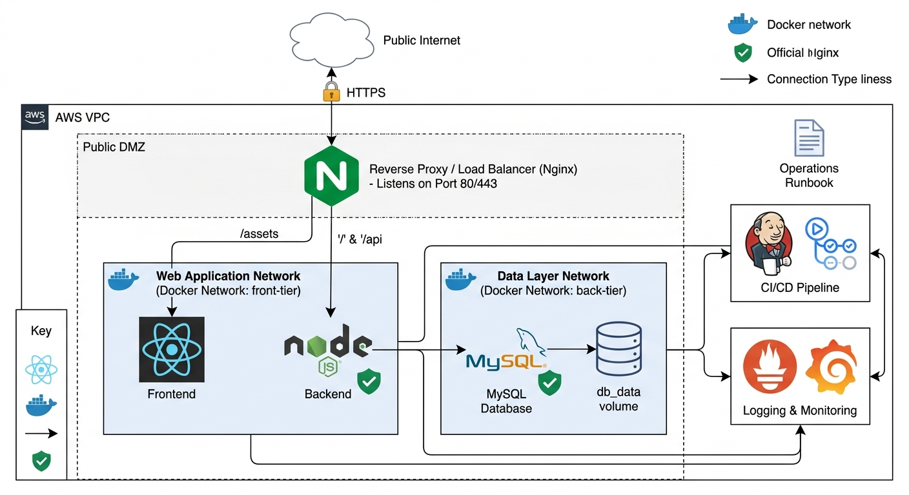

---

#### Screenshot 3 — Environment Variables and Ports Document

Add a screenshot showing the contents of:

```text
docs/02-env-and-ports.md
```

It must document environment-variable names, internal ports, persistent-data details, and the health-check method. Do not expose real credentials or values.

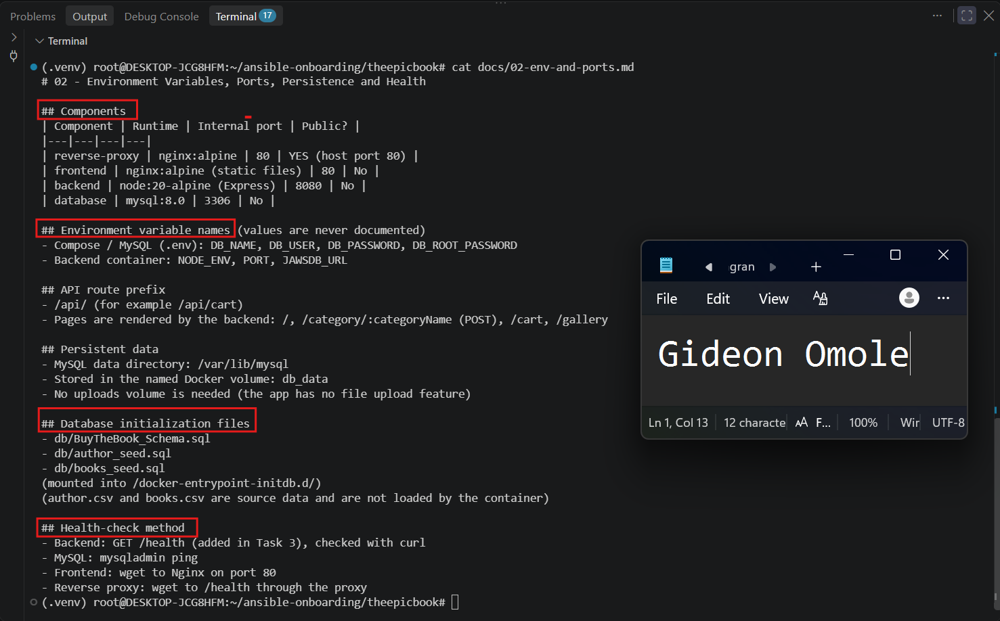

---

# Task 1 — Create Production Docker Images

## Goal

Create optimized production images for the EpicBook backend and frontend.

### Evidence

#### Screenshot 4 — Backend Dockerfile

Add a screenshot showing `backend/Dockerfile`, including:

- Dependency stage
- Minimal runtime stage
- Production startup command
- Internal backend port
- Non-root user configuration

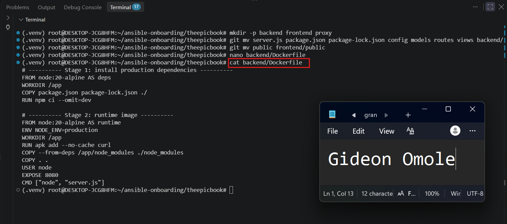

---

#### Screenshot 5 — Frontend Dockerfile

Add a screenshot showing `frontend/Dockerfile`, including:

- Nginx runtime image
- Static frontend files copied to the Nginx web root

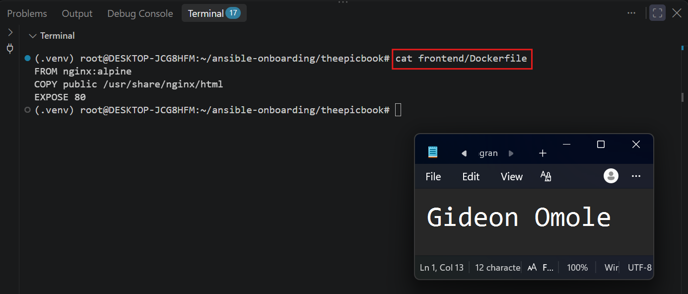

---

#### Screenshot 6 — Docker Ignore Files

Add a screenshot showing both:

```text
backend/.dockerignore
frontend/.dockerignore
```

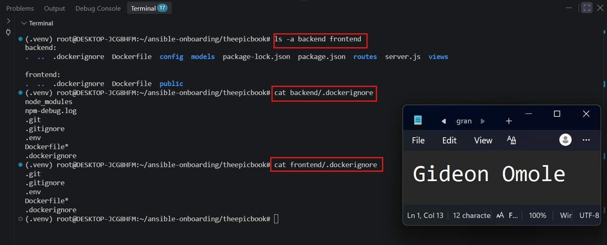

---

#### Screenshot 7 — Docker Image Builds and Size Comparison

Add a terminal screenshot showing successful builds of:

- Baseline backend image
- Optimized backend image
- Frontend image

The screenshot must also show the baseline and optimized backend image-size comparison.

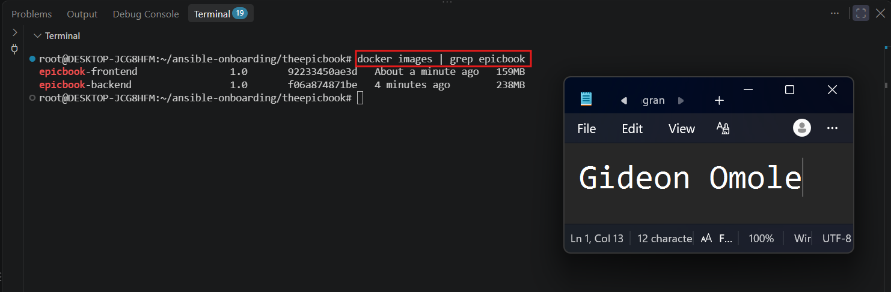

---

#### Screenshot 8 — Backend Running as Non-Root User

Add a terminal screenshot showing the optimized backend container running as a non-root user.

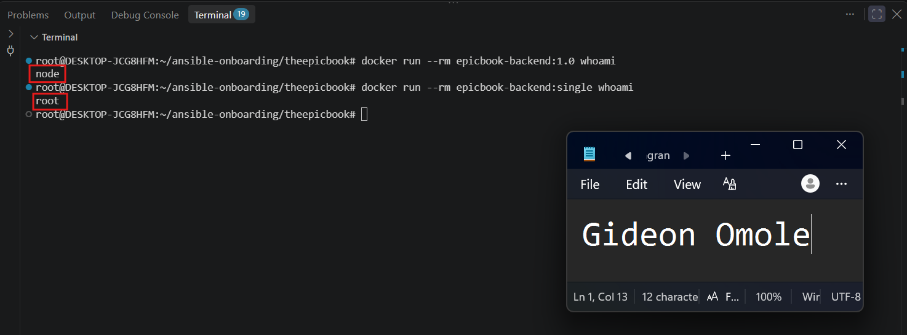
---

### Notes

Write a short note covering:

- Baseline and optimized backend image sizes
- The image-size reduction achieved
- One Docker layer-caching optimization used
- The security benefit of running the backend as a non-root user

**Baseline and optimized backend image sizes:** The baseline single-stage backend image (`epicbook-backend:baseline`, built on the full `node:20` image) is 1.68 GB. The optimized multi-stage backend image (`epicbook-backend:1.0`, built on `node:20-alpine`) is 230 MB.

**Image-size reduction achieved:** The optimized image is about 86% smaller: (1680 - 230) / 1680 x 100 = 86.3%. Most of the saving comes from using the small Alpine-based Node image and installing only production dependencies with `npm ci --omit=dev`.

**Layer-caching optimization:** `package.json` and `package-lock.json` are copied and `npm ci` is run before the rest of the source code is copied. Docker caches each layer, so when only application code changes, the dependency layer is reused and dependencies are not downloaded again. This makes rebuilds much faster.

**Security benefit of running as non-root:** The backend runs as the unprivileged `node` user (`USER node`). If an attacker exploits the application, they only get that user's limited permissions instead of root. They cannot install packages, modify system files or easily escalate privileges, and the risk of a container escape is reduced. I verified this with `docker run --rm epicbook-backend:1.0 whoami`, which prints `node`, while the baseline image prints `root`.

---

# Task 2 — Create the Docker Compose Stack and Networks

## Goal

Create one Docker Compose stack containing the reverse proxy, frontend, backend, and MySQL database.

### Evidence

#### Screenshot 9 — Docker Compose Services

Add a screenshot showing `docker-compose.yml` with all four services:

```text
reverse-proxy
frontend
backend
database
```

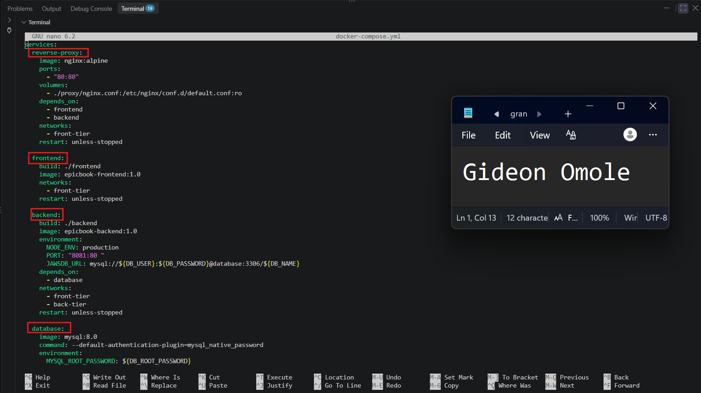

---

#### Screenshot 10 — Networks and Named Volume

Add a screenshot showing:

- `front-tier` network
- `back-tier` network
- `db_data` named volume

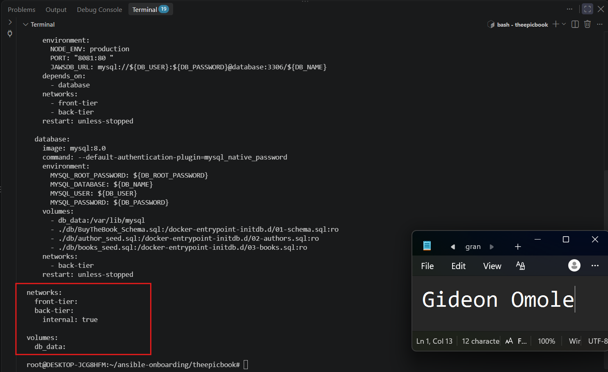

---

#### Screenshot 11 — Docker Compose Validation

Add a terminal screenshot showing successful Docker Compose validation without exposing environment-variable values or secrets.

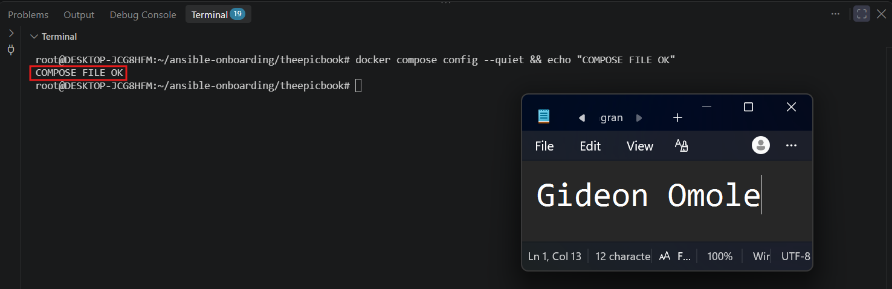

---

# Task 3 — Configure Health Checks and Startup Dependencies

## Goal

Configure health checks and ensure services start only after their dependencies are healthy.

### Evidence

#### Screenshot 12 — Backend Health Endpoint

Add a screenshot showing the backend application configuration for the `/health` endpoint.

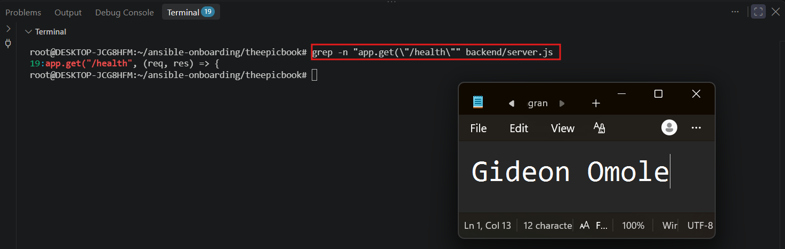

---

#### Screenshot 13 — MySQL and Backend Health Checks

Add a screenshot showing `docker-compose.yml` with health checks for MySQL and the backend.

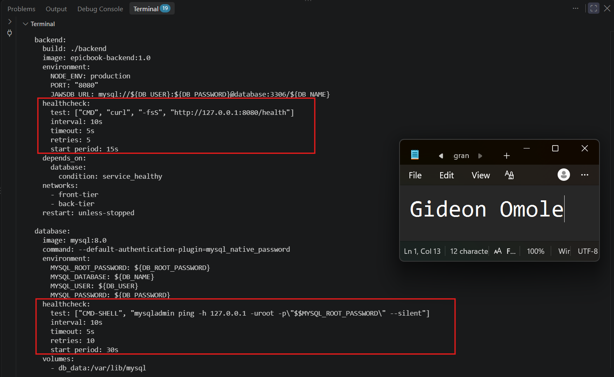

---

#### Screenshot 14 — Frontend and Reverse-Proxy Health Checks

Add a screenshot showing:

- Frontend health check
- Reverse-proxy health check
- `depends_on` conditions using `service_healthy`

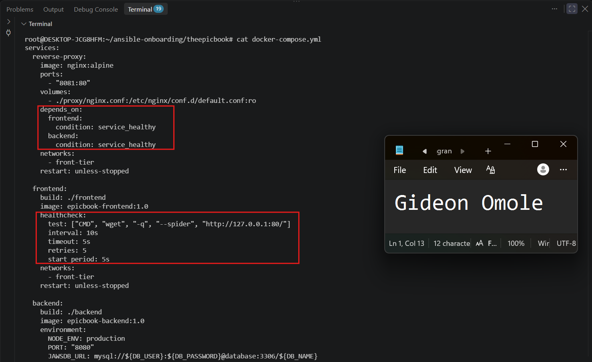

---

#### Screenshot 15 — Running Healthy Services

Add a terminal screenshot showing Docker Compose service status. The database, backend, frontend, and reverse proxy must be running successfully.

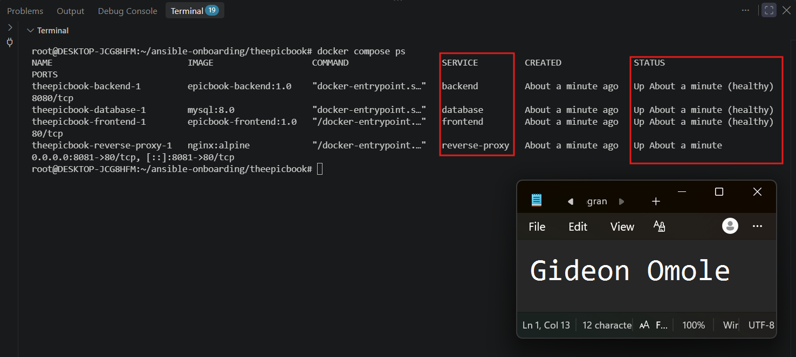

---

#### Screenshot 16 — Public Health Endpoint

Add a terminal screenshot showing a successful response from the public application health endpoint through the reverse proxy.

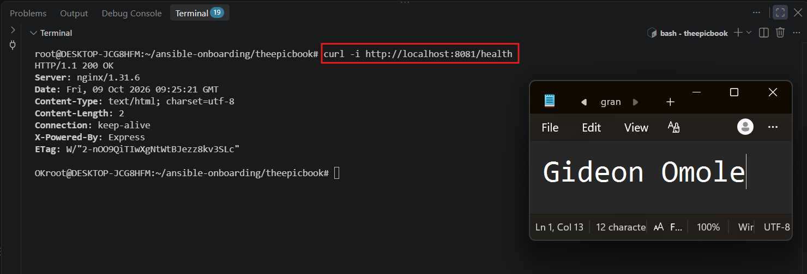

---

#### Screenshot 17 — Health-Check and Startup-Order Document

Add a screenshot showing the contents of:

```text
docs/03-healthchecks-and-depends-on.md
```

Explain the health-check method for each service and the startup dependency order.

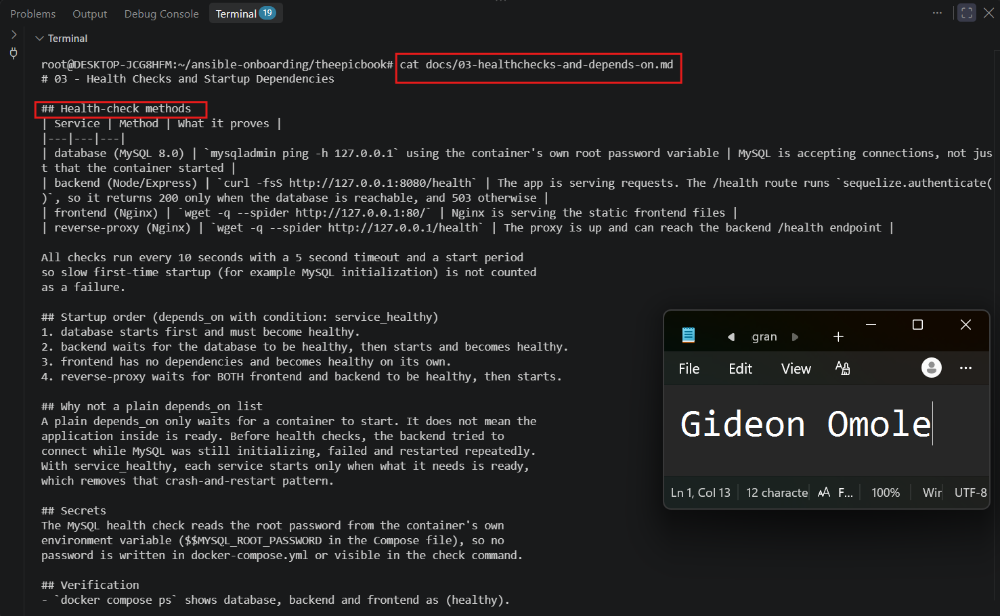

**Health-check method for each service:**

- **database (MySQL 8.0):** `mysqladmin ping -h 127.0.0.1`, using the container's own `MYSQL_ROOT_PASSWORD` variable. It proves MySQL is accepting connections, not just that the container has started. The password is never written in `docker-compose.yml`.
- **backend (Node/Express):** `curl -fsS http://127.0.0.1:8080/health`. The `/health` route runs `sequelize.authenticate()`, so it returns HTTP 200 only when the app can reach the database, and 503 otherwise.
- **frontend (Nginx):** `wget -q --spider http://127.0.0.1:80/`. It proves Nginx is serving the static frontend files.
- **reverse-proxy (Nginx):** `wget -q --spider http://127.0.0.1/health`. It proves the proxy is running and can reach the backend health endpoint.

All checks run every 10 seconds with a 5 second timeout. Each has a start period so slow first-time startup, such as MySQL initialization, is not counted as a failure.

**Startup dependency order (`depends_on` with `condition: service_healthy`):**

1. `database` starts first and must become healthy.
2. `backend` waits for the database to be healthy, then starts and becomes healthy.
3. `frontend` has no dependencies and becomes healthy on its own.
4. `reverse-proxy` waits for both `frontend` and `backend` to be healthy, then starts.

A plain `depends_on` list only waits for a container to start, not for the application inside it to be ready. Before health checks, the backend tried to connect while MySQL was still initializing, failed and restarted repeatedly. With `service_healthy`, each service starts only when what it needs is ready, so that crash-and-restart pattern is gone.

---

# Task 4 — Configure the Reverse Proxy and Same-Origin Routing

## Goal

Use either Nginx or Traefik as the only public entry point for the EpicBook application.

### Evidence

#### Screenshot 18 — Selected Reverse-Proxy Configuration

Add a screenshot showing the configuration for your selected reverse proxy.

It must show routes for:

- Static frontend assets
- Application pages
- API requests
- Health endpoint

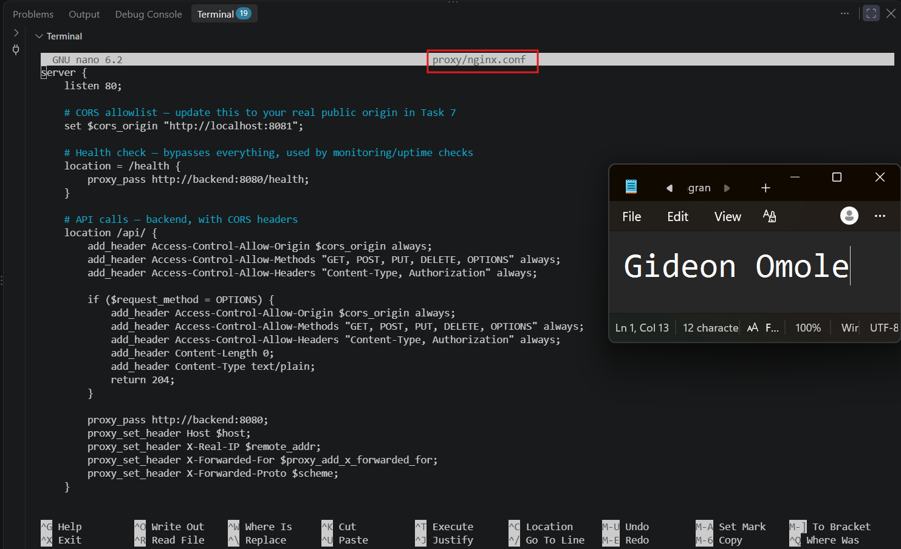

---

#### Screenshot 19 — Only Reverse Proxy Publishes Port 80

Add a screenshot of `docker-compose.yml` showing that only the `reverse-proxy` service publishes port 80.

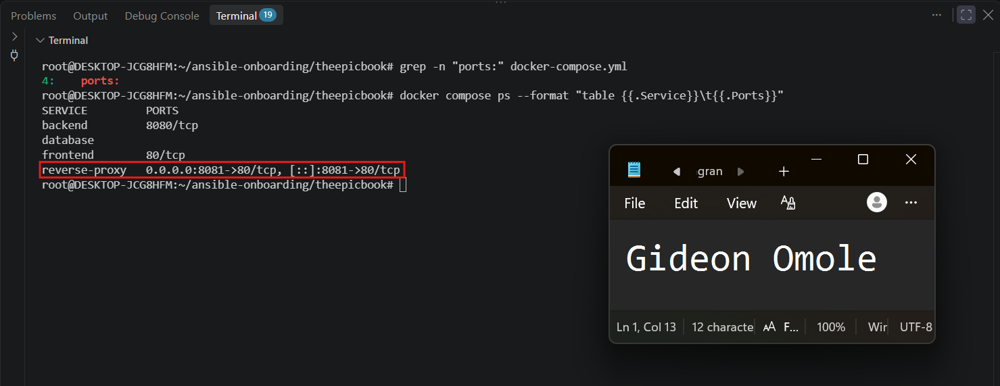

---

#### Screenshot 20 — Reverse-Proxy Route Testing

Add a terminal screenshot showing successful requests through the selected reverse proxy to:

- Application page
- One API endpoint
- One static asset
- Health endpoint

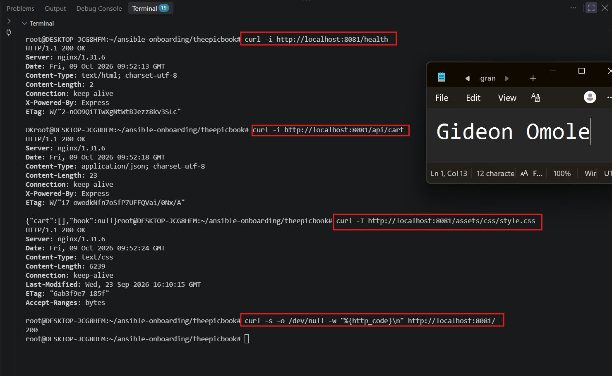

---

#### Screenshot 21 — EpicBook Application Through Public IP

Add a browser screenshot showing the EpicBook application loaded through the VM public IP address.

Add your full name as a clear caption below the screenshot.

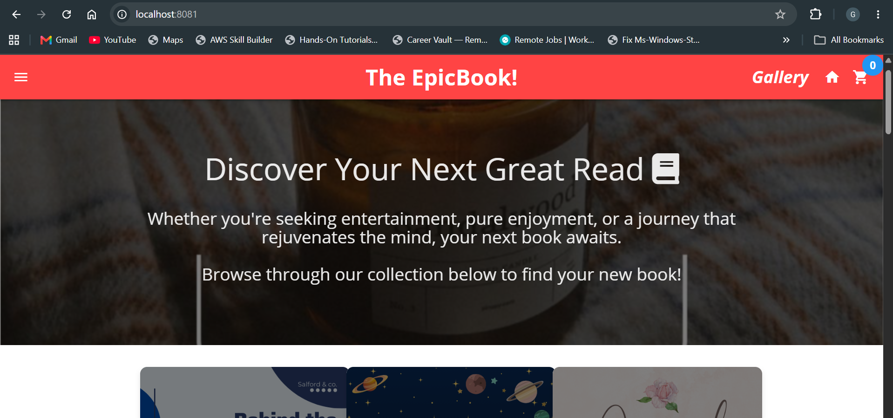

---

#### Screenshot 22 — Proxy Routing and CORS Document

Add a screenshot showing the contents of:

```text
docs/04-proxy-routing-and-cors.md
```

Explain the proxy routes and state whether CORS was required and why.

**Proxy routes (Nginx, the only public entry point):**

- `/assets/` goes to the `frontend` container on port 80. It serves the static CSS, JavaScript and images.
- `/health` goes to the `backend` container on port 8080. It is the health endpoint, and it returns 200 only when the backend can reach the database.
- `/api/` goes to the `backend` container on port 8080. It carries API requests such as `/api/cart`.
- `/` goes to the `backend` container on port 8080. It serves the server-rendered application pages.

The proxy reaches the upstreams by Docker Compose service names (`frontend` and `backend`), resolved by Docker's internal DNS, so no IP addresses are used. Only the reverse proxy publishes a host port. The frontend, backend and database ports stay private inside the Docker networks.

**Was CORS required? No.**

The browser loads the application pages, the static assets and the API calls all from the same origin, because the reverse proxy puts everything behind one address and port (`http://<VM_PUBLIC_IP>` in production). CORS applies only when a browser makes a request to a different origin, meaning a different scheme, host or port. Since every request goes to the same origin, the browser never makes a cross-origin request, so no `Access-Control-*` headers are configured. I confirmed this with `curl -i http://localhost:8081/api/cart`, which returns no `Access-Control-*` headers.

A wildcard origin (`Access-Control-Allow-Origin: *`) is never used. If the frontend and API were ever served from different origins, CORS would be configured with the exact allowed origin only.

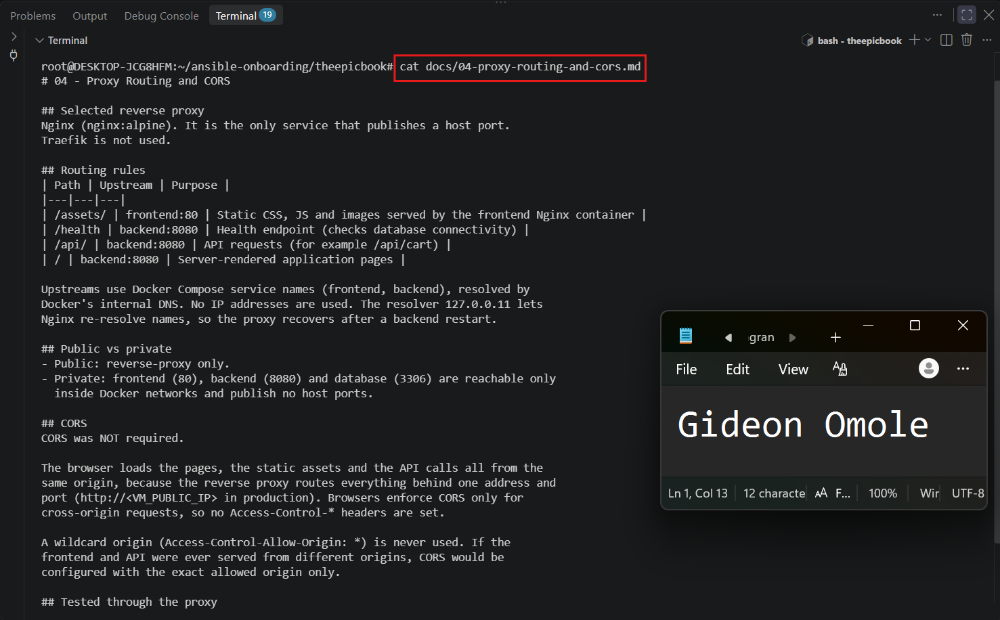

---

# Task 5 — Prove Data Persistence, Backup, and Restore

## Goal

Verify MySQL persistence and perform a controlled backup and restore drill.

### Evidence

#### Screenshot 23 — MySQL Volume Configuration

Add a terminal screenshot showing the `db_data` named volume and its MySQL mount configuration.

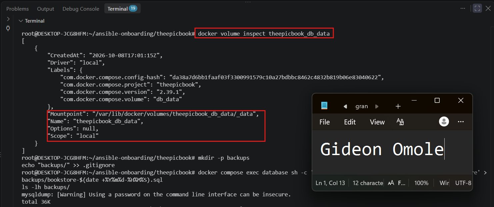

---

#### Screenshot 24 — Test Data Before Backup

Add a terminal screenshot showing the selected test data before the backup and restore drill.

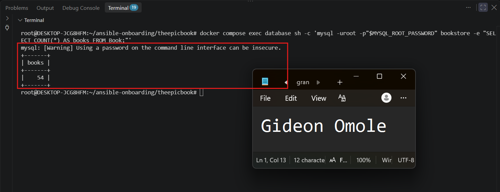

---

#### Screenshot 25 — Successful Backup Creation

Add a terminal screenshot showing successful backup creation and the backup file stored in the host backup directory.

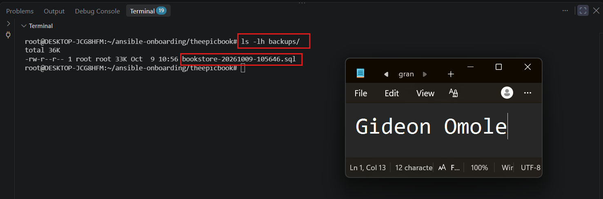

---

#### Screenshot 26 — Controlled Data-Loss Test

Add a terminal screenshot showing that the selected test record was removed during the controlled data-loss test.

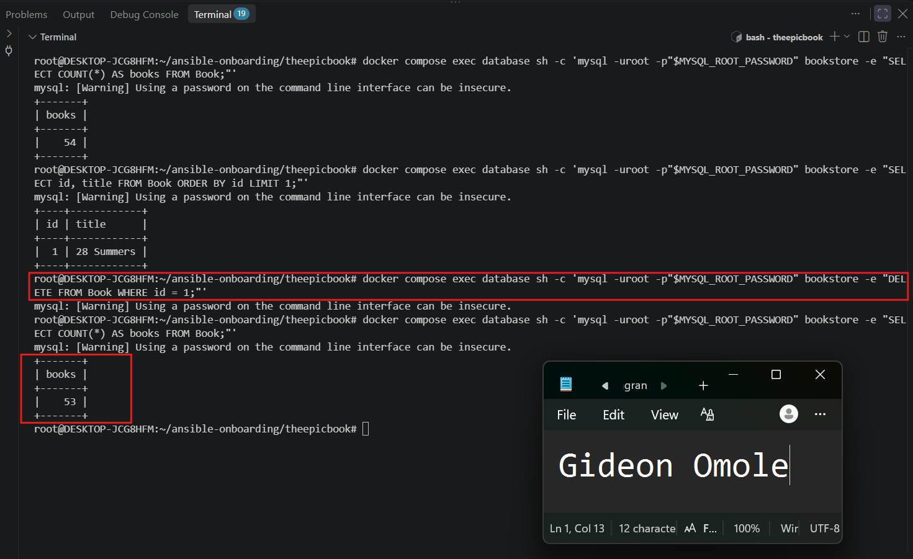

---

#### Screenshot 27 — Restore Verification

Add a terminal screenshot showing successful restore and verification that the deleted test record is available again.

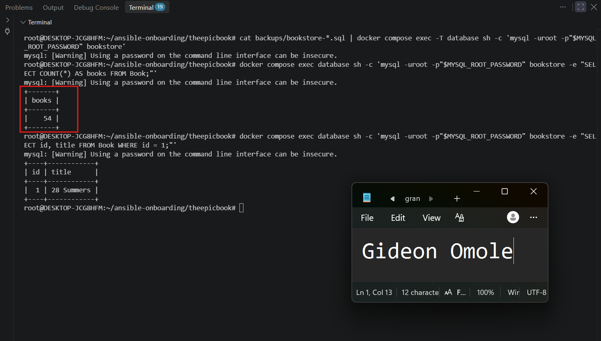

---

#### Screenshot 28 — Persistence After Down/Up Cycle

Add a terminal screenshot showing that database data remains available after a non-destructive Docker Compose down/up cycle.

Do not use `docker compose down -v`.

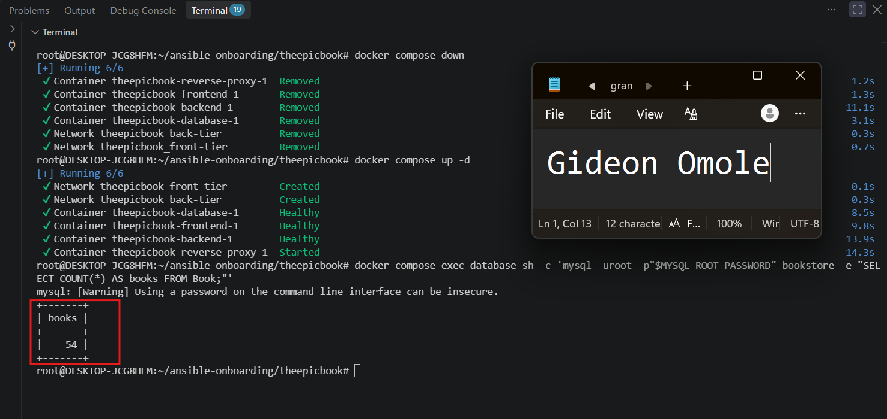

---

#### Screenshot 29 — Persistence and Backup Document

Add a screenshot showing the contents of:

```text
docs/05-persistence-and-backup.md
```

Include the backup plan and restore procedure.

# Task 5 — Persistence & Backup Plan

## What we back up
A `mysqldump` of the `bookstore` database (full schema + data, as portable SQL).
We do not back up raw volume files directly — a SQL dump is portable across
MySQL versions and easy to inspect or move.

## When
Daily, at a low-traffic hour (example: 2 AM server time).

## Where
Initially on the same VM's disk, in a `backups/` folder outside the Docker
volume. For a production setup we would add a step to upload each dump to
object storage (AWS S3), so a full VM loss doesn't also destroy the backups.
This is a stretch goal for this capstone.

## Retention
Keep the last 7 daily dumps, delete anything older, to avoid unbounded disk growth.

## Automation (for the cloud VM, Task 7)
A cron job running this one-line script:

    docker compose exec -T database sh -c 'mysqldump -uroot -p"$MYSQL_ROOT_PASSWORD" bookstore' > /home/<user>/backups/bookstore-$(date +\%Y\%m\%d).sql
    find /home/<user>/backups -name "*.sql" -mtime +7 -delete

## Restore procedure
    cat backups/<chosen-file>.sql | docker compose exec -T database sh -c 'mysql -uroot -p"$MYSQL_ROOT_PASSWORD" bookstore'

## Manual test performed
1. Confirmed baseline count: 54 books.
2. Deleted book id 1 ("28 Summers").
3. Confirmed count dropped to 53, proving real data loss.
4. Restored from a `mysqldump` backup taken beforehand.
5. Confirmed count returned to 54, and book id 1 ("28 Summers") was present again.

## Tested
Yes, manually, on [9/10/2027]. See screenshots (volume inspect,
before/delete/restore counts, container-restart persistence check).


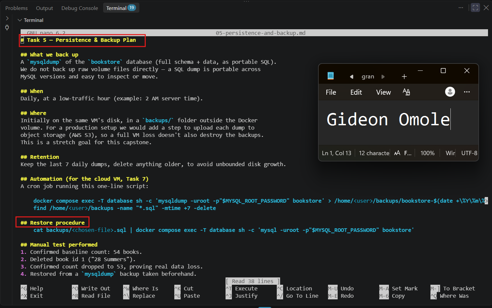

---

# Task 6 — Configure Logging and Observability

## Goal

Configure useful reverse-proxy and backend logs without exposing sensitive information.

### Evidence

#### Screenshot 30 — Logging Configuration

Add a screenshot showing:

- Configuration for the selected reverse proxy
- Proxy log format
- Docker Compose host log-directory bind mount

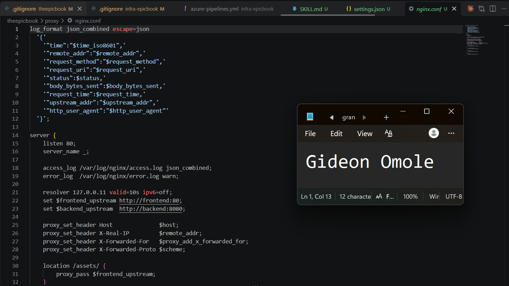
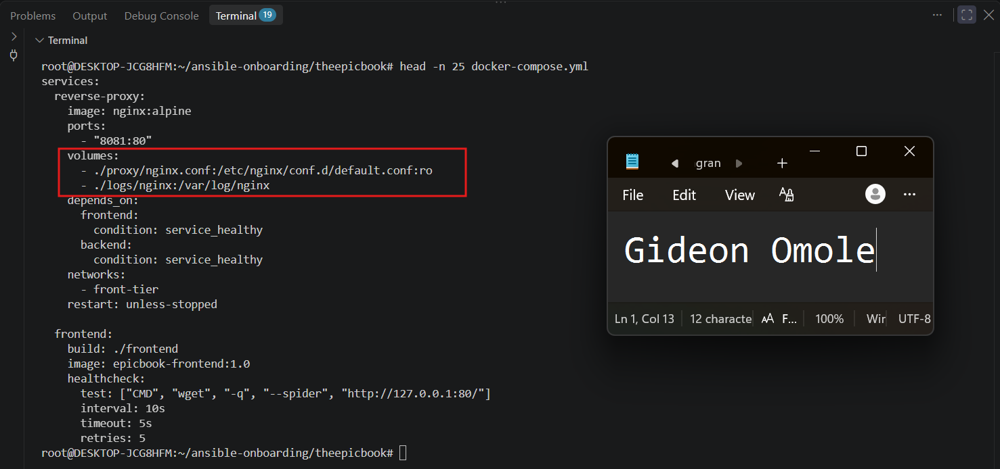

---

#### Screenshot 31 — Persistent Proxy Logs and Backend Logs

Add a terminal screenshot showing:

- Selected reverse-proxy logs available from the host directory after a proxy restart
- Backend logs displayed through Docker Compose

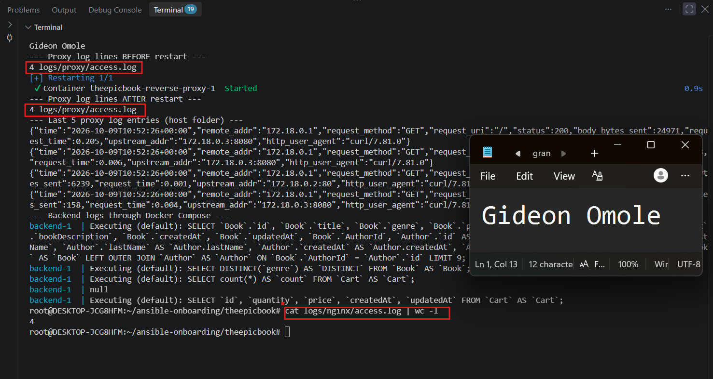

---

### Notes

Write a short note covering:

- The selected reverse proxy
- Host path used for reverse-proxy logs
- How backend logs are viewed
- Whether JSON or standard text logs were used
- Why passwords, tokens, headers, and database connection strings must not appear in logs

**Selected reverse proxy:** Nginx (`nginx:alpine`). It is the only public entry point of the stack.

**Host path used for reverse-proxy logs:** `./logs/proxy/` on the host, which holds `access.log` and `error.log`. The folder is bind-mounted to `/var/log/nginx` in the reverse-proxy container, so the logs can be read directly from the host and they survive proxy restarts. I confirmed this by restarting the proxy: the access log had the same 4 lines before and after.

**How backend logs are viewed:** The backend writes its logs to stdout and stderr, and Docker captures them. They are viewed with `docker compose logs backend`, and `--tail <number>` limits the output to the most recent lines.

**JSON or standard text logs:** The Nginx access log uses structured JSON (the `json_combined` format), with one JSON object per request. Each line records the time, client address, method, URI, status, bytes sent, request time, upstream address and user agent. The Nginx error log uses Nginx's standard timestamped text format.

**Why passwords, tokens, headers and database connection strings must not appear in logs:** Logs are read by many people and tools, kept for a long time, and often copied to log shippers, support tickets and third-party systems. A secret written to a log therefore spreads far beyond the systems meant to protect it, and anyone who can read the log can reuse the credential to access the database or the application. The access log here deliberately records no request headers, cookies or Referer, and the backend does not print its `JAWSDB_URL` connection string.

---

# Task 7 — Deploy and Verify the Stack on a Cloud VM

## Goal

Deploy the completed Docker Compose stack on an AWS or Azure VM and verify public access.

### Evidence

#### Screenshot 32 — VM Public IP and Inbound Rules

Add a cloud-console screenshot showing:

- VM public IP address
- SSH port 22 restricted to your IP address
- HTTP port 80 allowed from Anywhere

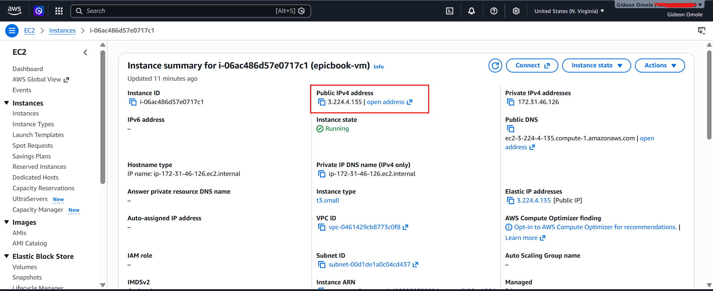

---

#### Screenshot 33 — Cloud VM Stack Verification

Add a VM terminal screenshot showing:

- Docker Compose service status
- Successful public health or API response
- No published database, frontend, or backend ports

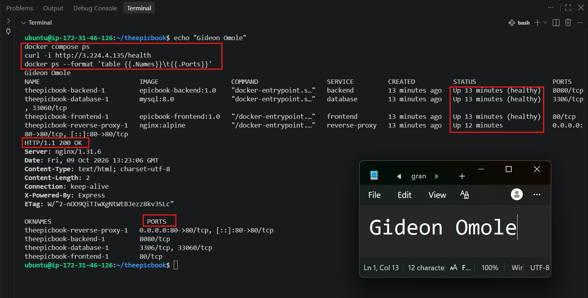

---

#### Screenshot 34 — EpicBook Application on Cloud VM

Add a browser screenshot showing the EpicBook application loaded through the VM public IP address.

Add your full name as a clear caption below the screenshot.

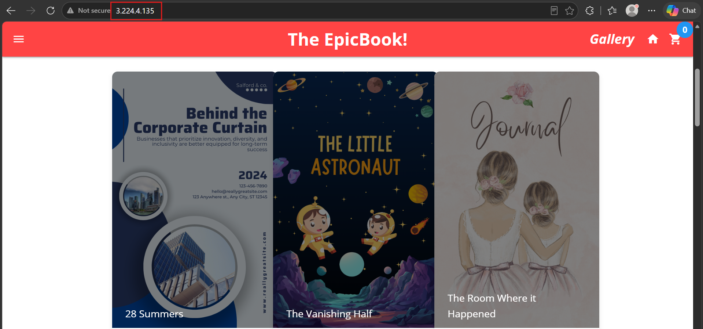

---

### Notes

**Cloud provider:** AWS (EC2, region eu-north-1), provisioned with Terraform.

**VM operating system:** Ubuntu 22.04 LTS (t3.micro), with Docker Engine, Docker Compose v2 and Git installed via cloud-init.

**Public IP / URL:** http://3.224.4.135/

**Public port exposed:** Port 80 (HTTP) only, published by the reverse-proxy (Nginx) container.

**Security rules configured:**
- SSH (22): restricted to my IP address only
- HTTP (80): open to Anywhere (0.0.0.0/0)
- No inbound rules for the database (3306), backend (8080) or frontend (80 inside Docker). These ports are not published to the host and are reachable only on the internal Docker networks (front-tier and back-tier). The back-tier network is internal.

**Confirmation:** The EpicBook application loaded in the browser through http://3.224.4.135/, with the book list and cover images displayed. Through the reverse proxy, the application page (/), the API endpoint (/api/cart), the static asset (/assets/css/style.css) and the health endpoint (/health) all returned HTTP 200 OK. The books are retrieved from the MySQL database through the backend API, which confirms that Nginx → backend → database works end to end.

---

# Task 8 — Automate Deployment with CI/CD (Optional)

## Goal

Optionally automate image build, image push, and deployment through GitHub Actions or Azure Pipelines.

### Optional Evidence

#### Optional Screenshot — Successful CI/CD Pipeline Run

Add a screenshot showing a successful pipeline run with build, image push, deployment, and verification stages.

Add your screenshot here.

---

### Optional Notes

Write a short note covering:

- CI/CD platform used
- Image-tagging method
- Registry used
- Deployment trigger
- Manual approval or secret-handling approach

Write your note here.

---

# Task 9 — Perform Reliability Tests and Create an Operations Runbook

## Goal

Test controlled service failures and document safe operating procedures.

### Evidence

#### Screenshot 35 — Backend Failure and Recovery

Add a terminal screenshot showing:

- Backend failure test
- Expected unavailable response through the reverse proxy
- Backend restart
- Successful health-check recovery

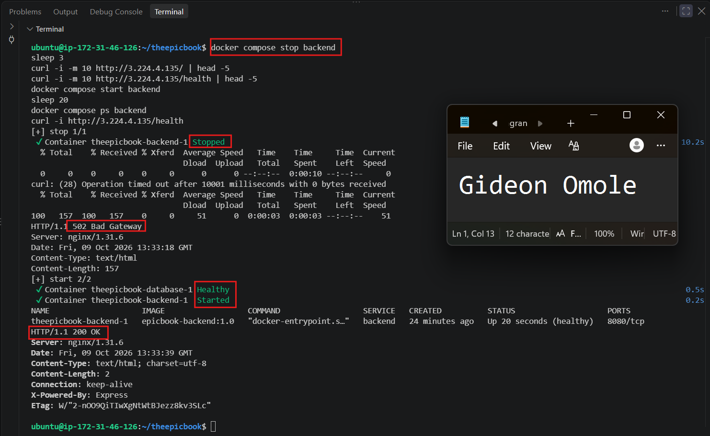

---

#### Screenshot 36 — Database Failure and Recovery

Add a terminal screenshot showing:

- Database outage test
- Failed database-dependent request
- Database restart
- Successful application recovery

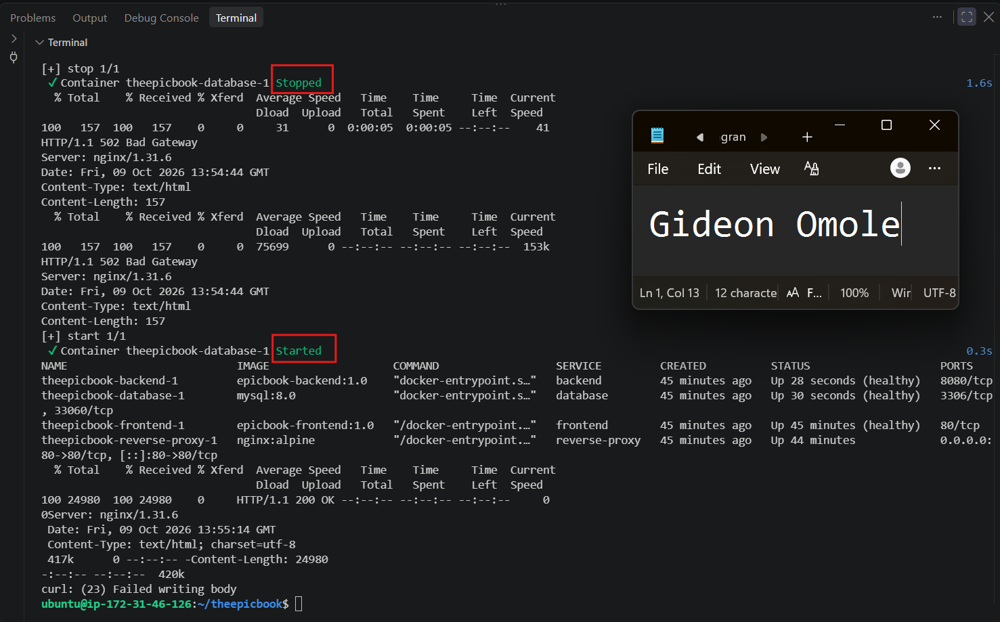

---

### Notes

Write a short operations runbook covering:

- Safe restart procedure for reverse proxy, frontend, backend, and database
- Backup and restore procedure
- Secret-rotation approach
- Database recovery procedure
- What to check when the application returns an error
- Results of backend and database reliability tests

**Environment:** AWS EC2 (Ubuntu), Docker Compose stack at `~/theepicbook`, public URL http://3.224.4.135/

## 1. Safe Restart Procedure

Always run from `~/theepicbook`. Check state first with `docker compose ps`, and restart one service at a time, confirming it is healthy before moving on.

| Service | Command | Notes |
|---|---|---|
| Database | `docker compose restart database` | Restart last. The backend may restart itself while MySQL is down. Wait for `(healthy)`. |
| Backend | `docker compose restart backend` | Wait about 20 seconds for `(healthy)`. Nginx returns 502 in the meantime. |
| Frontend | `docker compose restart frontend` | Only static assets are affected. |
| Reverse proxy | `docker compose restart reverse-proxy` | Brief public outage. Host logs in `logs/proxy/` persist. |

Full stack, keeping data: `docker compose down && docker compose up -d`.
**Never use `docker compose down -v`.** It deletes the `db_data` volume and all data.

If a service is stuck in `Created`, run `docker compose up -d`. Note that a manually stopped container is not restarted by `restart: unless-stopped`, so start it with `docker compose up -d <service>`.

## 2. Backup and Restore

**Backup** (logical dump, stored on the host in `backups/`, outside the container):

    docker compose exec -T database sh -c 'mysqldump -uroot -p"$MYSQL_ROOT_PASSWORD" bookstore' > backups/bookstore-$(date +%Y%m%d-%H%M%S).sql

**Restore:**

    cat backups/<file>.sql | docker compose exec -T database sh -c 'mysql -uroot -p"$MYSQL_ROOT_PASSWORD" bookstore'

Verify with `SELECT COUNT(*) FROM Book;` (expected: 54).
**Schedule:** daily at 02:00 via cron. **Retention:** the last 7 dumps (`find backups -name "*.sql" -mtime +7 -delete`). **Improvement:** copy dumps to S3 so a VM loss does not also destroy the backups.

## 3. Secret Rotation

1. Generate new values: `openssl rand -hex 16`.
2. Change the MySQL user password in the running database:
   `ALTER USER 'epicbook'@'%' IDENTIFIED BY '<new>';`
   (`.env` values only apply on the first boot of an empty volume.)
3. Update `.env` on the VM with the same value.
4. Recreate the backend: `docker compose up -d backend`.
5. Verify `/health` and the home page. Rotate Docker Hub tokens and the SSH key in the CI/CD secret store, and never commit `.env`.

## 4. Database Recovery Procedure

1. **Database container down:** `docker compose up -d database`, wait for `(healthy)`, then check the backend recovered.
2. **Data deleted or corrupted:** restore the most recent file in `backups/` (section 2) and verify the row counts.
3. **Container lost or recreated:** the data persists in the `db_data` volume, so `docker compose up -d` is enough.
4. **Volume lost:** start a fresh stack (schema and seed files load automatically on an empty volume), then restore the latest backup.

## 5. What to Check When the Application Returns an Error

1. `docker compose ps`: are all four services up and healthy?
2. `curl -i http://3.224.4.135/health`: 200 means the proxy and backend are reachable.
3. **502 Bad Gateway:** backend down or restarting. Check `docker compose logs backend --tail 50`.
4. **Pages fail but /health is OK:** suspect the database. Check `docker compose ps database` and the backend logs for `ECONNREFUSED` or `Access denied`.
5. **Proxy logs:** `tail -n 20 logs/proxy/access.log` and `error.log`.
6. **Resources:** `free -h` and `df -h`. A t3.micro has little memory.
7. **Network and firewall:** confirm the security group allows port 80, and check that the port mapping is `80:80`.
8. **Recent change:** check the last pipeline run or commit and roll back if needed.

## 6. Reliability Test Results

**Backend failure:** the backend was stopped and nginx returned **502 Bad Gateway**. After `docker compose start backend`, the backend became `Up (healthy)` and `/health` returned **200 OK**.

**Database outage:** the database was stopped, and both `/` and `/api/cart` returned **502 Bad Gateway**. After `docker compose start database`, the database became healthy, the backend restarted itself through `restart: unless-stopped`, and `/` returned **200 OK** with the full page.

**Findings:** healthchecks and restart policies recover the stack without manual repair. Stopping a container manually is not undone by the restart policy, so it has to be started explicitly.

---

# Final Public Application URL

**EpicBook URL:** `http://3.224.4.135/`

Replace the placeholder with your working public URL.

---

# GitHub Repository URL

**Your Fork or Repository URL:** `https://github.com/Gideon-Omole/theepicbook/tree/capstone/theepicbook-docker`

---

# LinkedIn Requirement

## Goal

Create a professional LinkedIn post of 6–10 lines about your EpicBook capstone deployment.

Your post must include:

- The architectural decision that most improved reliability
- Your biggest image-size reduction, with numbers
- Key production-hardening lessons
- A deployment verification image

### Evidence

**LinkedIn Post URL:** `https://www.linkedin.com/posts/gideon-omole-5ba318180_docker-devops-aws-ugcPost-7514328082795790336-hBf9/?utm_source=share&utm_medium=member_desktop&rcm=ACoAACrC7l4BK-z0pGwSRQMO8ZJ5pFZyqybbIk4`

#### LinkedIn Post Screenshot

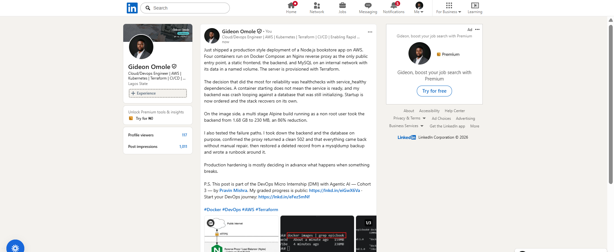

---

# Submission Checklist

- [ ] EpicBook repository reviewed and architecture diagram created
- [ ] Environment variables, ports, persistence, and health-check details documented
- [ ] Backend and frontend production Dockerfiles created
- [ ] Backend runs as a non-root user
- [ ] Docker image-size comparison completed
- [ ] Docker Compose stack includes reverse proxy, frontend, backend, and database
- [ ] `front-tier` and `back-tier` networks configured
- [ ] `db_data` named volume configured
- [ ] MySQL, backend, frontend, and reverse-proxy health checks configured
- [ ] Startup dependencies use `service_healthy`
- [ ] Nginx or Traefik selected as the only public reverse proxy
- [ ] Only reverse-proxy port 80 is publicly published
- [ ] Same-origin routing configured and CORS used only when required
- [ ] Backup, restore, and persistence testing completed
- [ ] Reverse-proxy and backend logs verified
- [ ] Cloud VM deployment verified through the public IP
- [ ] Backend and database reliability tests completed
- [ ] Screenshots 1–36 included
- [ ] Required notes completed
- [ ] LinkedIn post URL and screenshot included
- [ ] Full name visible in required screenshots or captions
- [ ] No passwords, tokens, private keys, account IDs, or other sensitive information exposed

---

## 📌 About DMI & CloudAdvisory

DevOps Micro Internship (DMI) is a project-based DevOps program run by Pravin Mishra (The CloudAdvisory) focused on real-world execution, systems thinking, and career readiness.

It helps learners build strong DevOps foundations with hands-on experience.

---

## 📌 Resources

- 🌐 DMI Official Website: https://dmi.pravinmishra.com?utm_source=github&utm_medium=readme  
- 🎓 University: https://university.pravinmishra.com?utm_source=github&utm_medium=readme  
- 💬 Discord Community: https://discord.pravinmishra.com?utm_source=github&utm_medium=readme  
- 📝 Blog: https://dmi.pravinmishra.com/blog?utm_source=github&utm_medium=readme  
- ▶️ YouTube Playlist: https://www.youtube.com/playlist?list=PLFeSNDtI4Cho  
- 🔗 Pravin Mishra (LinkedIn): https://www.linkedin.com/in/pravin-mishra-aws-trainer/  
- 🏢 CloudAdvisory (LinkedIn): https://www.linkedin.com/company/thecloudadvisory/

---

*This submission is part of DevOps Micro Internship (DMI) — Agentic AI Track.*
