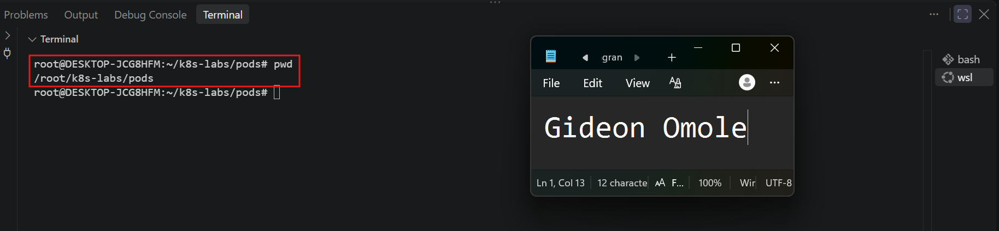
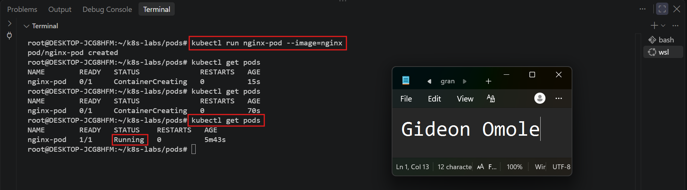
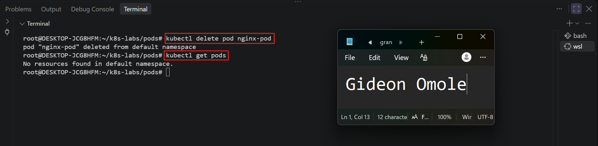
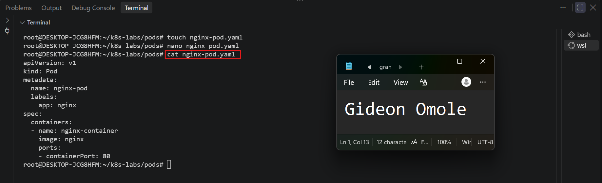
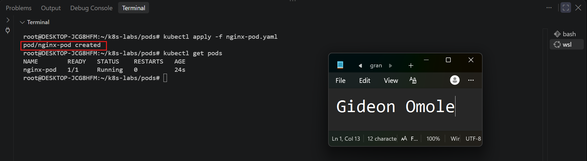
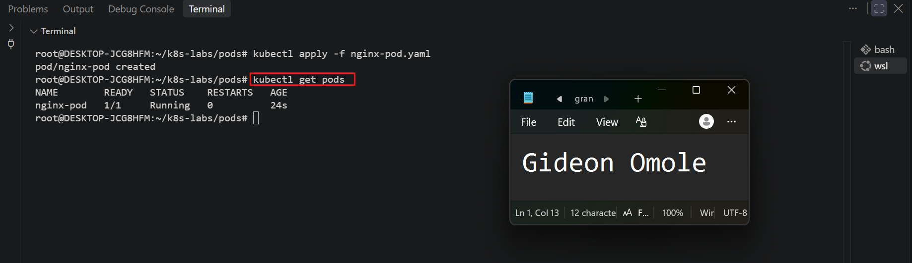
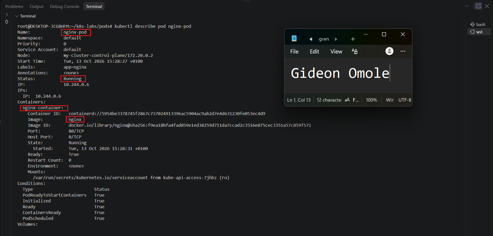
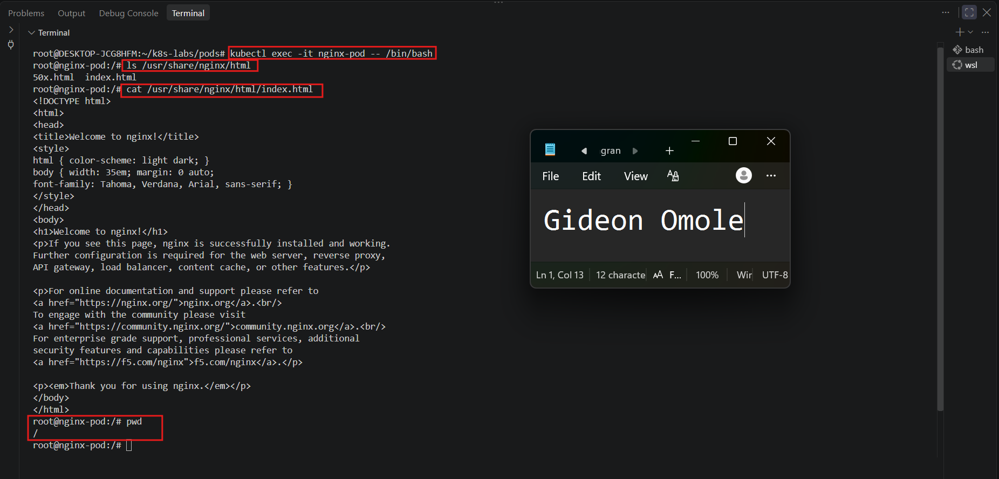

# Assignment 1 — Creating Your First Pod in Kubernetes

Part of the DevOps Micro Internship (DMI) with Agentic AI

---

## Purpose

In this assignment, you will create an NGINX Pod using both imperative and declarative methods. You will practice creating, checking, deleting, describing, viewing logs from, and opening a shell inside a Pod.

---

# Task 1 — Set Up Your Lab Folder

## Goal

Create a clean working directory for all Pod-related files used in this lab.

### Evidence

#### Screenshot 01 — Output of `pwd` showing the current directory ending in `/k8s-labs/pods`

---

# Task 2 — Create a Pod Imperatively

## Goal

Create an NGINX Pod directly from the command line, verify that it is running, and delete it before continuing to the declarative method.

### Evidence

#### Screenshot 02 — Output of `kubectl run nginx-pod --image=nginx` showing the creation message, and `kubectl get pods` showing `nginx-pod` with `1/1` under `READY` and `Running` under `STATUS`, before deletion

---

#### Screenshot 03 — Output of `kubectl delete pod nginx-pod` showing the successful deletion message

---

# Task 3 — Create a Pod Declaratively Using YAML

## Goal

Define the NGINX Pod in a YAML file, apply the manifest, and verify the resulting Pod.

### Evidence

#### Screenshot 04 — The filename `nginx-pod.yaml` and the complete YAML manifest with clear, readable indentation

---

#### Screenshot 05 — Output of `kubectl apply -f nginx-pod.yaml` showing the successful creation message

---

#### Screenshot 06 — Output of `kubectl get pods` showing the declarative `nginx-pod` with `1/1` under `READY` and `Running` under `STATUS`

---

### Notes

**1. What is the difference between imperative and declarative Pod creation?**

Imperative creation means giving Kubernetes direct commands from the terminal, telling it exactly what to do right now. In this lab, `kubectl run nginx-pod --image=nginx` created the Pod in a single command. It is fast and useful for learning and quick tests, but it leaves no written record of what was requested, so it is harder to repeat, review or track in a real project.

Declarative creation means writing the desired state in a YAML file (here, `nginx-pod.yaml`) and applying it with `kubectl apply -f nginx-pod.yaml`. Instead of telling Kubernetes what steps to take, you describe what you want ("a Pod named nginx-pod running the NGINX image") and Kubernetes works to make it true. Because the definition lives in a file, it can be version controlled, reused, shared and edited later, which is why this is the preferred method in production.

| | Imperative | Declarative |
|---|---|---|
| Command | `kubectl run nginx-pod --image=nginx` | `kubectl apply -f nginx-pod.yaml` |
| Approach | Tell Kubernetes what to do | Describe the desired end state |
| Written record | None | YAML file |
| Repeatable | Harder | Easy, re-apply the same file |
| Best for | Learning, quick tests | Real projects and production |

An important point about both methods is that a standalone Pod is not managed by anything. If it is deleted or crashes badly, nothing recreates it. Later labs introduce ReplicaSets and Deployments, which solve this.

---

# Task 4 — Inspect and Access the Pod

## Goal

Inspect the running Pod, view its logs, and open a shell inside the NGINX container.

### Evidence

#### Screenshot 07 — Output of `kubectl describe pod nginx-pod` showing the Pod name, `app=nginx` label, `Running` status, container name, and NGINX image

---

#### Screenshot 08 — Output of `kFilename: `08-pod-logs.png`

If no logs appear, add a caption stating that the command completed without output.

---

#### Screenshot 09 — Container shell opened using `kubectl exec -it nginx-pod -- /bin/bash`, showing `cd /usr/share/nginx/html`, `pwd`, and `ls -la`, with the directory path and default NGINX files visible before exiting

---

### Task 5 — Share Your First Kubernetes Pod on WhatsApp Status

**Goal**

Share your Kubernetes learning progress on WhatsApp Status, including your generated DMI leaderboard progress link.

**Steps**

1. Go to the DMI Leaderboard.
2. Find your name and select **Share your progress**.
3. Click the **WhatsApp icon**.
4. Copy the automatically generated leaderboard message containing your rank and progress link.
5. Open WhatsApp and go to **Updates**.
6. Create a new text Status.
7. Copy and paste the message below.
8. Add the generated leaderboard message in the indicated place.
9. Review and publish your Status.

**WhatsApp Status Message**

I created my first Kubernetes Pod as part of my DevOps learning journey! 🚀

Today, I deployed an NGINX Pod using both imperative kubectl commands and a declarative YAML manifest.

I also checked its status, inspected its details, viewed its logs, and accessed the container shell.

[PASTE YOUR GENERATED LEADERBOARD MESSAGE AND LINK HERE]

#DMIByPravinMishra #DevOps #Kubernetes

**Screenshots Required**

- **Screenshot 10 — `10-whatsapp-status.png`:** Published WhatsApp Status showing your Kubernetes Pod message and generated DMI leaderboard progress link.

---

# Submission Instructions

- Add all required screenshots to this submission template.
- Use the specified screenshot numbers and filenames.
- Ensure all screenshots are clear and readable.
- Submit the completed `nginx-pod.yaml` manifest as a separate file.
- Explain the difference between imperative and declarative Pod creation in your own words.
- Do not expose passwords, access tokens, or private keys.

---

# Completion Checklist

- [ ] Created `~/k8s-labs/pods` (Screenshot 01)
- [ ] Created `nginx-pod` imperatively and confirmed it reached the `Running` state (Screenshot 02)
- [ ] Deleted the imperative Pod (Screenshot 03)
- [ ] Created `nginx-pod.yaml` with the required manifest (Screenshot 04)
- [ ] Applied the YAML manifest (Screenshot 05)
- [ ] Confirmed the declarative Pod reached the `Running` state (Screenshot 06)
- [ ] Inspected the Pod using `kubectl describe` (Screenshot 07)
- [ ] Viewed container logs using `kubectl logs` (Screenshot 08)
- [ ] Accessed the container shell and inspected the NGINX files (Screenshot 09)
- [ ] Exited the container shell
- [ ] Published the WhatsApp status (Screenshot 10)
- [ ] Added Screenshot 10b if the caption was published separately
- [ ] Submitted all required screenshots with the correct filenames
- [ ] Submitted the `nginx-pod.yaml` file
- [ ] Explained the difference between imperative and declarative methods
- [ ] No sensitive data exposed

---

## 📌 About DMI & CloudAdvisory

DevOps Micro Internship (DMI) is a project-based DevOps program run by Pravin Mishra (The CloudAdvisory) focused on real-world execution, systems thinking, and career readiness.

It helps learners build strong DevOps foundations with hands-on experience.

---

## 📌 Resources

- 🌐 DMI Official Website: https://dmi.pravinmishra.com?utm_source=github&utm_medium=readme  
- 🎓 University: https://university.pravinmishra.com?utm_source=github&utm_medium=readme  
- 💬 Discord Community: https://discord.pravinmishra.com?utm_source=github&utm_medium=readme  
- 📝 Blog: https://dmi.pravinmishra.com/blog?utm_source=github&utm_medium=readme  
- ▶️ YouTube Playlist: https://www.youtube.com/playlist?list=PLFeSNDtI4Cho  
- 🔗 Pravin Mishra (LinkedIn): https://www.linkedin.com/in/pravin-mishra-aws-trainer/  
- 🏢 CloudAdvisory (LinkedIn): https://www.linkedin.com/company/thecloudadvisory/

---

*This submission is part of DevOps Micro Internship (DMI) — Agentic AI Track.*
