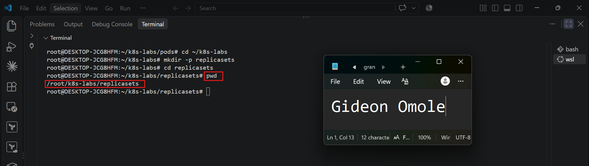
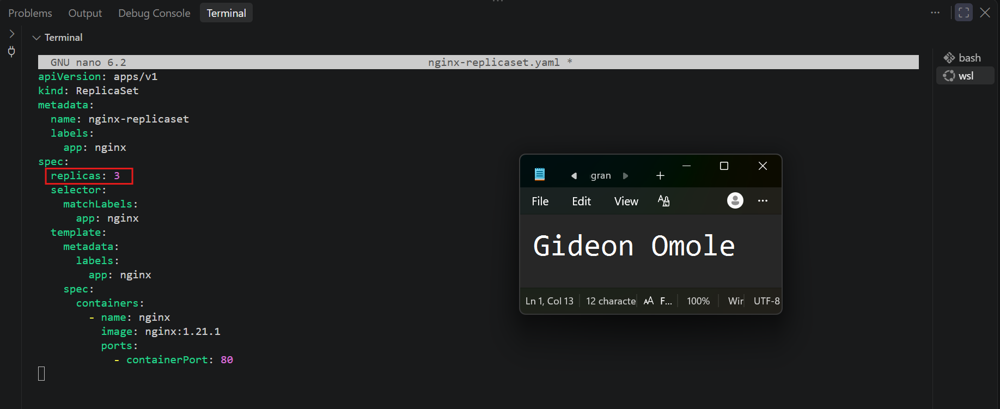
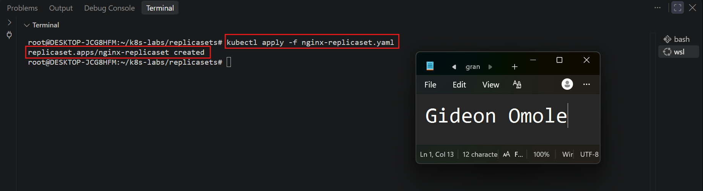
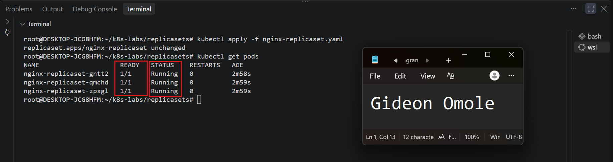
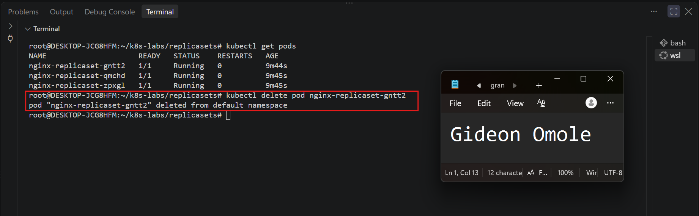
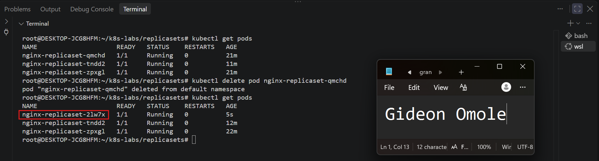
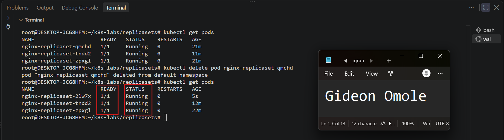
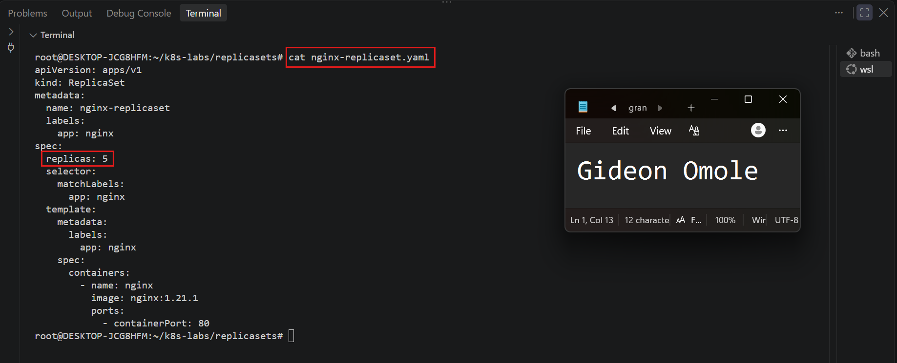
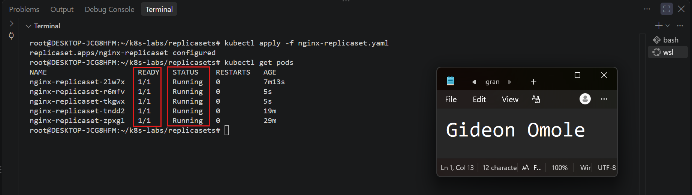
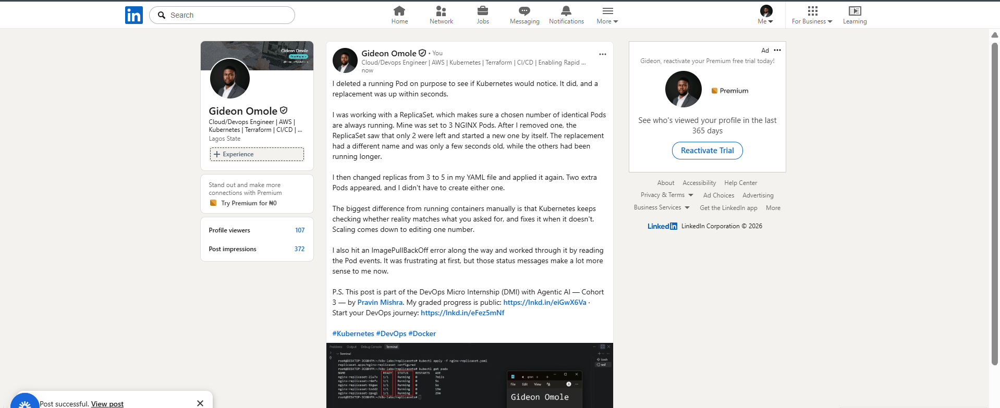

# Assignment 02 — ReplicaSets: Keeping Your Pods Alive

Part of the DevOps Micro Internship (DMI) with Agentic AI

---

## Purpose

In this assignment, you will create three NGINX Pods using a ReplicaSet, test auto-healing by deleting one Pod, and scale the ReplicaSet from three to five Pods.

---

# Task 0 — Pre-check: Remove the Pod from Assignment 01

## Goal

Confirm that you are connected to your learning cluster and remove the previous standalone Pod to prevent the ReplicaSet from adopting it.

### Evidence

No screenshots required.

---

# Task 1 — Set Up Your Working Directory

## Goal

Create and enter a dedicated directory for this ReplicaSet lab.

### Evidence

#### Screenshot 01 — Output of `pwd` showing the working directory ending in `/k8s-labs/replicasets`

---

### Notes

**1. Why is it useful to keep Kubernetes manifests in organized directories?**

Manifests are the written record of what you want Kubernetes to run, so keeping them in organized directories makes that record easy to find and manage. In this course, each lab has its own folder (`~/k8s-labs/pods`, `~/k8s-labs/replicasets`), which keeps the files for one topic together and separate from the others. This helps in several ways:

- **Easier to find and reuse:** you know exactly where `nginx-replicaset.yaml` lives instead of searching through one crowded folder.
- **Fewer mistakes:** commands like `kubectl apply -f nginx-replicaset.yaml` run from the right directory, and similarly named files for different resources do not get mixed up.
- **Better version control:** a clear folder structure maps neatly onto a Git repository, so changes can be tracked, reviewed and rolled back.
- **Clearer for teams:** in a real project, many manifests exist for the same application. A consistent layout lets other people understand the project quickly and work on it together.
- **Repeatable:** because the declarative method stores the desired state in files, an organized directory makes it easy to re-apply the same setup later or on another cluster.

---

**2. What file will you create in this directory for this assignment?**

I will create `nginx-replicaset.yaml` in the `~/k8s-labs/replicasets` directory. This file is the ReplicaSet manifest. It defines the desired state of the application: three replicas, the selector `app: nginx`, and a Pod template that runs the `nginx:1.21.1` image on port 80. It is applied with `kubectl apply -f nginx-replicaset.yaml`, and later edited to change `replicas` from 3 to 5 for the scaling task.

---

# Task 2 — Create and Apply the NGINX ReplicaSet

## Goal

Create a ReplicaSet that maintains three NGINX Pods.

### Evidence

#### Screenshot 02 — Completed `nginx-replicaset.yaml` manifest showing `replicas: 3`

---

#### Screenshot 03 — Output of `kubectl apply -f nginx-replicaset.yaml`

---

#### Screenshot 04 — Output of `kubectl get pods` showing three NGINX Pods with `1/1` under `READY` and `Running` under `STATUS`

---

### Notes

**1. What does `replicas: 3` mean in this manifest?**

`replicas: 3` sets the desired number of Pods for the ReplicaSet. It tells Kubernetes that three identical NGINX Pods should be running at all times. The ReplicaSet continuously compares this desired number with the actual number of matching Pods and works to keep them equal. If a Pod is deleted or fails, only two remain, so the ReplicaSet creates a replacement to get back to three. If there were ever more than three matching Pods, it would remove the extras. This is an example of Kubernetes maintaining the desired state. Changing the value (for example, to `5` in Task 4) and reapplying the manifest is how the ReplicaSet is scaled up or down.

---

**2. Why must `selector.matchLabels` match `template.metadata.labels`?**

The selector is how the ReplicaSet identifies which Pods belong to it. It looks for Pods carrying the label `app: nginx`. The Pod template is the blueprint the ReplicaSet uses to create new Pods, and its labels are what get placed on every Pod it creates. These two must match so that the ReplicaSet can recognize and manage the Pods it creates.

If they did not match, the ReplicaSet would create Pods that its own selector could not see. It would think zero Pods existed and keep creating more, and it could not track, replace or scale them correctly. For this reason, Kubernetes rejects a ReplicaSet manifest where the selector does not match the template labels.

The label also explains why the Lab 1 Pod had to be deleted first. It carried `app=nginx` too, so the ReplicaSet would have adopted it as one of its replicas and created only two new Pods.

---

**3. What image and image tag are used for the NGINX container?**

The container uses the `nginx` image with the pinned tag `1.21.1`, written as `nginx:1.21.1`. The image is pulled from Docker Hub. Pinning a specific version, instead of relying on the default `latest` tag, keeps the deployment predictable, because every Pod runs exactly the same NGINX version and the image does not change unexpectedly between pulls. The container listens on port 80 inside each Pod.

---

# Task 3 — Test ReplicaSet Auto-Healing

## Goal

Delete one Pod managed by the ReplicaSet and observe Kubernetes automatically create a replacement.

### Evidence

#### Screenshot 05 — Output of the command deleting one ReplicaSet-managed Pod

---

#### Screenshot 06 — Output of `kubectl get pods` showing the replacement Pod with a different name from the deleted Pod

---

#### Screenshot 07 — Output showing three NGINX Pods with `1/1` under `READY` and `Running` under `STATUS` again

---

### Notes

**1. What happened after you deleted one Pod?**

After I deleted one Pod with `kubectl delete pod <pod-name>`, the ReplicaSet immediately created a replacement. Before the deletion, three Pods were running. Once one was removed, only two remained, so the actual number no longer matched the desired number of three. Within seconds, Kubernetes created a new Pod from the ReplicaSet's Pod template, and the final `kubectl get pods` showed three Pods again. The replacement had a different, automatically generated name from the deleted Pod, and it briefly showed a status such as `ContainerCreating` or `Running` with a very small age. No manual `kubectl run` or Pod creation command was needed.

---

**2. How does the ReplicaSet know that a replacement Pod is needed?**

The ReplicaSet controller continuously compares the desired state with the actual state. The desired state is `replicas: 3`, set in the manifest. The actual state is the number of running Pods that match its selector (`app: nginx`). When a Pod is deleted, the number of matching Pods drops to two, so the controller detects a difference between the two numbers. It then reconciles the difference by creating a new Pod from its template until the count is back to three. This constant check-and-correct process is how Kubernetes maintains the desired state, and it works without any action from the user.

---

**3. What proves that auto-healing worked successfully?**

Several details in the `kubectl get pods` output prove it:

- **Three Pods are running again:** after the deletion, the list returned to three Pods, all showing `1/1` under READY and `Running` under STATUS.
- **The deleted Pod is gone and a new one has taken its place:** the deleted Pod's name no longer appears, and a new Pod with a different name appears in its place.
- **The replacement is much newer than the others:** its AGE is only a few seconds, while the other two Pods are much older.
- **No manual action was taken:** I only deleted a Pod, and the ReplicaSet created the replacement by itself.

Together, these show that the ReplicaSet detected the missing Pod and restored the desired number of replicas automatically.

---

# Task 4 — Manually Scale the ReplicaSet

## Goal

Scale the ReplicaSet from three NGINX Pods to five NGINX Pods by changing the YAML manifest.

### Evidence

#### Screenshot 08 — Updated `nginx-replicaset.yaml` showing `replicas: 5`

---

#### Screenshot 09 — Output of `kubectl get pods` showing five NGINX Pods with `1/1` under `READY` and `Running` under `STATUS`

---

### Notes

**1. What change did you make to scale the ReplicaSet?**

I edited `nginx-replicaset.yaml` and changed the `replicas` field under `spec` from `3` to `5`. Nothing else in the manifest was changed. I then reapplied the file with `kubectl apply -f nginx-replicaset.yaml`. Because the ReplicaSet already existed, Kubernetes reported `configured` instead of `created`. Running `kubectl get pods` and `kubectl get replicaset` afterwards showed five Pods and a ReplicaSet with a desired count of 5.

---

**2. Did you manually create the additional Pods? Explain why or why not.**

No. I did not run `kubectl run` or create any Pod individually. I only changed the desired state in the manifest, and the ReplicaSet created the two extra Pods itself. When the updated file was applied, the ReplicaSet compared the new desired count (5) with the actual count (3), saw that two Pods were missing, and created them from its Pod template. This is the declarative approach: I describe what I want, and Kubernetes works out the steps needed to get there. The two new Pods (`nginx-replicaset-52rg8` and `nginx-replicaset-8v48b` in my output) had a much smaller AGE than the three existing Pods, which confirms they were created after the change. Use the names and ages from your own output here.

---

**3. What would happen if you changed the replica count from five back to three?**

The same reconciliation would work in the opposite direction. After changing `replicas: 5` back to `replicas: 3` and reapplying the manifest, the ReplicaSet would detect that five matching Pods exist when only three are desired. It would then delete two Pods until the actual count matched the desired count. Running `kubectl get pods` would show three Pods remaining, with the extra two shown as `Terminating` briefly before they disappear. This shows that a ReplicaSet scales both up and down by comparing the desired state with the actual state.

---

# LinkedIn Requirement

Create a LinkedIn post that includes:

- A short explanation of what a Kubernetes ReplicaSet does.
- What happened when you deleted one NGINX Pod.
- How Kubernetes automatically created a replacement Pod to maintain the desired replica count.
- What you learned by changing the replica count from three to five.
- One screenshot showing either:
  - Three Pods running after the auto-healing test, or
  - Five Pods running after scaling the ReplicaSet.

Do not share sensitive information, cluster credentials, tokens, or kubeconfig details in your post.

### Evidence

#### Screenshot 10 — Published LinkedIn post showing your name, the required explanation, and the attached Pod screenshot

---

### Post Link

https://www.linkedin.com/posts/gideon-omole-5ba318180_kubernetes-devops-docker-share-7516123657245650946-Z-_v/?utm_source=share&utm_medium=member_desktop&rcm=ACoAACrC7l4BK-z0pGwSRQMO8ZJ5pFZyqybbIk4

---

# Submission Instructions

- Add all required screenshots, numbered 01–10, to this template.
- Full Name must be visible in required screenshots.
- Ensure screenshots are clear and readable.
- Submit the final `nginx-replicaset.yaml` file showing `replicas: 5`. Screenshot 02 provides evidence of the initial manifest with `replicas: 3`.
- Complete the Notes sections in Tasks 1–4 in your own words.
- Include the published LinkedIn post URL.
- Do not expose tokens, passwords, private keys, kubeconfig files, or account IDs.

---

# Completion Checklist

- [ ] Completed Task 0 and confirmed that the previous `nginx-pod` is no longer listed
- [ ] Created and entered the ReplicaSet working directory (Screenshot 01)
- [ ] Created `nginx-replicaset.yaml` with an initial replica count of three (Screenshot 02)
- [ ] Applied the ReplicaSet manifest successfully (Screenshot 03)
- [ ] Confirmed three NGINX Pods are running (Screenshot 04)
- [ ] Deleted one ReplicaSet-managed Pod (Screenshot 05)
- [ ] Observed the automatically created replacement Pod (Screenshot 06)
- [ ] Confirmed three NGINX Pods are running again (Screenshot 07)
- [ ] Changed the replica count from three to five (Screenshot 08)
- [ ] Confirmed five NGINX Pods are running (Screenshot 09)
- [ ] Submitted the final `nginx-replicaset.yaml` file with `replicas: 5`
- [ ] Completed the Notes sections in Tasks 1–4
- [ ] Published the LinkedIn post with the required explanation and Pod screenshot (Screenshot 10)
- [ ] Included the published LinkedIn post URL
- [ ] Included all required screenshots
- [ ] No sensitive data exposed

---

## 📌 About DMI & CloudAdvisory

DevOps Micro Internship (DMI) is a project-based DevOps program run by Pravin Mishra (The CloudAdvisory) focused on real-world execution, systems thinking, and career readiness.

It helps learners build strong DevOps foundations with hands-on experience.

---

## 📌 Resources

- 🌐 DMI Official Website: https://dmi.pravinmishra.com?utm_source=github&utm_medium=readme  
- 🎓 University: https://university.pravinmishra.com?utm_source=github&utm_medium=readme  
- 💬 Discord Community: https://discord.pravinmishra.com?utm_source=github&utm_medium=readme  
- 📝 Blog: https://dmi.pravinmishra.com/blog?utm_source=github&utm_medium=readme  
- ▶️ YouTube Playlist: https://www.youtube.com/playlist?list=PLFeSNDtI4Cho  
- 🔗 Pravin Mishra (LinkedIn): https://www.linkedin.com/in/pravin-mishra-aws-trainer/  
- 🏢 CloudAdvisory (LinkedIn): https://www.linkedin.com/company/thecloudadvisory/

---

*This submission is part of DevOps Micro Internship (DMI) — Agentic AI Track.*
