# Assignment 3 — Deployments: From Basics to Rolling Updates

Part of the DevOps Micro Internship (DMI) with Agentic AI

---

## Purpose

Create an NGINX Deployment, configure RollingUpdate, update the container image, roll back to the previous revision, and scale the workload.

---

# Task 0 — Pre-check: Remove the Assignment 02 ReplicaSet

## Goal

Confirm that you are connected to your learning cluster and remove the previous ReplicaSet and its managed Pods before starting this lab.

### Evidence

No screenshots required.

---

# Task 1 — Set Up the Working Directory

## Goal

Create and enter the dedicated Deployment lab directory.

### Evidence

#### Screenshot 01 — Output of `pwd` showing the directory ending in `/k8s-labs/deployments`

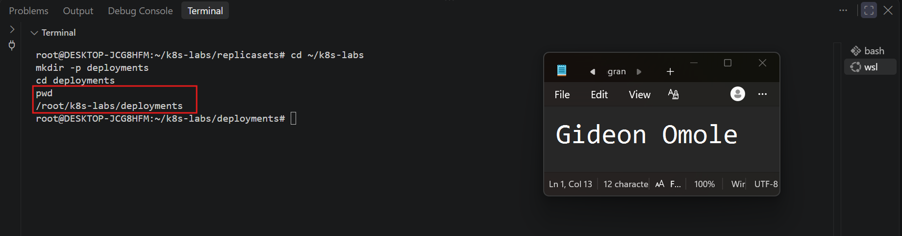

---

# Task 2 — Create the Basic Deployment

## Goal

Create a two-replica NGINX Deployment and verify the automatically managed ReplicaSet and Pods.

### Evidence

#### Screenshot 02 — Completed basic `nginx-deployment.yaml` showing two replicas and the initial NGINX image

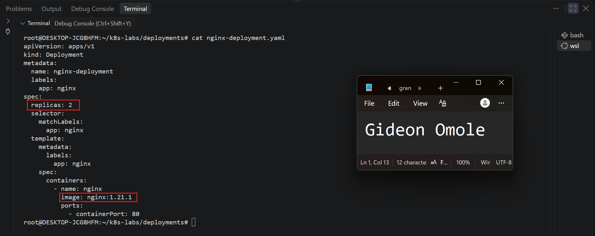

---

#### Screenshot 03 — Successful apply output and verification output showing the Deployment, its automatically created ReplicaSet, and two Pods with `1/1` under `READY` and `Running` under `STATUS`

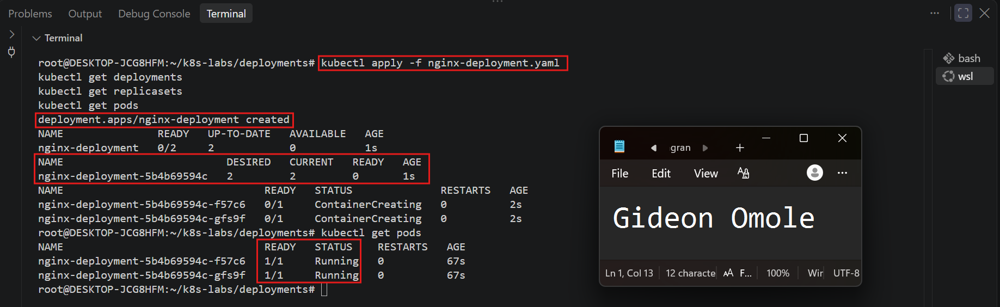

---

# Task 3 — Configure the RollingUpdate Strategy

## Goal

Configure RollingUpdate to maintain the desired available replica count during an image update.

### Evidence

#### Screenshot 04 — Updated YAML showing `RollingUpdate`, `maxSurge: 1`, and `maxUnavailable: 0`

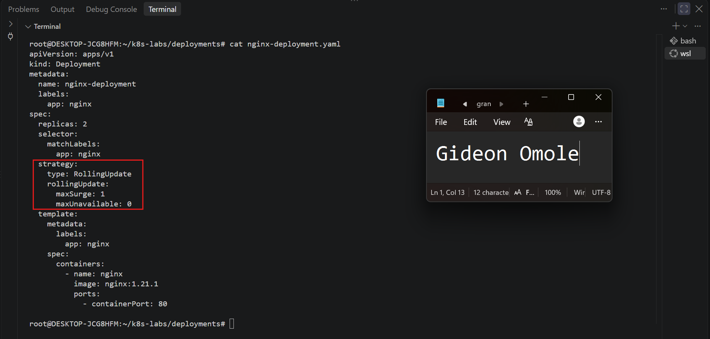

---

#### Screenshot 05 — Successful apply output and Deployment details showing the configured rolling-update strategy

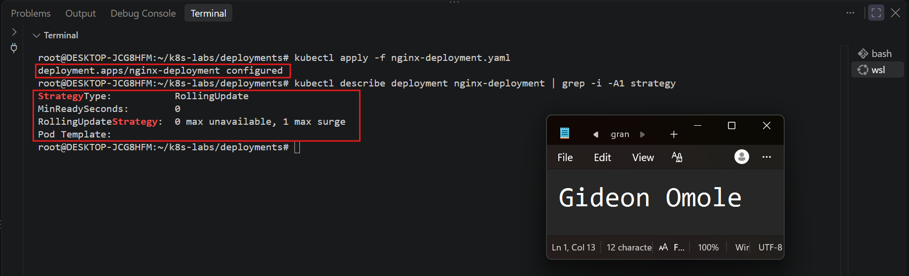

---

# Task 4 — Perform and Roll Back an Image Update

## Goal

Update NGINX to 1.23.1, observe the rollout, and return to the previous stable revision.

### Evidence

#### Screenshot 06 — Image-update command and rollout status showing successful completion

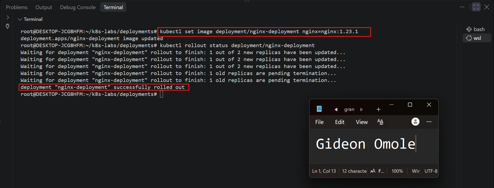

---

#### Screenshot 07 — ReplicaSet output showing the previous and updated ReplicaSets, and Deployment details showing `nginx:1.23.1`

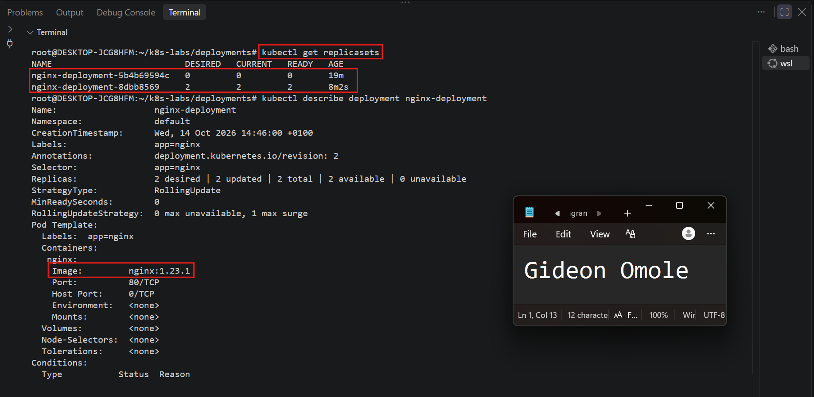

---

#### Screenshot 08 — Rollback command and rollout status showing successful completion

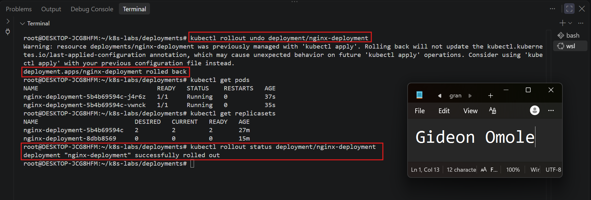

---

#### Screenshot 09 — Rollout history and Deployment details showing the restored `nginx:1.21.1` image

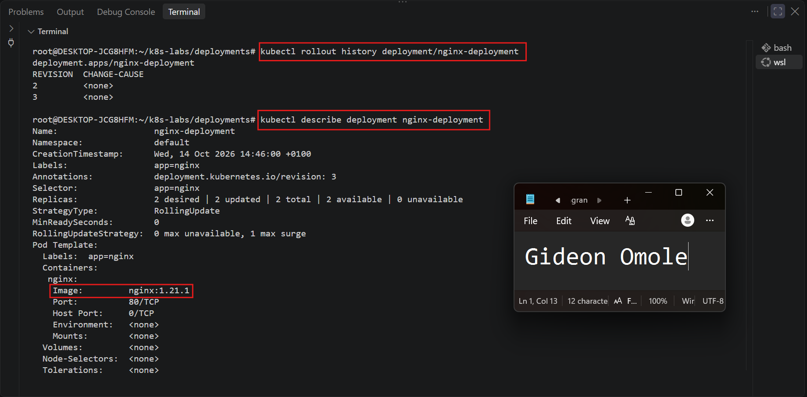

---

# Task 5 — Scale the Deployment

## Goal

Scale the workload to five replicas and return it to two.

### Evidence

#### Screenshot 10 — Scale-up command and output showing five Pods with `1/1` under `READY` and `Running` under `STATUS`

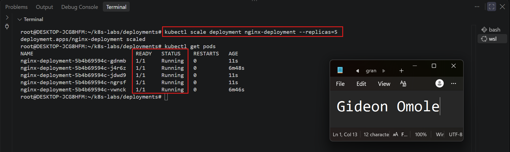

---

#### Screenshot 11 — Scale-down command and output showing the final two Pods with `1/1` under `READY` and `Running` under `STATUS`

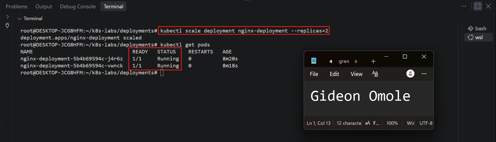

---

# Task 6 — Share Your Kubernetes Deployment Progress on WhatsApp Status

## Goal

Share your Kubernetes Deployment learning progress on WhatsApp Status, including your generated DMI leaderboard progress link.

### Steps

1. Go to the DMI Leaderboard.
2. Find your name and select **Share your progress**.
3. Click the **WhatsApp icon**.
4. Copy the automatically generated leaderboard message containing your rank and progress link.
5. Open WhatsApp and go to **Updates**.
6. Create a new text Status.
7. Copy and paste the message below.
8. Insert the generated leaderboard message in the indicated place.
9. Review and publish your Status.

### WhatsApp Status Message

I practiced Kubernetes Deployments as part of my DevOps learning journey! 🚀

Today, I deployed NGINX, configured rolling updates, updated the container image, and rolled back to the previous version.

I also scaled my Deployment from two Pods to five and back to two!

[I just completed 12/14 weeks of the DevOps Micro Internship — Cohort 3 · Live! � https://dmi.pravinmishra.com/s/Gideon-Omole.html?utm_source=dmi&utm_medium=share&utm_campaign=badge-share-hero-whatsapp]

#DMIByPravinMishra #DevOps #Kubernetes

### Evidence

#### Screenshot 12 — Published WhatsApp Status showing your Kubernetes Deployment message and generated DMI leaderboard progress link

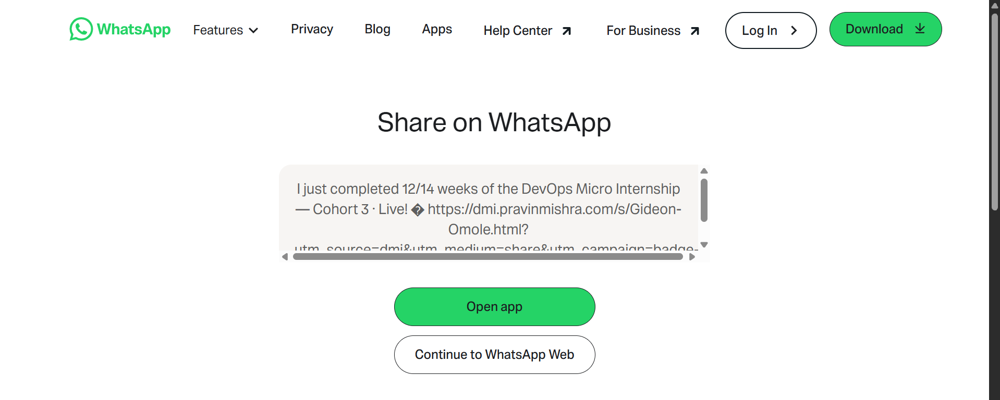

A draft or editing screen is not sufficient.

---

# Lab Summary

A Deployment is the controller that manages the full lifecycle of an application. It does not create Pods directly. Instead, it creates and manages ReplicaSets, and each ReplicaSet creates and maintains the Pods. In this lab, applying `nginx-deployment.yaml` created a Deployment, which automatically created a ReplicaSet, which in turn created two NGINX Pods. The Deployment holds the desired state (image, replica count, strategy), while the ReplicaSet handles self-healing by keeping the right number of Pods running.

**Rolling updates:** When the image was changed from `nginx:1.21.1` to `nginx:1.23.1` with `kubectl set image`, the Deployment created a new ReplicaSet for the new version and gradually replaced the old Pods. With `maxSurge: 1` and `maxUnavailable: 0`, the Deployment was allowed to add one extra Pod above the desired count while never dropping below two available Pods. A new Pod had to become ready before an old one was removed, so the application stayed available throughout the update. After the rollout, the old ReplicaSet was scaled down to 0 Pods but kept in the cluster, while the new ReplicaSet ran the two Pods. This differs from the Recreate strategy, which stops all old Pods before starting new ones and causes downtime.

**Rollbacks:** Because the Deployment keeps the previous ReplicaSet, it stores a revision history. Running `kubectl rollout undo deployment/nginx-deployment` returned the Deployment to the earlier revision using `nginx:1.21.1`. The old ReplicaSet was scaled back up and the newer one was scaled down, using the same gradual process as the update. The `kubectl rollout history` output showed the revisions that were created by the update and the rollback.

**Scaling:** Running `kubectl scale deployment nginx-deployment --replicas=5` changed the desired replica count, and the Deployment's ReplicaSet created three more Pods until five were running. Scaling back to two removed the extra Pods until only two remained. Scaling does not create a new revision because the Pod template does not change. One important note is that scaling with a command is temporary compared with the manifest. If the YAML file still says `replicas: 2` and is reapplied, the declarative state wins and the count returns to two.

Overall, Deployments add rollout control, revision history and safe updates on top of the self-healing and scaling that ReplicaSets already provide, which is why they are the standard choice for stateless production workloads.

---

# Submission Instructions

- Include all required screenshots, numbered 01–12.
- Ensure screenshots are clear and readable.
- Submit the final `nginx-deployment.yaml` containing two replicas, the initial NGINX image, and the configured RollingUpdate strategy.
- Complete the Lab Summary in your own words.
- Include evidence of your published WhatsApp Status.
- Do not expose passwords, tokens, private keys, or kubeconfig credentials.

---

# Completion Checklist

- [ ] Completed Task 0
- [ ] Created the deployments directory (Screenshot 01)
- [ ] Created the basic two-replica NGINX Deployment manifest (Screenshot 02)
- [ ] Applied the Deployment and verified its ReplicaSet and two running Pods (Screenshot 03)
- [ ] Added RollingUpdate with `maxSurge: 1` and `maxUnavailable: 0` (Screenshot 04)
- [ ] Applied and verified the rolling-update strategy (Screenshot 05)
- [ ] Updated NGINX to 1.23.1 and confirmed rollout completion (Screenshot 06)
- [ ] Inspected the ReplicaSets and verified the updated image (Screenshot 07)
- [ ] Rolled back the update and confirmed rollout completion (Screenshot 08)
- [ ] Reviewed rollout history and verified the restored image (Screenshot 09)
- [ ] Scaled to five running Pods (Screenshot 10)
- [ ] Scaled back to two running Pods (Screenshot 11)
- [ ] Published the WhatsApp Status with the generated leaderboard progress link (Screenshot 12)
- [ ] Submitted the final `nginx-deployment.yaml`
- [ ] Included screenshots 01–12
- [ ] Completed the Lab Summary
- [ ] No sensitive data exposed

---

## 📌 About DMI & CloudAdvisory

DevOps Micro Internship (DMI) is a project-based DevOps program run by Pravin Mishra (The CloudAdvisory) focused on real-world execution, systems thinking, and career readiness.

It helps learners build strong DevOps foundations with hands-on experience.

---

## 📌 Resources

- 🌐 DMI Official Website: https://dmi.pravinmishra.com?utm_source=github&utm_medium=readme  
- 🎓 University: https://university.pravinmishra.com?utm_source=github&utm_medium=readme  
- 💬 Discord Community: https://discord.pravinmishra.com?utm_source=github&utm_medium=readme  
- 📝 Blog: https://dmi.pravinmishra.com/blog?utm_source=github&utm_medium=readme  
- ▶️ YouTube Playlist: https://www.youtube.com/playlist?list=PLFeSNDtI4Cho  
- 🔗 Pravin Mishra (LinkedIn): https://www.linkedin.com/in/pravin-mishra-aws-trainer/  
- 🏢 CloudAdvisory (LinkedIn): https://www.linkedin.com/company/thecloudadvisory/

---

*This submission is part of DevOps Micro Internship (DMI) — Agentic AI Track.*
