# Assignment 4 — Auto-Scaling & Auto-Healing: Let Kubernetes React for You

Part of the DevOps Micro Internship (DMI) with Agentic AI

---

## Purpose

Create Deployments, test Pod auto-healing, configure CPU requests and limits, verify Metrics Server, and create a Horizontal Pod Autoscaler.

Optionally generate CPU load to observe how the HPA responds.

---

# Task 0 — Check the Existing Cluster Resources

## Goal

Confirm that you are connected to your learning cluster and inspect existing Deployments and HPAs.

### Evidence

No screenshots required.

---

# Task 1 — Set Up Your Lab Directory

## Goal

Create and enter a dedicated directory for the auto-scaling lab.

### Evidence

#### Screenshot 1 — Terminal showing that you are working inside `~/k8s-labs/autoscaling`

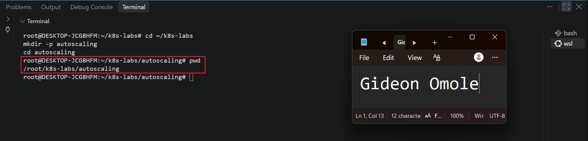

---

### Notes

**1. What is the difference between auto-healing and auto-scaling?**

Auto-healing restores the desired number of Pods when one fails or is deleted. In Kubernetes, the ReplicaSet behind a Deployment keeps comparing the desired replica count with the number of matching Pods that actually exist, and creates a replacement whenever the count falls short. Auto-healing never changes the desired count, it only brings the actual count back to it.

Auto-scaling changes the desired number of Pods itself in response to workload demand. When CPU usage rises, the Horizontal Pod Autoscaler (HPA) raises the Deployment's replica count, and when demand falls it lowers the count again. Auto-healing answers "a Pod was lost, replace it", while auto-scaling answers "demand changed, so how many Pods do we need?"

---

**2. Which Kubernetes feature will you use for CPU-based auto-scaling?**

I will use the Horizontal Pod Autoscaler (HPA). It reads CPU usage from Metrics Server and compares the average utilization across the Pods with a target. In this lab the target is 50% of the CPU request (100m), and the HPA keeps `nginx-deployment` between 2 and 5 replicas. For this to work, the Pods must have CPU requests defined and Metrics Server must be running.

---

# Task 2 — Test Auto-Healing with a Deployment

## Goal

Create a Deployment with two replicas, delete one Pod, and observe Kubernetes create a replacement Pod.

### Evidence

#### Screenshot 2 — Completed `autohealing-deployment.yaml` manifest

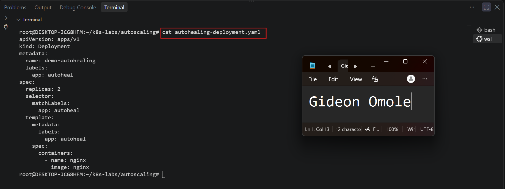

---

#### Screenshot 3 — Output of `kubectl get pods` showing two running Pods before deletion

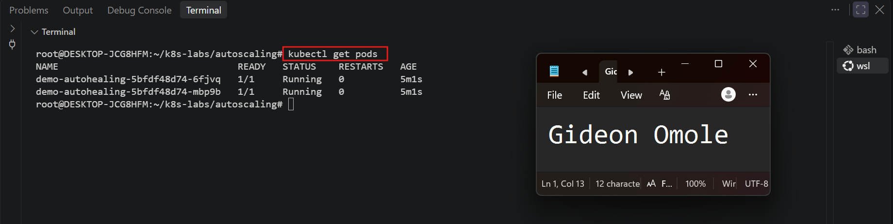

---

#### Screenshot 4 — Output of the `kubectl delete pod` command

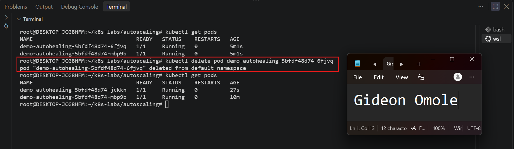

---

#### Screenshot 5 — Output of `kubectl get pods` showing the replacement Pod and two running Pods

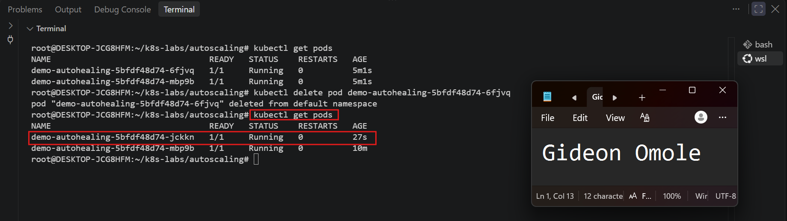

---

### Notes

**1. What happened after you deleted one Pod?**

After I ran `kubectl delete pod <pod-name>`, the selected Pod briefly showed `Terminating` and was then removed. Almost immediately, Kubernetes created a new Pod to replace it. Within a few seconds the new Pod went through `ContainerCreating` and reached `1/1 Running`, so the `demo-autohealing` Deployment was back to two running Pods without any manual action from me.

---

**2. What Kubernetes resource maintains the desired replica count for this Deployment?**

The ReplicaSet maintains the desired replica count. The `demo-autohealing` Deployment creates a ReplicaSet, and the ReplicaSet creates and manages the Pods. It runs a reconciliation loop that keeps comparing the desired count (2) with the number of matching Pods that exist. When I deleted one Pod, only one remained, so the ReplicaSet created a replacement from its Pod template. This is also why the Pod names follow the pattern `demo-autohealing-<replicaset-hash>-<random-suffix>`.

---

**3. What proves that auto-healing worked?**

Two details in the second `kubectl get pods` output prove it:

- The replacement Pod has a **different name** from the Pod I deleted, which shows it is a brand-new Pod and not the old one restarted.
- The replacement Pod has an **AGE of only a few seconds**, while the untouched Pod keeps its original age.

In addition, `kubectl get pods` shows two `demo-autohealing` Pods with `1/1 Running` again, so the desired count of 2 was restored automatically after the deletion.

---

# Task 3 — Create a Deployment for HPA

## Goal

Create a Deployment with CPU resource requests and limits so that HPA can calculate CPU utilization.

### Evidence

#### Screenshot 6 — Completed `hpa-deployment.yaml` manifest showing CPU requests and limits

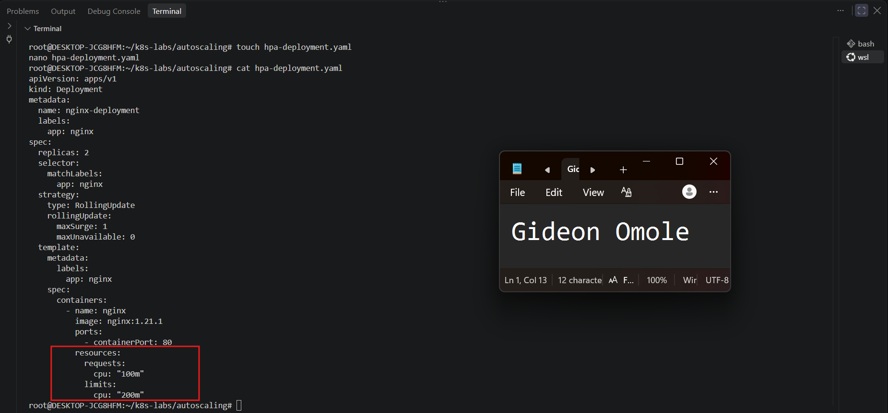

---

#### Screenshot 7 — Output showing `nginx-deployment` and its running Pods

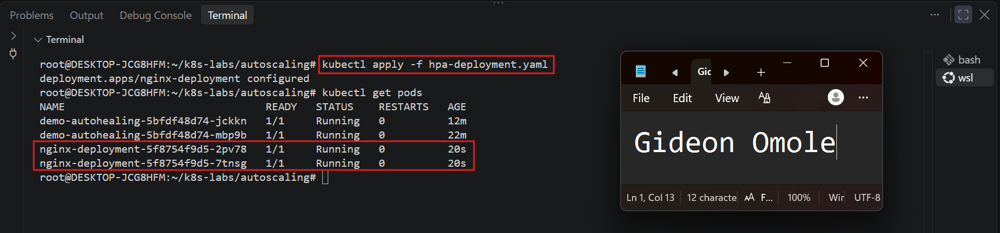

---

### Notes

**1. What does `cpu: "100m"` mean?**

`100m` means 100 millicores, which is one tenth (0.1) of a single CPU core. In this lab it is the amount of CPU each NGINX container asks for.

---

**2. What is the difference between a CPU request and a CPU limit?**

- **CPU request (`100m`):** the amount of CPU the container is guaranteed. Kubernetes uses it to decide which node has room for the Pod.
- **CPU limit (`200m`):** the most CPU the container is allowed to use. If it tries to use more, Kubernetes slows it down (throttles it) but does not kill it.

Example: this container is guaranteed 0.1 of a core and can never use more than 0.2 of a core.

---

**3. Why does CPU-based HPA require CPU requests?**

The HPA measures CPU usage as a percentage, and it needs something to take that percentage of. The CPU request is that number. For example, if a Pod requests `100m` and is using `50m`, the HPA sees 50% utilization. The target in this lab is 50%, so the HPA compares that 50% with the target.

Without a CPU request, there is nothing to calculate the percentage from, so the HPA shows `<unknown>` in the TARGETS column and cannot scale the Deployment.

---

# Task 4 — Enable and Verify Metrics Server

## Goal

Ensure the cluster can collect resource metrics for the HPA.

### Evidence

#### Screenshot 8 — Output showing Metrics Server running, or `kubectl top pods` displaying Pod metrics

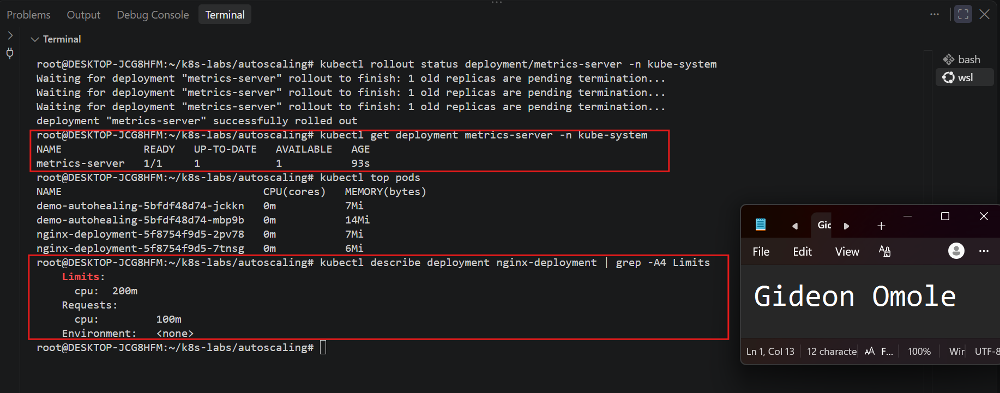

---

### Notes

**1. Why does HPA need Metrics Server?**

The HPA needs to know how much CPU the Pods are actually using. Kubernetes does not measure this by itself. Metrics Server collects CPU and memory usage from the nodes and makes it available to the cluster. The HPA reads these numbers, compares them with its target (50% in this lab), and decides whether to add or remove Pods.

---

**2. What issue can occur if Metrics Server is not working?**

The HPA cannot read CPU usage, so the TARGETS column in `kubectl get hpa` shows `<unknown>/50%`. The HPA then cannot make scaling decisions, so the Deployment will not scale up when the load rises or scale down when it falls. `kubectl top pods` will also fail with an error such as "Metrics API not available".

---

**3. What does `kubectl top pods` help you check?**

It shows the current CPU (in millicores) and memory usage of each Pod. I use it to confirm that Metrics Server is working and that the cluster can collect metrics. If CPU and memory values appear for the `nginx-deployment` Pods, the HPA will be able to read them. If the command shows an error, the metrics are not ready yet and the HPA will not work.

---

# Task 5 — Create a Horizontal Pod Autoscaler

## Goal

Create an HPA that keeps at least two Pods running and can scale up to five Pods when average CPU utilization exceeds 50%.

### Evidence

#### Screenshot 9 — The imperative command output OR completed `hpa-nginx.yaml` manifest

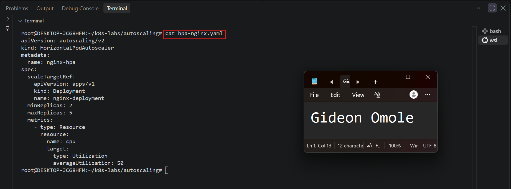

---

#### Screenshot 10 — Output of `kubectl get hpa` and the relevant `kubectl describe hpa` command

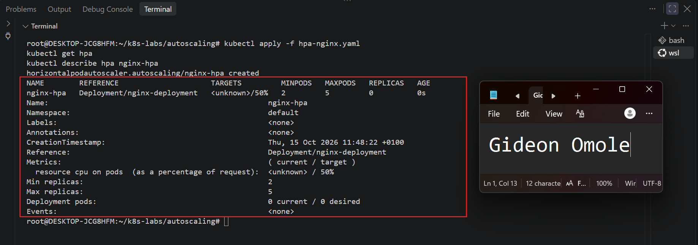

---

### Notes

**1. What does `minReplicas: 2` mean?**

The HPA will never reduce the Deployment below 2 Pods, even when CPU usage is very low. This keeps at least two Pods running at all times.

---

**2. What does `maxReplicas: 5` mean?**

The HPA will never increase the Deployment above 5 Pods, even when CPU usage is very high. This sets an upper limit so the Deployment cannot use up the cluster's resources.

---

**3. What does `averageUtilization: 50` mean?**

The HPA tries to keep the average CPU usage across all the Pods at 50% of their CPU request. Each Pod requests `100m`, so 50% is about `50m` per Pod. If the average goes above 50%, the HPA adds Pods. If it stays well below 50%, the HPA removes Pods, down to the minimum of 2.

---

**4. Why should only one HPA manage a Deployment at a time?**

Each HPA sets the replica count on its own. Two HPAs would each calculate a different number and keep overwriting each other's changes. The Deployment would then jump between replica counts and scaling would be unpredictable. One HPA gives a single, clear decision about how many Pods are needed.

---

# Task 6 — Optional: Generate CPU Load and Observe Scaling

## Goal

Generate CPU load in one NGINX Pod and observe how HPA responds.

### Evidence

If you skip this task, write “Not completed — optional” and leave the remaining Task 6 placeholders blank.

Task status: Completed.

I ran `yes > /dev/null` inside the Pod `nginx-deployment-5f8754f9d5-2pv78` and watched the HPA and the Pods in two other terminals.

#### Screenshot 11 — Terminal showing the CPU-load command running inside the selected Pod

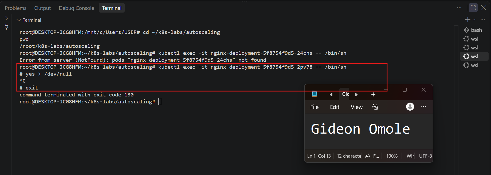

---

#### Screenshot 12 — Output of `kubectl get hpa` and `kubectl get pods` while HPA evaluates or changes the replica count

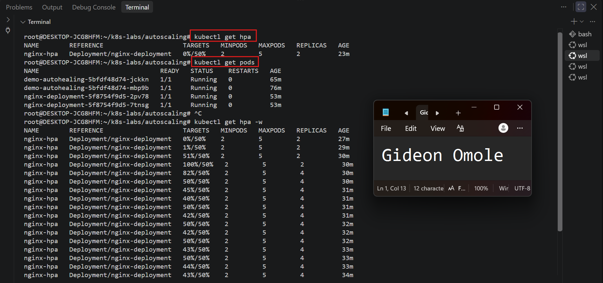

---

### Notes

**1. Did the HPA change the number of Pods? Explain what you observed.**

Yes. Before the load, `kubectl get hpa -w` showed `0%/50%` and `1%/50%` with 2 replicas. After I started the load, CPU utilization rose to `51%/50%` and then `100%/50%`. The HPA then increased the replicas from 2 to 4.

`kubectl get pods -w` showed two new Pods go from `Pending` to `ContainerCreating` to `1/1 Running` in about 2 seconds. After the new Pods started, the average CPU dropped to between 40% and 50%, close to the target. The replica count stayed at 4 and did not reach the maximum of 5, because the average was no longer far above 50%. Later, the two extra Pods showed `Terminating`, so the Deployment went back down to 2 Pods after the load stopped.

I did not run `kubectl scale`. The HPA made all of these changes by itself.

---

**2. If scaling did not happen, what are two possible reasons?**

Scaling did happen in my test. Two reasons it might not happen are:

- **Metrics Server is not working.** The HPA cannot read CPU usage, so the TARGETS column shows `<unknown>` and no scaling decisions are made.
- **The Deployment has no CPU request, or the load is too low.** Without a CPU request the HPA cannot calculate a percentage. If the load keeps average CPU below 50%, there is no reason to add Pods.

---

**3. Why is automatic scale-down useful after traffic decreases?**

When traffic drops, the extra Pods are no longer needed. Removing them frees CPU and memory for other workloads and reduces cost. It also happens automatically, so nobody has to remember to scale the Deployment down by hand.

# LinkedIn Requirement

### Evidence

#### Screenshot 13 — Published LinkedIn post showing your name, the required explanation, and the attached Kubernetes screenshot

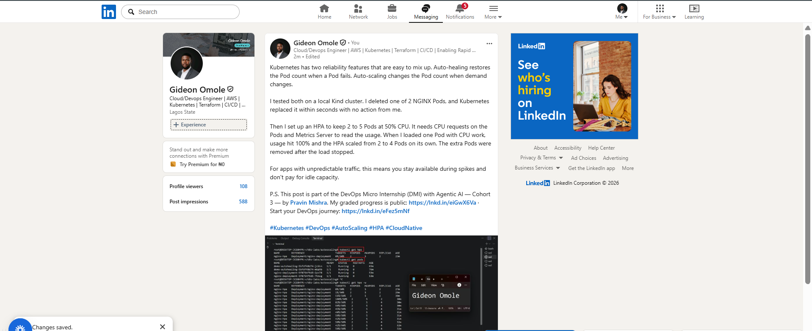

#### Linkedin Post Link

https://www.linkedin.com/posts/gideon-omole-5ba318180_kubernetes-devops-autoscaling-share-7516465651578720257-d8Pt/?rcm=ACoAACrC7l4BK-z0pGwSRQMO8ZJ5pFZyqybbIk4

---

# Submission Instructions

- Include required Screenshots 1–10 and Screenshot 13.
- Include Screenshots 11–12 only if you complete Task 6.
- Full Name must be visible in required screenshots.
- Ensure screenshots are clear and readable.
- Include the completed `autohealing-deployment.yaml` and `hpa-deployment.yaml` files.
- Include `hpa-nginx.yaml` if you selected the declarative HPA method.
- Complete the Notes sections for Tasks 1–5 in your own words.
- Complete Task 6 notes only if you perform the optional test.
- Do not expose passwords, tokens, private keys, kubeconfig files, or account IDs.

---

# Completion Checklist

- [ ] Checked the active context and existing cluster resources
- [ ] Created the autoscaling working directory (Screenshot 1)
- [ ] Created `autohealing-deployment.yaml` (Screenshot 2)
- [ ] Confirmed two auto-healing Pods were running (Screenshot 3)
- [ ] Deleted one managed Pod (Screenshot 4)
- [ ] Confirmed that the Pod was automatically replaced (Screenshot 5)
- [ ] Created `hpa-deployment.yaml` with CPU requests and limits (Screenshot 6)
- [ ] Verified `nginx-deployment` and its running Pods (Screenshot 7)
- [ ] Verified Metrics Server and confirmed Pod metrics are available (Screenshot 8)
- [ ] Created one HPA using the selected method (Screenshot 9)
- [ ] Verified minimum replicas of 2, maximum replicas of 5, and a CPU target of 50% (Screenshot 10)
- [ ] Completed Notes for Tasks 1–5
- [ ] Completed Task 6 evidence and notes, or marked it “Not completed — optional”
- [ ] Stopped the CPU-load command and exited the container shell, if Task 6 was completed
- [ ] Published the LinkedIn post with the required explanation and attached screenshot (Screenshot 13)
- [ ] Included the required manifest files
- [ ] No sensitive data exposed

---

## 📌 About DMI & CloudAdvisory

DevOps Micro Internship (DMI) is a project-based DevOps program run by Pravin Mishra (The CloudAdvisory) focused on real-world execution, systems thinking, and career readiness.

It helps learners build strong DevOps foundations with hands-on experience.

---

## 📌 Resources

- 🌐 DMI Official Website: https://dmi.pravinmishra.com?utm_source=github&utm_medium=readme  
- 🎓 University: https://university.pravinmishra.com?utm_source=github&utm_medium=readme  
- 💬 Discord Community: https://discord.pravinmishra.com?utm_source=github&utm_medium=readme  
- 📝 Blog: https://dmi.pravinmishra.com/blog?utm_source=github&utm_medium=readme  
- ▶️ YouTube Playlist: https://www.youtube.com/playlist?list=PLFeSNDtI4Cho  
- 🔗 Pravin Mishra (LinkedIn): https://www.linkedin.com/in/pravin-mishra-aws-trainer/  
- 🏢 CloudAdvisory (LinkedIn): https://www.linkedin.com/company/thecloudadvisory/

---

*This submission is part of DevOps Micro Internship (DMI) — Agentic AI Track.*
