# Assignment 5 — Kubernetes Health Probes (Readiness)

Part of the DevOps Micro Internship (DMI) with Agentic AI

---

## Purpose

In this assignment, you will configure and test a Kubernetes readiness probe. You will create a baseline NGINX Deployment, add an HTTP readiness probe, intentionally break it, observe a stalled rollout, and restore the working configuration.

You will also demonstrate how readiness probes protect rolling updates.

---

# Task 0 — Prepare the Lab Environment

## Goal

Confirm that you are connected to your learning cluster and remove the previous assignment’s HPA and NGINX Deployment before starting this lab.

No screenshot or written notes are required for this pre-check.

---

# Task 1 — Set Up Your Lab Directory

## Goal

Create and enter a dedicated directory for the readiness-probe lab.

### Evidence

#### Screenshot 1 — Terminal showing that you are working inside `~/k8s-labs/health-probes-readiness`

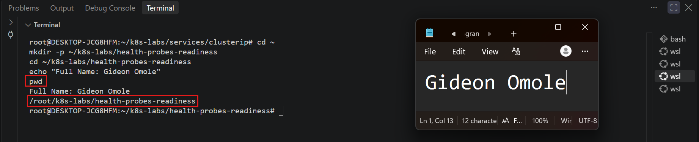

---

### Notes

**1. What is the purpose of a readiness probe?**

A readiness probe tells Kubernetes whether a Pod is ready to accept traffic right now. Kubernetes runs the check periodically, and until it succeeds the Pod is marked NotReady and is not counted as available. This protects users and rolling updates: a Pod that is still starting up, or is unhealthy, is not treated as ready to serve requests (and once Services are introduced, it is left out of the Service endpoints).

**2. Why is a Pod being Running not always enough to confirm it can serve traffic?**

Running only means the container process has started. It does not mean the application inside is able to handle requests. The app may still be loading configuration, warming up, or waiting for a dependency such as a database. If Kubernetes treated the Pod as available at that point, users could get errors or timeouts. A readiness probe confirms the application is actually responding before the Pod is considered Ready.

---

# Task 2 — Create a Baseline Deployment Without Probes

## Goal

Create a baseline NGINX Deployment with two replicas and no readiness probe.

### Evidence

#### Screenshot 2 — Completed `00-nginx-deploy-baseline.yaml` manifest

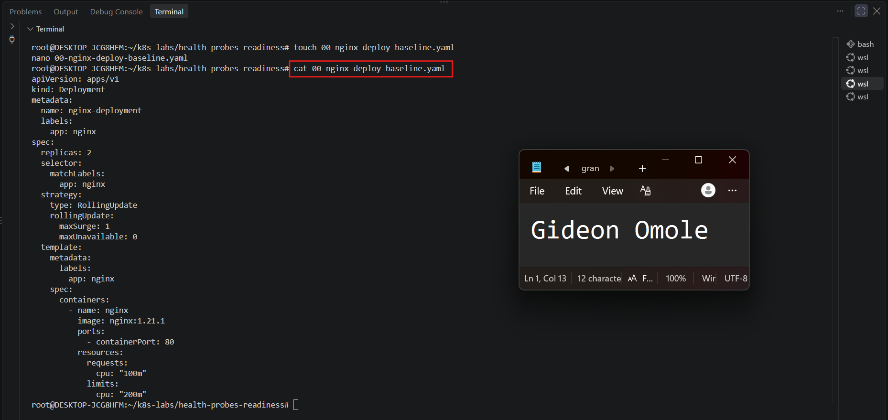

---

#### Screenshot 3 — Output showing a successful rollout and two running NGINX Pods

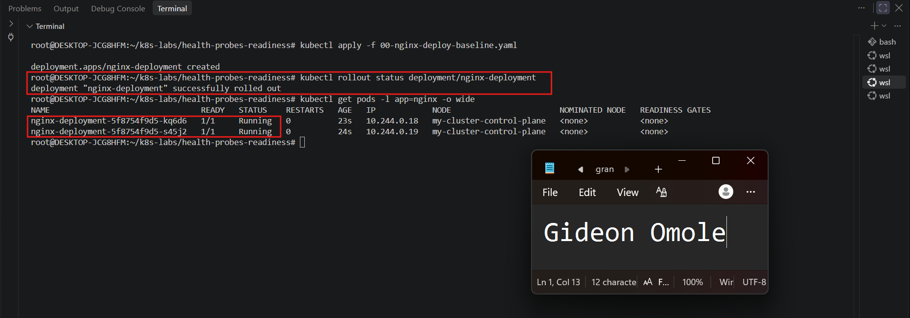

---

#### Screenshot 4 — Relevant output from `kubectl describe deployment nginx-deployment`

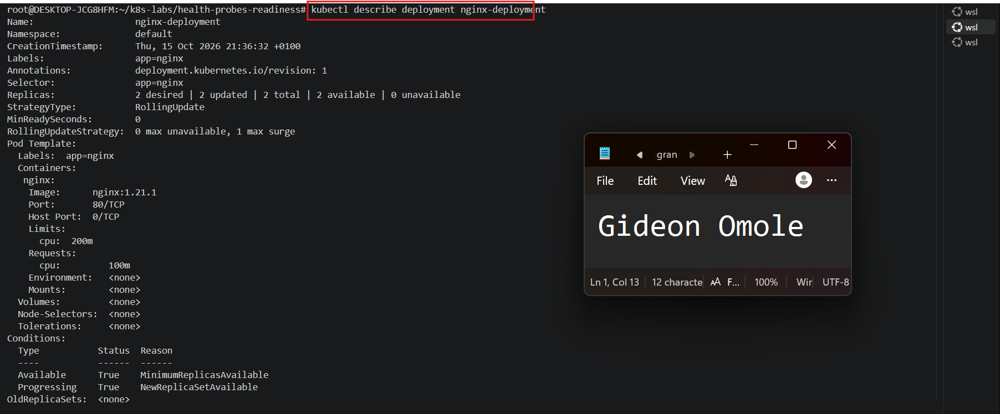

---

### Notes

**1. How many replicas does this Deployment maintain?**

This Deployment maintains 2 replicas, set by `replicas: 2` in the spec. The ReplicaSet keeps two NGINX Pods running at all times, and it recreates a Pod if one is deleted or fails.

**2. What does `maxUnavailable: 0` mean during a rolling update?**

It means Kubernetes is not allowed to take any existing Pod out of service until a replacement is ready. The number of available Pods can never drop below the desired replica count of 2 during the update. To make this work, `maxSurge: 1` lets Kubernetes temporarily create one extra Pod. It starts the new Pod first, waits for it to become available, and only then terminates an old Pod. This keeps the application available throughout the update.

**3. Is a readiness probe configured in this baseline Deployment?**

No. The baseline manifest has no `readinessProbe` section under the container. Without one, Kubernetes treats a Pod as Ready as soon as its container starts running, without checking that NGINX is actually responding to requests. The next task adds the probe to fix this.

---

# Task 3 — Add a Readiness Probe

## Goal

Add an HTTP readiness probe so Kubernetes checks whether each NGINX container is ready to accept requests.

### Evidence

#### Screenshot 5 — Completed `01-nginx-deploy-readiness.yaml` manifest showing the readiness probe

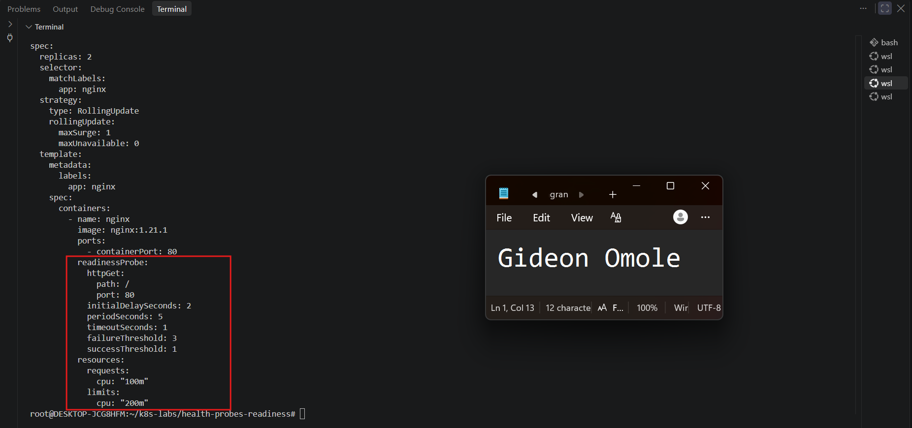

---

#### Screenshot 6 — Output of the successful rollout and ready Pods

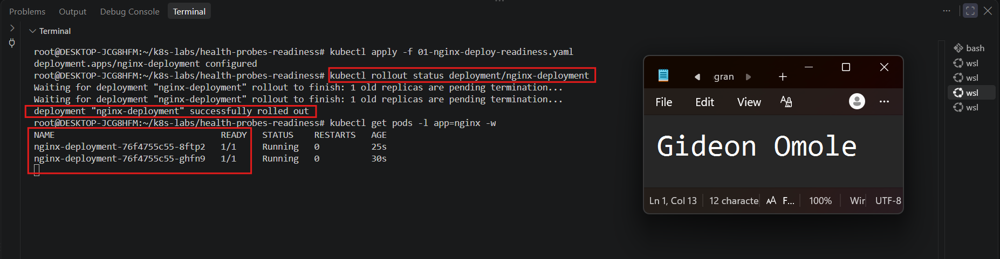

---

#### Screenshot 7 — Pod description showing readiness conditions and readiness probe details

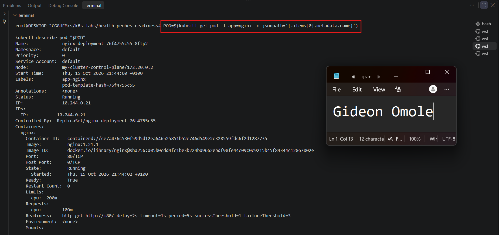
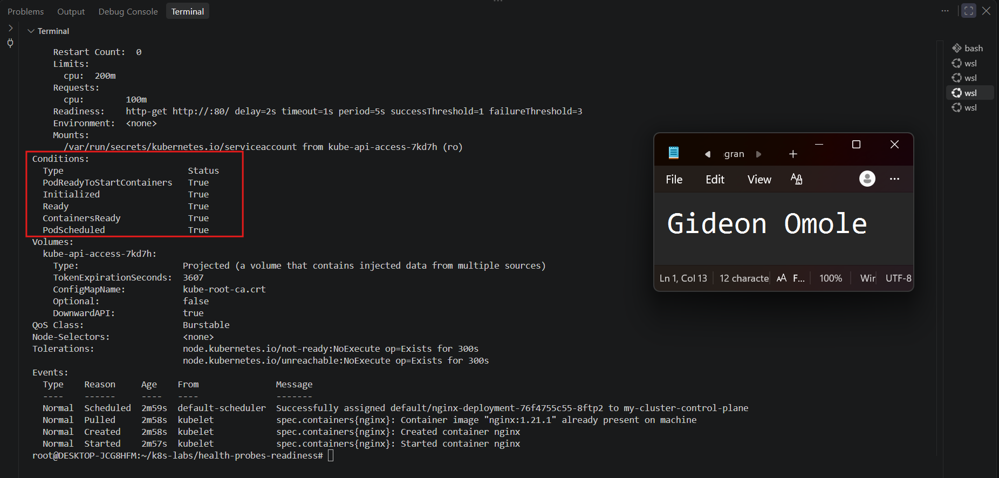

---

### Notes

**1. What path and port does the readiness probe check?**

The probe checks the path `/` on port 80. Kubernetes sends an HTTP GET request to `http://<pod-ip>:80/`, which is the NGINX root page.

**2. What does `initialDelaySeconds: 2` do?**

It makes Kubernetes wait 2 seconds after the container starts before running the first readiness check. This gives NGINX a short moment to start up so the very first check doesn't fail just because the process isn't listening yet.

**3. What does `periodSeconds: 5` do?**

It sets how often Kubernetes runs the readiness check. After the first check, the probe runs every 5 seconds for as long as the Pod is running, so Kubernetes keeps re-checking whether the Pod can still accept traffic.

**4. What must happen before Kubernetes considers this Pod ready?**

The container must be running, and the readiness probe must succeed. Here, `successThreshold: 1` means one successful check is enough: the HTTP GET to `/` on port 80 must return a status code between 200 and 399 within the 1-second timeout. Once that happens, the Pod's `Ready` and `ContainersReady` conditions become `True`, and the Pod counts as available for the Deployment rollout.

---

# Task 4 — Break and Restore Readiness

## Goal

Intentionally fail the readiness probe, observe the NotReady behavior, and then restore the working probe configuration.

### Evidence

#### Screenshot 8 — `02-nginx-readiness-broken.yaml` showing `/does-not-exist`

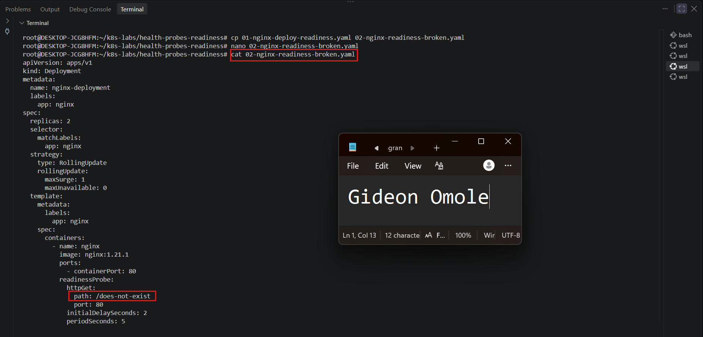

---

#### Screenshot 9 — Output showing the rollout timeout or incomplete rollout

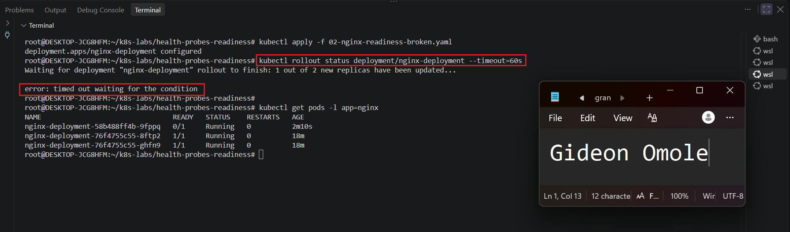

---

#### Screenshot 10 — Pod details showing `Ready: False` or readiness-probe failure events

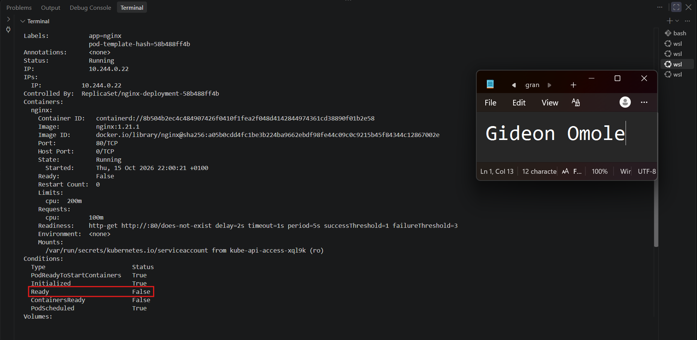

---

#### Screenshot 11 — Output showing successful rollout and ready Pods after the fix

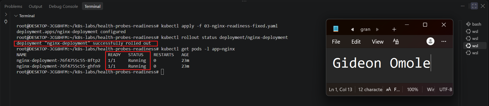

---

### Notes

**1. Why did the readiness probe fail?**

I changed the readiness probe path from `/` to `/does-not-exist`. NGINX serves its welcome page at `/` but has nothing at `/does-not-exist`, so every probe request returned `404 Not Found`. Kubernetes only treats an HTTP probe as successful when the status code is between 200 and 399, so each check failed. The Pod events showed `Readiness probe failed: HTTP probe failed with statuscode: 404`.

**2. What happened to the Pod readiness status?**

The new Pod stayed in the `Running` state but showed `0/1` under READY. In the `describe` output, the `Ready` and `ContainersReady` conditions were `False`. The container itself was healthy and had 0 restarts, because a failed readiness probe does not restart the container. It only marks the Pod as NotReady, so Kubernetes does not count it as available.

**3. Why did the rollout fail to complete?**

Changing the probe changed the Pod template, so the Deployment started a rolling update with a new ReplicaSet. With `maxUnavailable: 0`, Kubernetes cannot remove an old healthy Pod until a new Pod becomes Ready. The new Pod never passed its readiness check, so Kubernetes kept waiting. `kubectl rollout status` timed out after 60 seconds, and the old Pods stayed in service the whole time.

**4. How did you restore the Deployment successfully?**

I copied the working `01-nginx-deploy-readiness.yaml` to `03-nginx-readiness-fixed.yaml`, which has the probe path set back to `/`, and applied it with `kubectl apply -f 03-nginx-readiness-fixed.yaml`. Kubernetes rolled out Pods with the correct probe, they passed the readiness check and became `1/1 Running`, and `kubectl rollout status` reported that the rollout completed successfully.

---

# Task 5 — See How Readiness Protects Rolling Updates

## Goal

Observe how readiness prevents a bad new Pod from replacing healthy Pods during a rolling update.

### Evidence

#### Screenshot 12 — Successful update command and rollout status

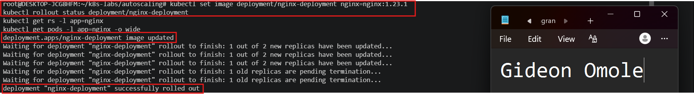

---

#### Screenshot 13 — ReplicaSets and Pods after the successful rolling update

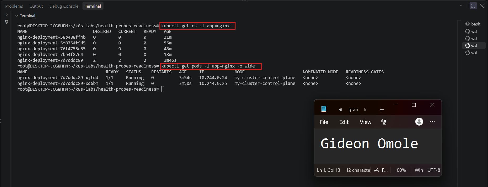

---

#### Screenshot 14 — Completed `04-readiness-broken-patch.yaml`

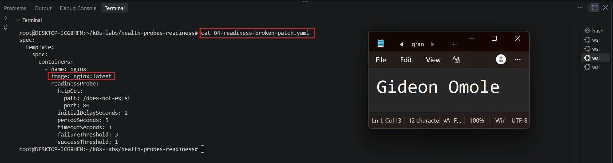

---

#### Screenshot 15 — Output showing the expected stalled rollout or timeout

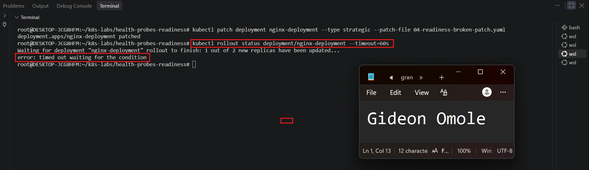

---

#### Screenshot 16 — Deployment or Pod output showing the effect of the broken readiness probe

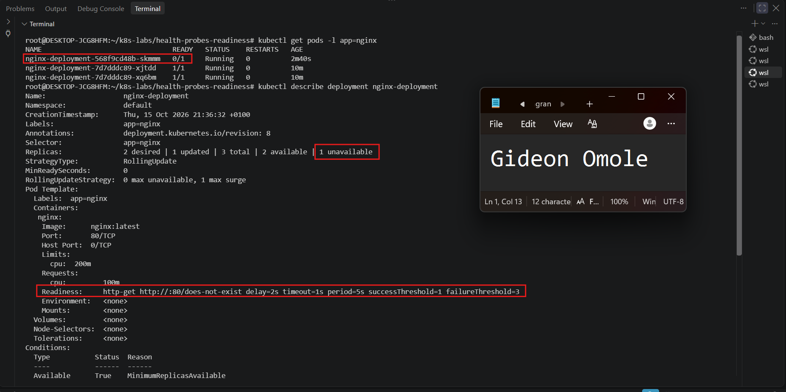

---

#### Screenshot 17 — Successful rollout status after restoring the fixed configuration

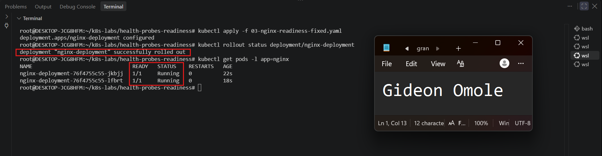

---

### Notes

**1. What happened during the successful rolling update?**

I ran `kubectl set image deployment/nginx-deployment nginx=nginx:1.23.1` to move the Deployment from `nginx:1.21.1` to `nginx:1.23.1`. Kubernetes created a new ReplicaSet and started one new Pod first (allowed by `maxSurge: 1`). That Pod passed its readiness probe and became `1/1 Running`, and only then did Kubernetes terminate one old Pod. It repeated the same step for the second Pod. At the end, the new ReplicaSet had 2 Pods ready, the old ReplicaSet was scaled down to 0, and `kubectl rollout status` reported a successful rollout. The application stayed available the whole time.

**2. Why did Kubernetes create a new ReplicaSet?**

Changing the container image changes the Pod template (`spec.template`). A ReplicaSet manages Pods built from one specific template, so a different template needs a different ReplicaSet. The Deployment controller creates a new ReplicaSet for the new template, with a different `pod-template-hash`, and gradually scales it up while scaling the old one down. The old ReplicaSet is kept at 0 replicas, which is what makes rollbacks possible.

**3. Why were the new Pods unable to replace the existing healthy Pods after readiness was broken?**

The patch changed the image to `nginx:latest` and set the readiness probe path to `/does-not-exist`. NGINX returned `404 Not Found` for that path, so the readiness probe failed on every check. The new Pod stayed `Running` but `0/1` Ready, with `Ready: False` in its conditions, and Kubernetes did not count it as available. A Deployment only removes an old Pod once a new one is Ready, so the old healthy Pods were never replaced. `kubectl rollout status` timed out after 60 seconds, and the old Pods kept serving.

**4. How does `maxUnavailable: 0` protect availability during this rollout?**

It forbids Kubernetes from taking an existing Pod out of service unless a replacement is already available. Since the new Pod never became Ready, no old Pod was terminated, so the Deployment kept its full count of 2 healthy Pods throughout the failed rollout. Combined with `maxSurge: 1`, the only change was one extra NotReady Pod, which did not affect the healthy ones. A bad update therefore stalled safely instead of causing an outage, and applying `03-nginx-readiness-fixed.yaml` restored the correct configuration and completed the rollout.

---

# Task 6 — Share Your Readiness-Probe Learning on LinkedIn

## Goal

Share what you learned about Kubernetes readiness probes and how they protect rolling updates.

### Evidence

#### Screenshot 18 — Published LinkedIn post

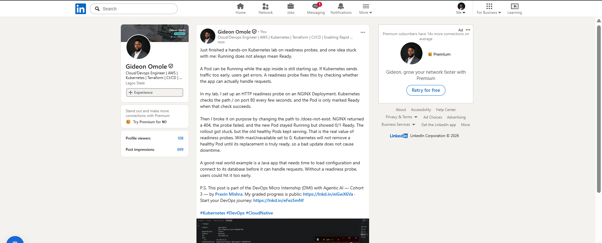

#### Linkedin post link

https://www.linkedin.com/posts/gideon-omole-5ba318180_kubernetes-devops-cloudnative-share-7516616465492529152-ZL67/?rcm=ACoAACrC7l4BK-z0pGwSRQMO8ZJ5pFZyqybbIk4

---

# Submission Instructions

- Add all required screenshots numbered 1–18.
- Ensure your full name is visible in required screenshots.
- Use clear, readable screenshots showing the relevant manifest or output.
- Include the completed baseline and readiness-probe manifests in your repository.
- Answer all Notes questions for Tasks 1–5 in your own words.
- Include evidence of the intentional readiness failure and successful recovery.
- Do not expose tokens, passwords, kubeconfig files, account IDs, or other sensitive information.

---

# Completion Checklist

- [ ] Learning cluster confirmed and previous assignment resources removed where applicable
- [ ] Readiness-probe lab directory created (Screenshot 1)
- [ ] Baseline Deployment created successfully (Screenshot 2)
- [ ] Two baseline Pods running and successful rollout verified (Screenshot 3)
- [ ] Baseline Deployment details reviewed (Screenshot 4)
- [ ] Readiness probe added successfully (Screenshot 5)
- [ ] Successful readiness rollout verified (Screenshot 6)
- [ ] Pod readiness conditions and probe details inspected (Screenshot 7)
- [ ] Broken readiness configuration created (Screenshot 8)
- [ ] Stalled rollout or timeout observed (Screenshot 9)
- [ ] NotReady status or readiness-probe failure events captured (Screenshot 10)
- [ ] Working readiness configuration restored (Screenshot 11)
- [ ] Successful image update completed (Screenshot 12)
- [ ] ReplicaSets and Pods inspected after the update (Screenshot 13)
- [ ] Broken-readiness patch created (Screenshot 14)
- [ ] Stalled rollout observed after the patch (Screenshot 15)
- [ ] Effect of broken readiness captured (Screenshot 16)
- [ ] Final recovery completed (Screenshot 17)
- [ ] LinkedIn post published (Screenshot 18)
- [ ] Notes for Tasks 1–5 completed
- [ ] Required manifests included
- [ ] All screenshots are clear and readable
- [ ] No sensitive data exposed

---

## 📌 About DMI & CloudAdvisory

DevOps Micro Internship (DMI) is a project-based DevOps program run by Pravin Mishra (The CloudAdvisory) focused on real-world execution, systems thinking, and career readiness.

It helps learners build strong DevOps foundations with hands-on experience.

---

## 📌 Resources

- 🌐 DMI Official Website: https://dmi.pravinmishra.com?utm_source=github&utm_medium=readme  
- 🎓 University: https://university.pravinmishra.com?utm_source=github&utm_medium=readme  
- 💬 Discord Community: https://discord.pravinmishra.com?utm_source=github&utm_medium=readme  
- 📝 Blog: https://dmi.pravinmishra.com/blog?utm_source=github&utm_medium=readme  
- ▶️ YouTube Playlist: https://www.youtube.com/playlist?list=PLFeSNDtI4Cho  
- 🔗 Pravin Mishra (LinkedIn): https://www.linkedin.com/in/pravin-mishra-aws-trainer/  
- 🏢 CloudAdvisory (LinkedIn): https://www.linkedin.com/company/thecloudadvisory/

---

*This submission is part of DevOps Micro Internship (DMI) — Agentic AI Track.*
