# Assignment 6 — Kubernetes Health Probes (Liveness)

Part of the DevOps Micro Internship (DMI) with Agentic AI

---

## Purpose

In this assignment, you will configure and test a Kubernetes liveness probe. You will create a baseline NGINX Deployment, add an HTTP liveness probe, intentionally make it fail, observe container restarts, and restore the working configuration.

---

# Task 0 — Prepare the Lab Environment

## Goal

Confirm that you are connected to your learning cluster and remove the previous HPA and NGINX Deployment before starting this lab.

No screenshot or written notes are required for this pre-check.

---

# Task 1 — Set Up Your Lab Directory

## Goal

Create and enter a dedicated directory for the liveness-probe lab.

### Evidence

#### Screenshot 1 — Terminal showing that you are working inside `~/k8s-labs/health-probes-liveness`

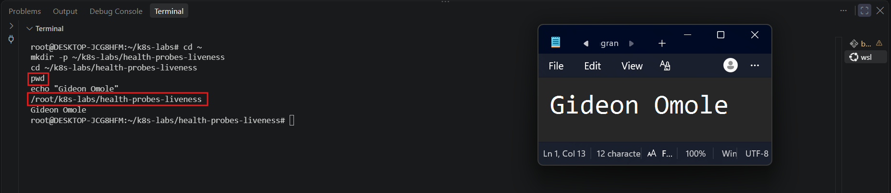

---

### Notes

**1. What problem does a liveness probe solve?**

A liveness probe solves the problem of a container that is still "Running" from Kubernetes' point of view but is no longer working correctly. For example, the application may be frozen, deadlocked, or stuck because of a bug or a memory issue. The container process still exists, so Kubernetes does not notice anything wrong on its own, but users experience timeouts or errors. A liveness probe periodically checks the application's health (for example, with an HTTP request). If the check fails repeatedly, Kubernetes restarts the container automatically, which restores service without manual intervention (self-healing).

**2. What is the key difference between a readiness probe and a liveness probe?**

A readiness probe decides whether a Pod should receive traffic. If it fails, the Pod is marked NotReady and removed from Service endpoints, but the container is not restarted. A liveness probe decides whether a container should be restarted. If it fails repeatedly (up to the `failureThreshold`), Kubernetes kills and restarts the container. In short: readiness controls traffic, liveness controls restarts.

---

# Task 2 — Create a Baseline Deployment Without Probes

## Goal

Create a baseline NGINX Deployment with two replicas and no health probes.

### Evidence

#### Screenshot 2 — Completed `00-nginx-deploy-baseline.yaml` manifest

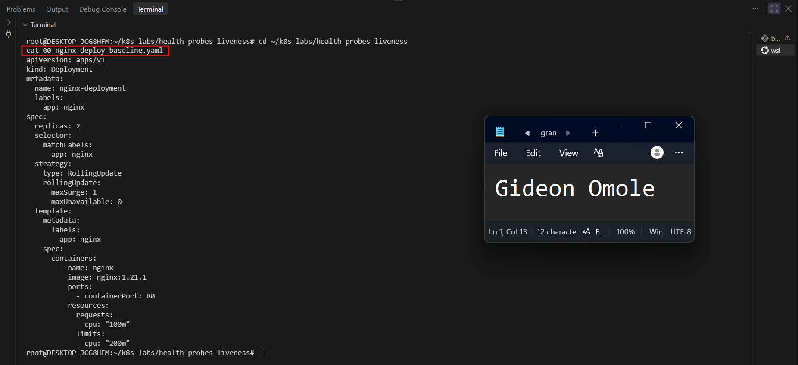

---

#### Screenshot 3 — Output showing a successful rollout and two running NGINX Pods

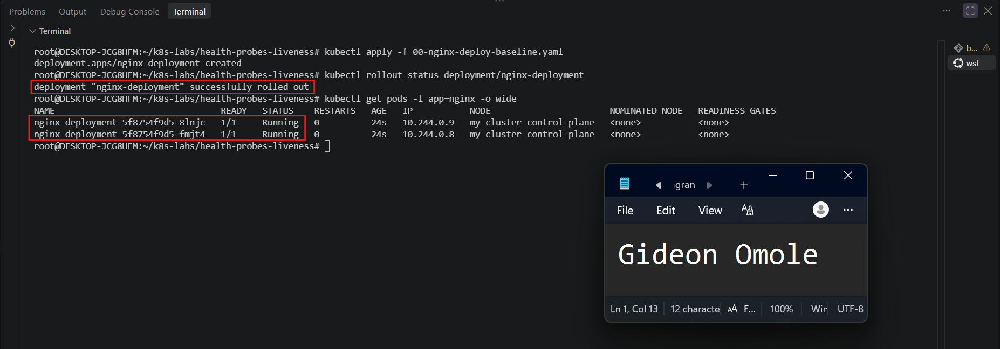

---

#### Screenshot 4 — Relevant output from `kubectl describe deployment nginx-deployment`

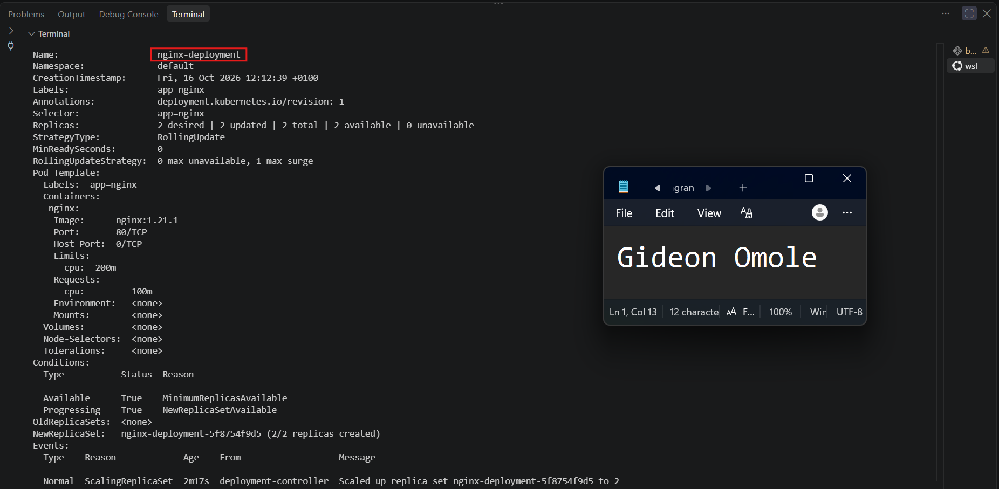

---

### Notes

**1. How many replicas does this Deployment maintain?**

The Deployment maintains 2 replicas. This means Kubernetes keeps two NGINX Pods running at all times. If one Pod is deleted or crashes, Kubernetes creates a new one to get back to two.

**2. Are any health probes configured in the baseline Deployment?**

No. The baseline Deployment has no readiness probe and no liveness probe. Kubernetes only checks whether the container process is running, not whether the application inside it is actually responding.

**3. Why is a baseline useful before adding a liveness probe?**

The baseline gives us a starting point to compare against. We can see how the Deployment behaves with no probes, then add a liveness probe and clearly see what changes. It also confirms that the NGINX image and the Deployment work correctly on their own, so if something goes wrong later, we know the problem came from the probe and not from the setup.

---

# Task 3 — Add a Liveness Probe

## Goal

Add an HTTP liveness probe so Kubernetes can periodically check whether the NGINX container is still responsive.

### Evidence

#### Screenshot 5 — Completed `01-nginx-deploy-liveness.yaml` manifest showing the liveness probe

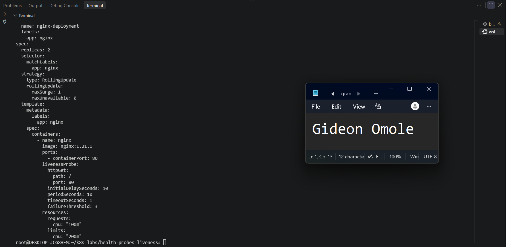

---

#### Screenshot 6 — Output showing successful rollout and running Pods

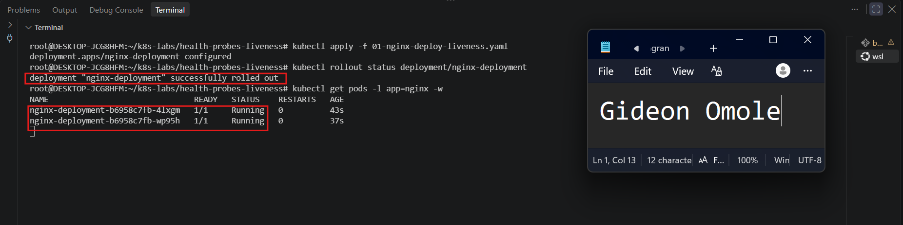

---

#### Screenshot 7 — Pod description showing liveness-probe details

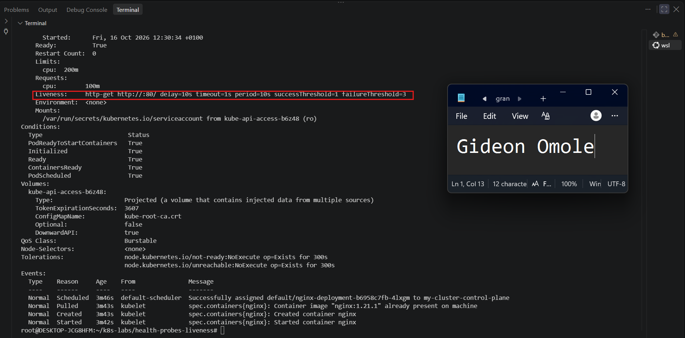

---

### Notes

**1. What path and port does the liveness probe check?**

The liveness probe checks the path `/` (the NGINX root page) on port `80`. Kubernetes sends an HTTP GET request to `/` on port 80, and if NGINX replies with a success status code, the container is considered healthy.

**2. What does `initialDelaySeconds: 10` do?**

It tells Kubernetes to wait 10 seconds after the container starts before running the first liveness check. This gives NGINX time to start up, so it isn't marked as unhealthy before it has had a chance to get ready.

**3. What does `failureThreshold: 3` mean?**

It means the probe must fail 3 times in a row before Kubernetes considers the container unhealthy and restarts it. One failed check is not enough, which helps avoid restarting a container because of a single brief hiccup.

**4. Does a successful liveness probe control whether a Pod receives traffic? Explain briefly.**

No. A liveness probe only decides whether the container should be restarted. Whether a Pod receives traffic is controlled by the readiness probe. A passing liveness probe simply tells Kubernetes the container is healthy and should be left running.

---

# Task 4 — Trigger and Observe a Liveness Restart

## Goal

Intentionally make the liveness probe fail and observe Kubernetes restart the unhealthy container.

### Evidence

#### Screenshot 8 — `02-nginx-liveness-broken.yaml` showing `/does-not-exist`

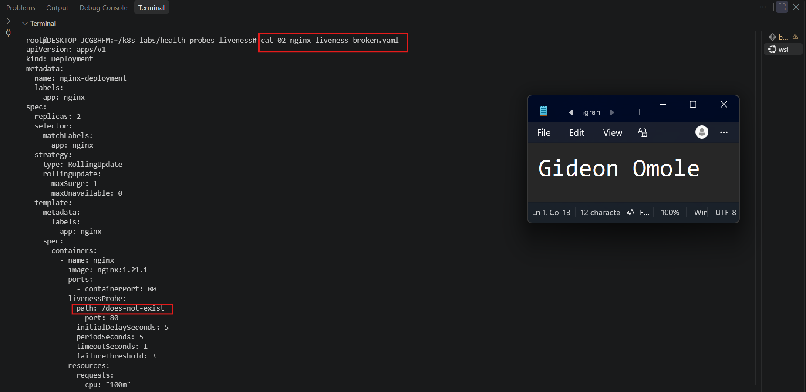

---

#### Screenshot 9 — Pod output showing an increased RESTARTS count

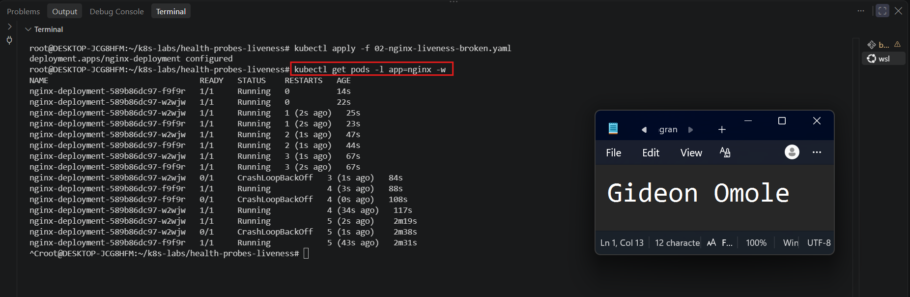

---

#### Screenshot 10 — Pod description showing liveness-probe failure events or restart details

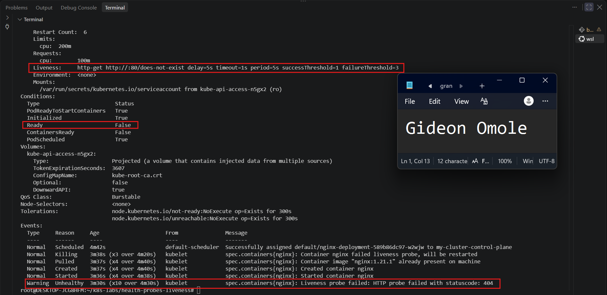

---

#### Screenshot 11 — Output showing stable running Pods after applying the fixed configuration

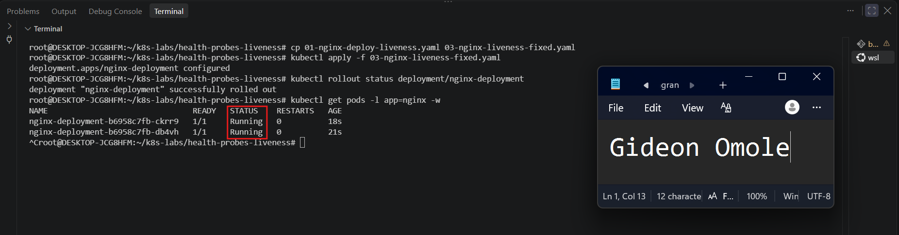

---

### Notes

**1. Why did the liveness probe fail?**

The liveness probe was changed to check the path `/does-not-exist` on port 80. NGINX does not have a page at that path, so it replied with an HTTP 404 (Not Found) error every time. Kubernetes treats any response that is not a success as a failed check, so the probe failed again and again even though NGINX itself was running normally.

**2. What happened after Kubernetes detected repeated liveness-probe failures?**

After the probe failed 3 times in a row (the `failureThreshold`), Kubernetes decided the container was unhealthy. It killed the container and started a new one inside the same Pod. The Pod events showed the liveness probe failures (HTTP 404) followed by messages that the container was being restarted. Because the probe was still broken, this kept repeating.

**3. What does the RESTARTS column prove?**

It proves that Kubernetes restarted the container automatically after the liveness probe kept failing. Each time the number goes up, it means Kubernetes restarted the container once. This shows that the liveness probe is working as designed: it detects an unhealthy container and restarts it without any manual action.

**4. How did you restore the Deployment to a stable state?**

I copied the working manifest `01-nginx-deploy-liveness.yaml` to `03-nginx-liveness-fixed.yaml`, which uses the correct probe path `/`. Then I applied it with `kubectl apply -f 03-nginx-liveness-fixed.yaml`. Kubernetes rolled out new Pods with the working probe, and after the rollout finished, both Pods showed `1/1 READY` and `Running`, and their restart counts stopped increasing.

---

# Task 5 — Optional: Observe a Restart Loop

## Goal

Observe why overly aggressive or incorrectly configured liveness probes can create restart loops.

Complete this section only if you attempt Task 5. Otherwise, mark it as “Not attempted.”

**Task status:** Completed / Not attempted

### Evidence

#### Optional Screenshot — Pod output showing the RESTARTS count increasing during the restart-loop observation

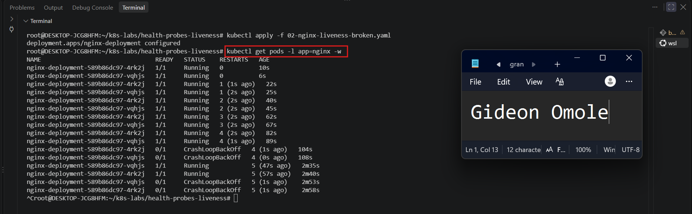

No specific restart count or CrashLoopBackOff status is required.

---

### Notes — Answer Only If Attempted

**1. What is a restart loop?**

A restart loop is when a container keeps getting restarted over and over because it never becomes healthy. In this lab, the liveness probe kept failing on `/does-not-exist`, so Kubernetes kept killing and restarting the container, and the RESTARTS count kept going up. Kubernetes also waits longer between each restart, which can lead to a `CrashLoopBackOff` status.

**2. Why can an aggressive liveness probe be harmful?**

An aggressive probe checks too often, has a very short timeout, or gives up after too few failures. This means a healthy container can be restarted just because of a brief slowdown or a busy moment. Each restart interrupts the application, can drop active requests, and can make a small problem worse. If many Pods restart at the same time, it can even cause an outage.

**3. Why should liveness checks be lightweight and carefully tuned?**

A lightweight check (like a simple `/` or `/healthz` page) responds quickly and doesn't put extra load on the application. It should also not depend on outside services, such as a database, because a short outage there would cause unnecessary restarts. Careful tuning of the delay, period, timeout, and failure threshold gives the application enough time to start and recover from small hiccups, so Kubernetes only restarts a container when something is truly wrong.

---

# Task 6 — Share Your Liveness-Probe Learning on LinkedIn

## Goal

Share what you learned about Kubernetes liveness probes, container restarts, and the difference between readiness and liveness.

### Evidence

#### Screenshot 12 — Published LinkedIn post

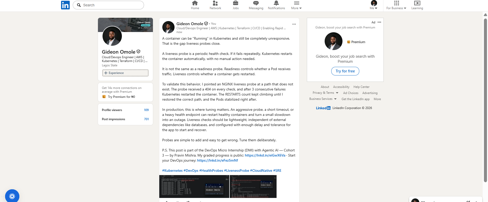

#### Linkedin post URL

[Add URl here](https://www.linkedin.com/posts/gideon-omole-5ba318180_kubernetes-devops-healthprobes-ugcPost-7516835749132955648-81j4/?rcm=ACoAACrC7l4BK-z0pGwSRQMO8ZJ5pFZyqybbIk4)

---

# Submission Instructions

- Add all required screenshots numbered 1–12.
- Include the optional Task 5 screenshot only if you attempt that task.
- Ensure your full name is visible in required screenshots.
- Use clear, readable screenshots showing the relevant manifest or output.
- Include the completed baseline and liveness-probe manifests in your repository.
- Answer all Notes questions for Tasks 1–4 in your own words.
- If you attempt Task 5, complete its Notes and restore the working configuration afterward.
- Do not expose tokens, passwords, kubeconfig files, account IDs, or other sensitive information.

---

# Completion Checklist

- [ ] Learning cluster confirmed and previous assignment resources removed where applicable
- [ ] Liveness-probe lab directory created (Screenshot 1)
- [ ] Baseline Deployment manifest completed (Screenshot 2)
- [ ] Successful rollout and two baseline Pods verified (Screenshot 3)
- [ ] Baseline Deployment details reviewed (Screenshot 4)
- [ ] Liveness probe added successfully (Screenshot 5)
- [ ] Successful liveness-probe rollout verified (Screenshot 6)
- [ ] Liveness-probe details inspected (Screenshot 7)
- [ ] Broken liveness configuration created (Screenshot 8)
- [ ] Increased container restart count observed (Screenshot 9)
- [ ] Liveness-probe failure events or restart details captured (Screenshot 10)
- [ ] Working liveness configuration restored and stable Pods verified (Screenshot 11)
- [ ] Optional Task 5 evidence and Notes completed, if attempted
- [ ] Working configuration restored after Task 5, if attempted
- [ ] LinkedIn post published (Screenshot 12)
- [ ] Notes for Tasks 1–4 completed
- [ ] Required manifests included
- [ ] All required screenshots are clear and readable
- [ ] No sensitive data exposed

---

## 📌 About DMI & CloudAdvisory

DevOps Micro Internship (DMI) is a project-based DevOps program run by Pravin Mishra (The CloudAdvisory) focused on real-world execution, systems thinking, and career readiness.

It helps learners build strong DevOps foundations with hands-on experience.

---

## 📌 Resources

- 🌐 DMI Official Website: https://dmi.pravinmishra.com?utm_source=github&utm_medium=readme  
- 🎓 University: https://university.pravinmishra.com?utm_source=github&utm_medium=readme  
- 💬 Discord Community: https://discord.pravinmishra.com?utm_source=github&utm_medium=readme  
- 📝 Blog: https://dmi.pravinmishra.com/blog?utm_source=github&utm_medium=readme  
- ▶️ YouTube Playlist: https://www.youtube.com/playlist?list=PLFeSNDtI4Cho  
- 🔗 Pravin Mishra (LinkedIn): https://www.linkedin.com/in/pravin-mishra-aws-trainer/  
- 🏢 CloudAdvisory (LinkedIn): https://www.linkedin.com/company/thecloudadvisory/

---

*This submission is part of DevOps Micro Internship (DMI) — Agentic AI Track.*
