# Assignment 7 — Kubernetes Services (ClusterIP)

Part of the DevOps Micro Internship (DMI) with Agentic AI

---

## Purpose

In this assignment, you will create and test a Kubernetes ClusterIP Service. You will connect it to a healthy NGINX Deployment, access it using DNS and its ClusterIP, break and restore its selector, and observe how readiness affects Service routing.

---

# Task 0 — Prepare the Lab Environment

## Goal

Confirm your learning-cluster context and remove previous lab resources where applicable before starting this assignment.

No screenshot or written notes are required for this pre-check.

---

# Task 1 — Set Up Your Lab Directory

## Goal

Create and enter a dedicated directory for the ClusterIP Service lab.

### Evidence

#### Screenshot 1 — Terminal showing that you are working inside `~/k8s-labs/services/clusterip`

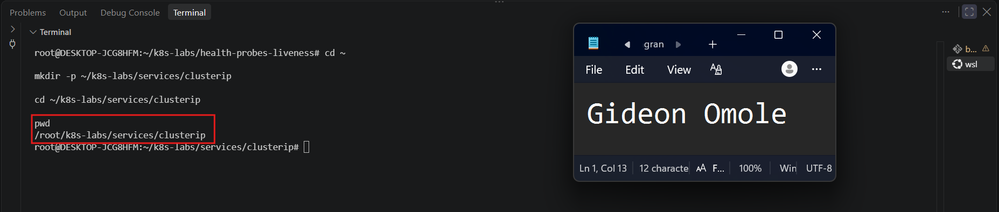

---

### Notes

**1. Why is it not reliable to communicate with an application using a Pod IP address?**

A Pod IP address is temporary. Every time a Pod is deleted, crashes, is rescheduled, scaled, or replaced during an update, the new Pod gets a different IP address. If an application stored or hardcoded a Pod IP, it would stop working as soon as that Pod was replaced. Also, a single Pod IP points to only one Pod, so it can't spread traffic across several Pods or skip an unhealthy one.

**2. What Kubernetes resource provides a stable internal address for a group of Pods?**

A **Service** (specifically a **ClusterIP Service**) provides the stable internal address. It gets a fixed virtual IP and a DNS name (such as `nginx-svc`) that do not change, even when the Pods behind it change. It uses a label selector to find the matching Pods and sends traffic only to the ones that are ready.

---

# Task 2 — Create a Healthy NGINX Deployment

## Goal

Create an NGINX Deployment with labels, readiness probes, and liveness probes that can act as the backend for a Service.

### Evidence

#### Screenshot 2 — Completed `00-nginx-deploy.yaml` manifest

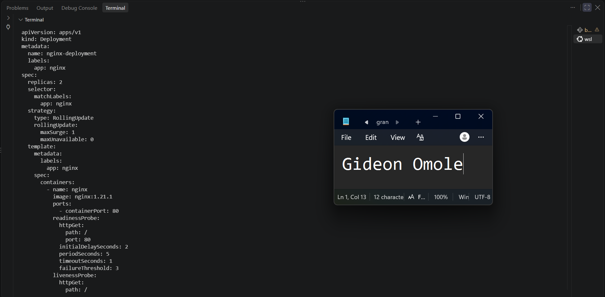

---

#### Screenshot 3 — Output showing successful rollout and two ready NGINX Pods

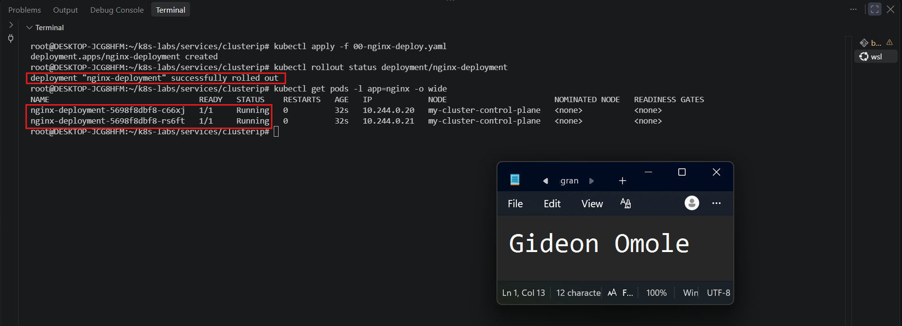

---

### Notes

**1. Which label will the Service use to find these Pods?**

The Service uses the label `app: nginx`. The Deployment adds this label to every NGINX Pod, and the Service selector looks for Pods with this same label. Any Pod that has `app: nginx` becomes a possible backend for the Service.

**2. Why is readiness important before connecting Pods to a Service?**

A readiness probe tells Kubernetes whether a Pod is ready to handle requests. A Pod can be running but still starting up or not working properly. Without readiness, the Service might send traffic to a Pod that cannot answer yet, and users would see errors or timeouts. With readiness, the Service sends traffic only to Pods that pass the check, so users reach healthy Pods only.

**3. What port does the NGINX container listen on?**

The NGINX container listens on **port 80**. This is set as `containerPort: 80` in the Deployment, and the readiness and liveness probes also check port 80.

---

# Task 3 — Create a ClusterIP Service

## Goal

Create a stable internal Service that routes traffic to the NGINX Pods.

### Evidence

#### Screenshot 4 — Completed `01-nginx-svc-clusterip.yaml` manifest

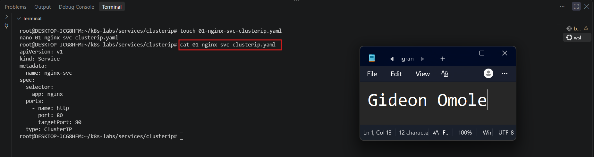

---

#### Screenshot 5 — Output showing the ClusterIP Service, endpoints, or EndpointSlices

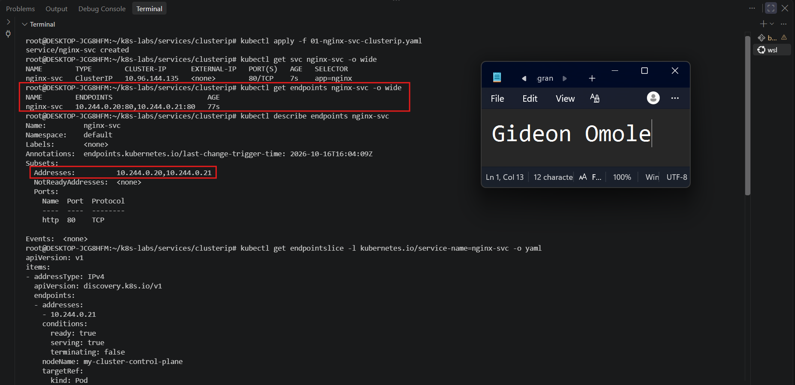

---

### Notes

**1. What is the purpose of a ClusterIP Service?**

A ClusterIP Service gives a group of Pods one stable internal IP address and DNS name that can be used inside the cluster. Other Pods can use this address to reach the application without knowing the individual Pod IPs. The Service also spreads traffic across all the ready Pods behind it. A ClusterIP Service is only reachable from inside the cluster, not from outside.

**2. What is the difference between `port` and `targetPort`?**

`port` is the port the Service itself listens on. Clients use this port when they call the Service (for example, `http://nginx-svc:80`). `targetPort` is the port on the backend Pod where the traffic is actually sent. In this lab both are 80, but they can be different. For example, a Service could listen on port 80 and forward traffic to a container that listens on port 8080.

**3. Why must the Service selector match the Pod labels?**

The Service uses its selector to find which Pods belong to it. If the selector matches the Pod labels, those Pods become backends and receive traffic. If it does not match, the Service finds no Pods, its endpoints stay empty, and requests fail. That is what happened when we changed the selector to `app: does-not-match`.

**4. What information do EndpointSlices contain?**

EndpointSlices list the backends behind a Service. They contain the IP addresses of the matching Pods, the port they receive traffic on, and their readiness conditions (such as `ready: true` or `ready: false`). They also link back to the Service name and the Pod each address belongs to. Kubernetes updates them automatically when Pods are added, removed, or become ready or not ready.

---

# Task 4 — Access the Service from Inside the Cluster

## Goal

Create a client Pod and access the NGINX Service using DNS and its ClusterIP.

### Evidence

#### Screenshot 6 — Output showing the `tester` Pod running

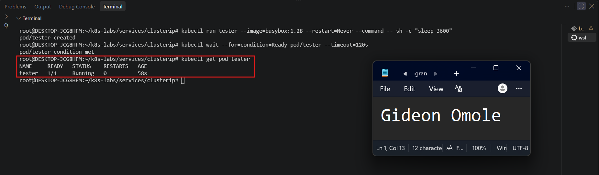

---

#### Screenshot 7 — Successful Service request using DNS name and ClusterIP

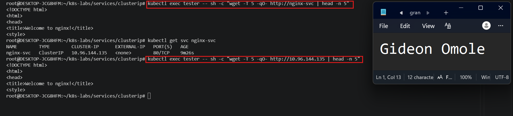

---

#### Screenshot 8 — Successful DNS lookup for the Service

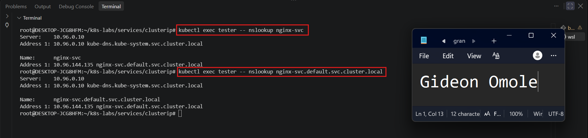

---

### Notes

**1. Why should an application use `nginx-svc` instead of a Pod IP address?**

The name `nginx-svc` never changes, but Pod IP addresses do. Pods get new IPs whenever they are replaced, rescheduled, scaled, or updated. If an application used a Pod IP, it would break as soon as that Pod was replaced. Using `nginx-svc` lets Kubernetes find the current healthy Pods automatically, and it also spreads traffic across them.

**2. What does the DNS name `nginx-svc.default.svc.cluster.local` represent?**

It is the full DNS name (fully qualified domain name) of the Service. Each part has a meaning:

- `nginx-svc` is the Service name
- `default` is the namespace the Service is in
- `svc` shows that this is a Service
- `cluster.local` is the cluster's default domain

CoreDNS resolves this name to the Service's ClusterIP. Pods in the same namespace can use just `nginx-svc`, but the full name works from any namespace.

**3. Why can the client access the Service even if the backend Pod IPs change?**

The client talks to the Service's ClusterIP and DNS name, not to the Pod IPs. Both of these stay the same for as long as the Service exists. When Pods are replaced and get new IPs, Kubernetes updates the EndpointSlices behind the Service automatically. The Service then sends traffic to the new Pods, so the client does not need to change anything.

---

# Task 5 — Break and Restore the Label-Selector Contract

## Goal

Break the Service selector, observe that usable endpoints disappear, and then restore the correct selector.

### Evidence

#### Screenshot 9 — `02-nginx-svc-selector-broken.yaml` showing the incorrect selector

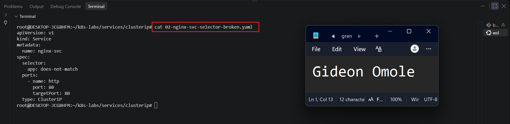

---

#### Screenshot 10 — Empty endpoints or EndpointSlice output after applying the broken selector

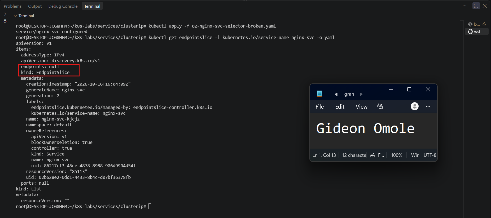

---

#### Screenshot 11 — Failed request output from the `tester` Pod

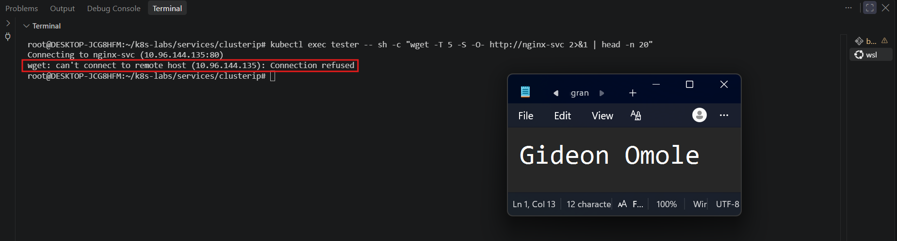

---

#### Screenshot 12 — Restored endpoints and successful Service request

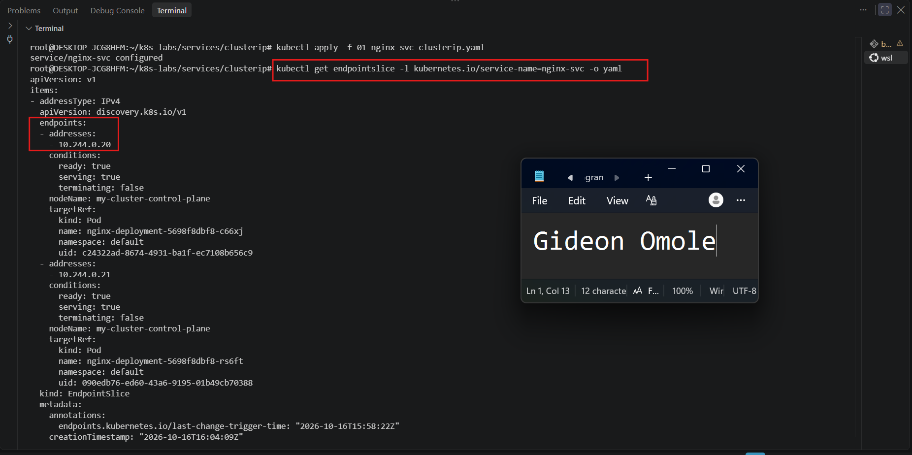
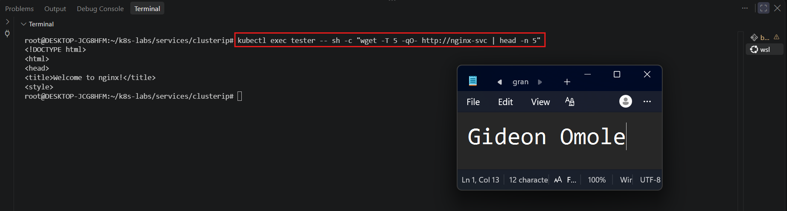

---

### Notes

**1. Why did the Service endpoints become empty?**

I changed the Service selector from `app: nginx` to `app: does-not-match`. None of the NGINX Pods have the label `app: does-not-match`, so the Service could not find any matching Pods. Because there were no matching Pods, Kubernetes had no backend addresses to list, and the endpoints became empty. The Pods were still running and healthy. The problem was only that the Service could no longer find them.

**2. What caused the request from the client Pod to fail?**

The request failed because the Service had no backend Pods to send traffic to. The tester Pod could still resolve the name `nginx-svc` to the ClusterIP, but the ClusterIP had no ready endpoints behind it. As a result, the request ended in a connection refusal or timeout instead of returning the NGINX page.

**3. How did you restore connectivity to the NGINX Pods?**

I restored the original Service manifest by running `kubectl apply -f 01-nginx-svc-clusterip.yaml`. This changed the selector back to `app: nginx`, which matches the labels on the NGINX Pods. Kubernetes then added the Pod IPs back to the EndpointSlices with `ready: true`, and the request from the tester Pod to `http://nginx-svc` worked again.

---

# Task 6 — Observe How Readiness Affects Service Routing

## Goal

Observe how a new Pod that fails readiness is excluded from ready Service backends while the existing healthy Pod continues serving traffic.

### Evidence

#### Screenshot 13 — Output showing the Deployment scaled to one ready Pod

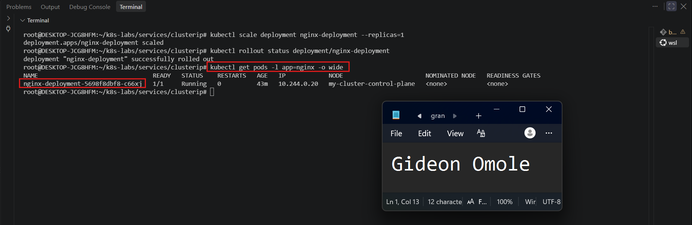

---

#### Screenshot 14 — Completed `03-readiness-broken.yaml` patch file

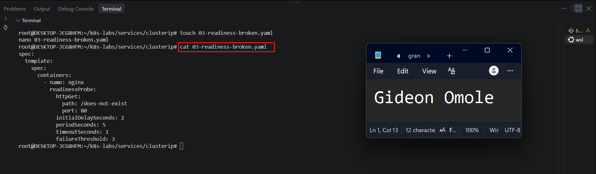

---

#### Screenshot 15 — Output showing the expected incomplete rollout or NotReady Pod

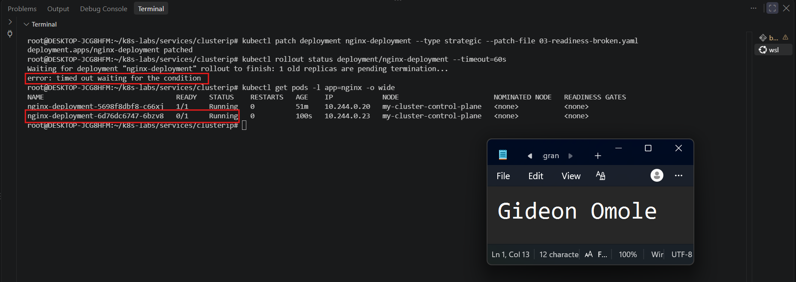

---

#### Screenshot 16 — EndpointSlice output showing the healthy Pod with `ready: true` and the new NotReady Pod with `ready: false`

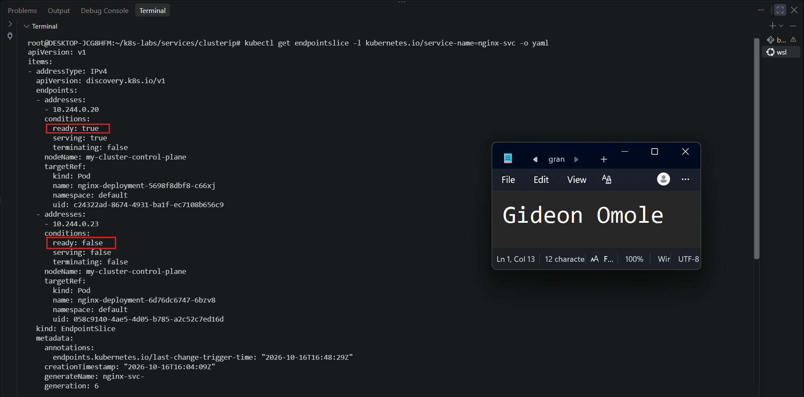

---

#### Screenshot 17 — Service EndpointSlice output showing ready backends after restoring the Deployment

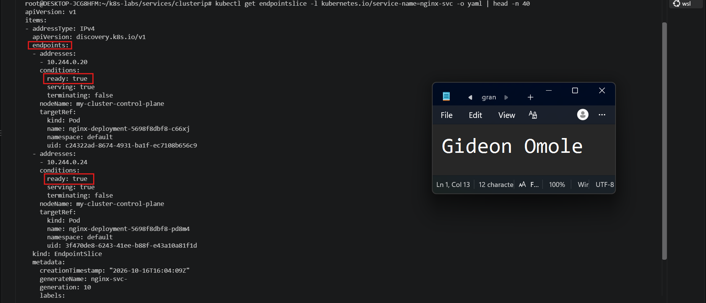

---

### Notes

**1. Why was the new NotReady Pod excluded from ready Service backends?**

The new Pod had a readiness probe that checked `/does-not-exist`, a path that NGINX does not serve. The probe kept failing, so Kubernetes marked the Pod as NotReady (`0/1 READY`). The Service only sends traffic to Pods that are ready, so the EndpointSlice showed this Pod with `ready: false` and it did not receive any requests. The Pod was running, but it was not considered healthy enough to serve traffic.

**2. What is the relationship between readiness probes and Service routing?**

The readiness probe decides whether a Pod can receive traffic from a Service. When the probe passes, the Pod is marked ready and its IP is listed as a ready backend in the EndpointSlice. When the probe fails, the Pod is marked NotReady and is excluded from the ready backends. This happens automatically, and the Pod is added back as soon as its readiness probe passes again.

**3. Why does this behavior protect users from unhealthy application instances?**

It keeps requests away from Pods that cannot handle them yet. In this test, the old healthy Pod kept serving traffic while the new broken Pod was left out, so the `wget` request to `http://nginx-svc` still worked. In a real application, this means a bad update or a Pod that is still starting up will not cause errors for users. Because of `maxUnavailable: 0`, the old healthy Pod was also not removed until a working replacement was ready.

---

# Task 7 — Share Your ClusterIP Service Learning on LinkedIn

## Goal

Share what you learned about ClusterIP Services, Kubernetes DNS, selectors, and readiness-aware Service routing.

### Evidence

#### Screenshot 18 — Published LinkedIn post

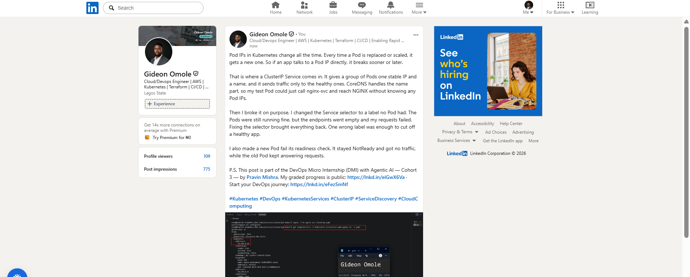

#### Linkedin post link

[Paste your link here](https://www.linkedin.com/posts/gideon-omole-5ba318180_kubernetes-devops-kubernetesservices-share-7516909953811369984-d-nY/?rcm=ACoAACrC7l4BK-z0pGwSRQMO8ZJ5pFZyqybbIk4)

---

# Submission Instructions

- Add all required screenshots numbered 1–18.
- Ensure your full name is visible in required screenshots.
- Use clear, readable screenshots showing the relevant manifest or output.
- Include the completed NGINX Deployment and ClusterIP Service manifests in your repository.
- Answer all Notes questions for Tasks 1–6 in your own words.
- Include evidence of the intentional failures and successful recovery.
- Do not expose tokens, passwords, kubeconfig files, account IDs, or other sensitive information.

---

# Completion Checklist

- [ ] Learning-cluster context confirmed and previous lab resources removed where applicable
- [ ] ClusterIP lab directory created (Screenshot 1)
- [ ] Healthy NGINX Deployment manifest completed (Screenshot 2)
- [ ] Successful rollout and two ready NGINX Pods verified (Screenshot 3)
- [ ] ClusterIP Service manifest completed (Screenshot 4)
- [ ] Service and backend endpoints or EndpointSlices verified (Screenshot 5)
- [ ] Client Pod created and running (Screenshot 6)
- [ ] Service accessed using DNS name and ClusterIP (Screenshot 7)
- [ ] Service DNS resolution verified (Screenshot 8)
- [ ] Broken selector manifest created (Screenshot 9)
- [ ] Empty endpoints observed (Screenshot 10)
- [ ] Failed Service request captured (Screenshot 11)
- [ ] Original selector restored and connectivity verified (Screenshot 12)
- [ ] Deployment scaled to one ready Pod (Screenshot 13)
- [ ] Broken readiness patch created (Screenshot 14)
- [ ] Incomplete rollout or NotReady Pod observed (Screenshot 15)
- [ ] Readiness effect on Service backends verified (Screenshot 16)
- [ ] Deployment restored and ready Service backends verified (Screenshot 17)
- [ ] LinkedIn post published (Screenshot 18)
- [ ] Notes for Tasks 1–6 completed
- [ ] Required manifests included
- [ ] All required screenshots are clear and readable
- [ ] No sensitive data exposed

---

## 📌 About DMI & CloudAdvisory

DevOps Micro Internship (DMI) is a project-based DevOps program run by Pravin Mishra (The CloudAdvisory) focused on real-world execution, systems thinking, and career readiness.

It helps learners build strong DevOps foundations with hands-on experience.

---

## 📌 Resources

- 🌐 DMI Official Website: https://dmi.pravinmishra.com?utm_source=github&utm_medium=readme  
- 🎓 University: https://university.pravinmishra.com?utm_source=github&utm_medium=readme  
- 💬 Discord Community: https://discord.pravinmishra.com?utm_source=github&utm_medium=readme  
- 📝 Blog: https://dmi.pravinmishra.com/blog?utm_source=github&utm_medium=readme  
- ▶️ YouTube Playlist: https://www.youtube.com/playlist?list=PLFeSNDtI4Cho  
- 🔗 Pravin Mishra (LinkedIn): https://www.linkedin.com/in/pravin-mishra-aws-trainer/  
- 🏢 CloudAdvisory (LinkedIn): https://www.linkedin.com/company/thecloudadvisory/

---

*This submission is part of DevOps Micro Internship (DMI) — Agentic AI Track.*
