# Assignment 8 — Kubernetes Services (NodePort)

Part of the DevOps Micro Internship (DMI) with Agentic AI

---

## Purpose

Create a healthy NGINX Deployment, expose it through a NodePort Service, test access using a node IP and NodePort, and observe how the Service behaves when a backend Pod is replaced.

---

# Task 1 — Set Up Your Lab Directory

## Goal

Create and enter a dedicated directory for the NodePort Service lab.

### Evidence

#### Screenshot 1 — Terminal showing that you are working inside `~/k8s-labs/services/nodeport`

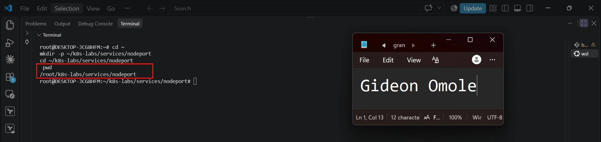

### Notes

**1. What is the difference between ClusterIP and NodePort?**

A ClusterIP Service is reachable only from inside the cluster. It gives a group of Pods a stable internal IP and DNS name, so other Pods can call it, but nothing outside the cluster can. A NodePort Service does everything a ClusterIP Service does, and it also opens the same port on every node in the cluster (30000 to 32767 by default). This means it can be reached from outside the cluster too, using `<NodeIP>:<NodePort>`. NodePort is built on top of ClusterIP, so a NodePort Service also gets its own ClusterIP.

**2. What does a NodePort Service allow users to do?**

A NodePort Service allows users to reach an application from outside the cluster without any extra tools. They can open `<NodeIP>:<NodePort>` in a browser or send a request to it, and Kubernetes forwards the traffic to one of the ready Pods behind the Service. For example, if the NGINX Service used NodePort 30080, a user on a laptop could open `http://<node-ip>:30080` to see the NGINX page. This is useful for testing and demos. For real production traffic, a LoadBalancer Service or an Ingress is usually a better choice.

---

# Task 2 — Create a Healthy NGINX Deployment

## Goal

Create a healthy NGINX Deployment that can act as the backend for the NodePort Service.

### Evidence

#### Screenshot 2 — Completed `00-nginx-deploy.yaml` manifest

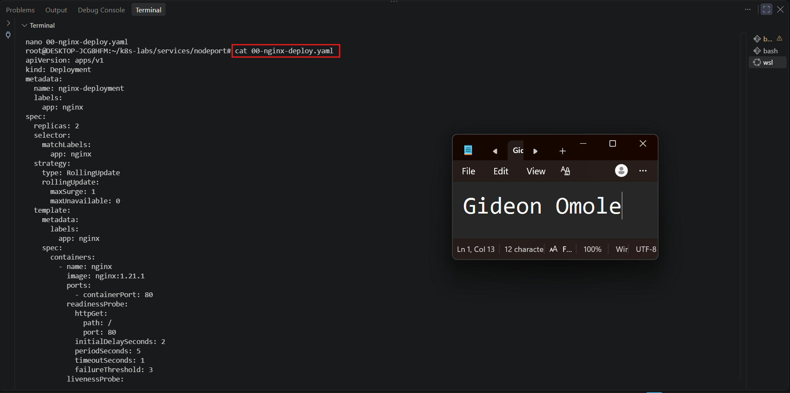

---

#### Screenshot 3 — Output showing successful rollout and two ready NGINX Pods

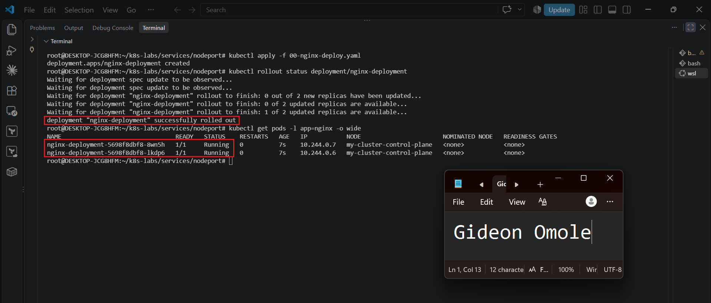

### Notes

**1. Which label will the NodePort Service use to find the NGINX Pods?**

The NodePort Service uses the label `app: nginx`. The Service's `selector` field is set to `app: nginx`, which matches the `app: nginx` label defined in the Deployment's Pod template (`spec.template.metadata.labels`). Any Pod carrying this label becomes a candidate backend for the Service.

**2. Why must the Pods be ready before they can receive Service traffic?**

Kubernetes only adds a Pod to a Service's endpoints (EndpointSlice) when its readiness probe passes and the Pod reports `Ready`. A Pod that is still starting, or one whose application is not yet able to answer requests, would return errors or time out if it received traffic. By waiting for readiness, Kubernetes ensures that only healthy, working Pods are eligible backends, so users do not get failed requests. If a Pod later fails its readiness probe, it is removed from the endpoints until it recovers.

**3. What port does the NGINX container listen on?**

The NGINX container listens on port **80**. This is declared as `containerPort: 80` in the Deployment. The readiness and liveness probes also check port 80, and the Service's `targetPort: 80` forwards traffic to it.

---

# Task 3 — Create the NodePort Service

## Goal

Create a NodePort Service that exposes the NGINX application through a port on every cluster node.

### Evidence

#### Screenshot 4 — Completed `01-nginx-svc-nodeport.yaml` manifest

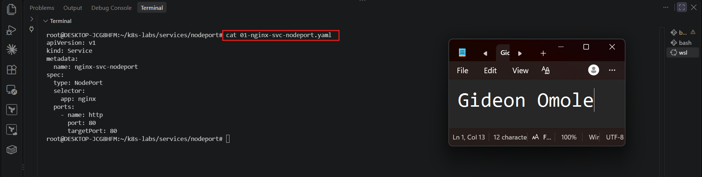

---

#### Screenshot 5 — Output showing the NodePort Service and its endpoints or EndpointSlices

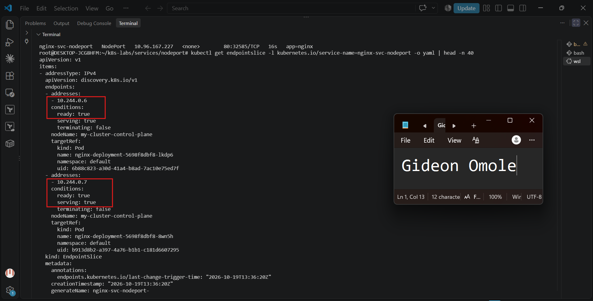

### Notes

**1. What is the purpose of `type: NodePort`?**

`type: NodePort` exposes the Service on a static port on every node in the cluster. Requests sent to `<node-ip>:<node-port>` are forwarded to the Service, which then routes them to matching ready Pods. It gives simple external access without needing a cloud LoadBalancer or Ingress, which makes it useful for labs, development environments, and on-premises clusters. A NodePort Service also gets a ClusterIP, so it remains reachable inside the cluster as well.

**2. What is the difference between `port`, `targetPort`, and `nodePort`?**

- `port` is the port the Service itself listens on, used to reach it through its ClusterIP (here, `80`).
- `targetPort` is the port on the backend Pods where the application actually listens, and where the Service forwards traffic (here, `80`, the NGINX container port).
- `nodePort` is the port opened on every node, used together with a node IP for access from outside the Service's ClusterIP network. It comes from the default range 30000-32767 and is assigned automatically if not specified.

The traffic flow is: `<node-ip>:nodePort` → Service `port` → Pod `targetPort`.

**3. What NodePort was assigned or selected in your environment?**

Kubernetes assigned NodePort **32585** automatically, since I did not specify one in the manifest. It appears in the Service's PORT(S) column as `80:32585/TCP`, and I tested it using the kind node's INTERNAL-IP, `172.20.0.2`.

**4. Why do Service endpoints need ready Pods?**

A Service sends traffic only to the addresses listed in its endpoints (EndpointSlices), and Kubernetes adds a Pod there as ready only after its readiness probe passes. This prevents traffic from reaching a Pod that is still starting or cannot answer requests, which would cause errors or timeouts. If a Pod fails its readiness probe later, it is removed from the endpoints until it recovers. Without any ready Pods, the Service has no usable backends, and NodePort requests fail even though the port is still open on the node.

---

# Task 4 — Find a Node IP and Test the NodePort

## Goal

Find a reachable node IP and access the NodePort Service.

### Evidence

#### Screenshot 6 — Output of `kubectl get nodes -o wide`

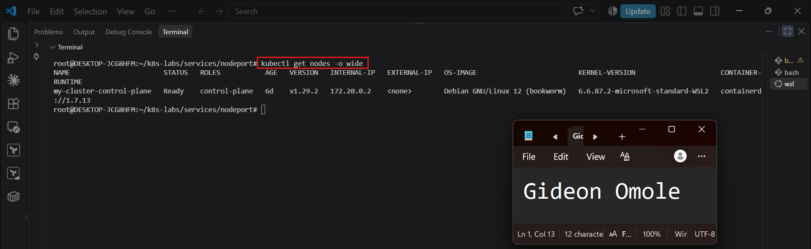

---

#### Screenshot 7 — Output showing the `tester` Pod running

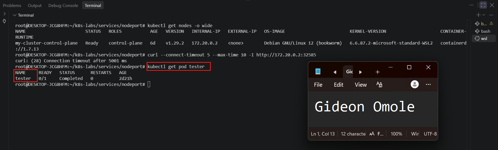

---

#### Screenshot 8 — Successful NodePort response from the laptop or the `tester` Pod

If neither route is supported by your environment, include the failed request output and ready endpoint evidence, and explain the limitation in your Notes.

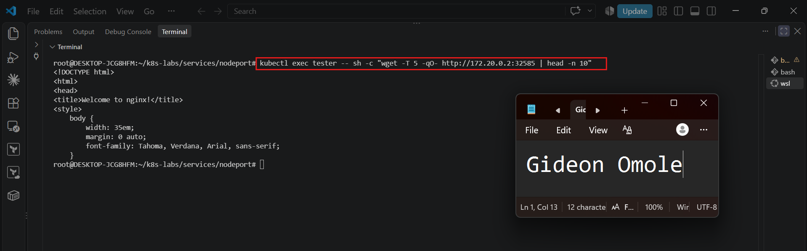

### Notes

**1. Which node IP and NodePort did you test?**

I tested node IP `172.20.0.2`, the INTERNAL-IP of the `my-cluster-control-plane` node, with NodePort `32585`. This NodePort was assigned automatically by Kubernetes and appears as `80:32585/TCP` in the Service's PORT(S) column. I ran the test from both my WSL terminal (laptop) and from inside the cluster using the `tester` Pod.

**2. Was your laptop able to reach the NodePort directly? Explain your result.**

No. My `curl` request to `http://172.20.0.2:32585` timed out after 5 seconds with `Connection timeout`. My cluster is kind running on WSL2, so the node is a Docker container on a private Docker network, and its IP address is not routable from my WSL shell. The Service itself was not the problem: it had ready endpoints, and the same NodePort request from the `tester` Pod inside the cluster network returned the NGINX welcome page. This shows the NodePort works and the limitation comes from the local networking environment.

**3. Why can external NodePort access behave differently in Minikube, kind, Docker Desktop, and cloud clusters?**

A NodePort opens a port on every node, but whether anyone outside the cluster can reach that node IP depends on how the environment's networking is built:

- **kind:** Nodes are Docker containers on a private Docker network. Their IPs are usually not reachable from the host unless extra port mappings are configured.
- **Docker Desktop:** Nodes run inside a managed VM or container, so node IPs are typically not directly routable from the host.
- **Minikube:** Reachability depends on the driver. With a VM driver the node IP may be reachable, but with the Docker driver it often is not, which is why `minikube service <name> --url` creates a tunnel or forwarded URL.
- **Cloud clusters:** Nodes have real VPC IP addresses, and may have public IPs, but security groups and firewall rules must explicitly allow the NodePort range (30000-32767) before outside traffic can reach them.

So the NodePort mechanism is the same everywhere, but node IP routability, NAT, and firewall rules differ between environments.

---

# Task 5 — Optional: Test the Label-Selector Contract

## Goal

Break the Service selector, observe that usable endpoints disappear, and restore the correct selector.

Complete the Evidence and Notes below only if you attempted this optional task.

### Evidence

#### Screenshot 9 — `02-nginx-svc-selector-broken.yaml` showing the incorrect selector

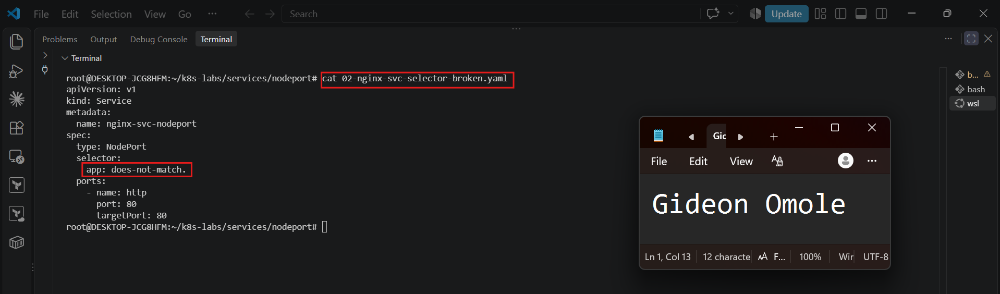

---

#### Screenshot 10 — Empty endpoints or EndpointSlice output after applying the broken selector

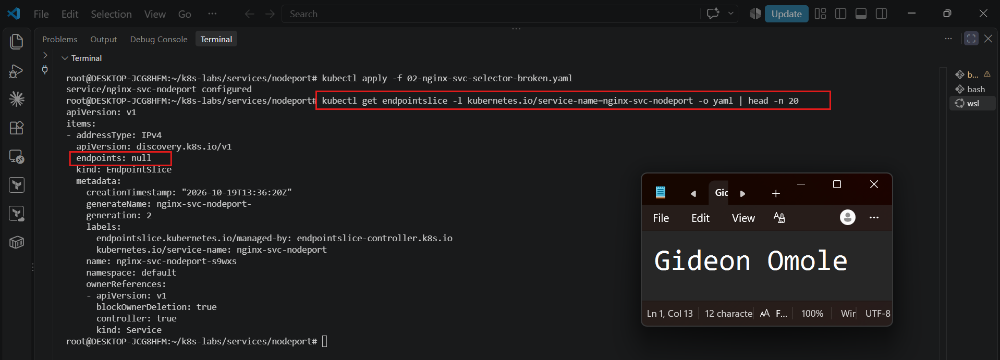

---

#### Screenshot 11 — Restored endpoints or EndpointSlices after applying the original Service manifest

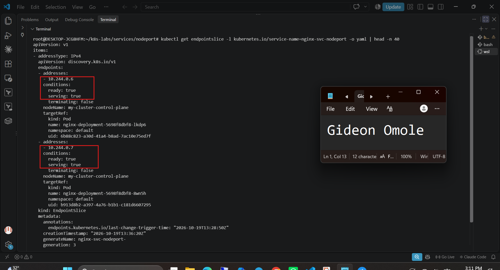

### Notes

**1. Why did the Service endpoints become empty?**

I changed the Service selector from `app: nginx` to `app: does-not-match`. A Service builds its endpoints by selecting Pods whose labels match its selector, and the NGINX Pods only carry the label `app: nginx`. Because no Pod matched the new selector, Kubernetes removed all backend addresses from the Service's EndpointSlice, leaving it with no endpoints. The Pods themselves were still running and healthy, but the Service no longer knew they were its backends.

**2. Why is NodePort only useful when matching ready Pods exist?**

A NodePort is only an entry point. It opens a port on every node and forwards requests to the Service, which then forwards them to one of its endpoints. If no matching ready Pods exist, there is nothing to forward traffic to, so requests fail with a connection refusal or timeout even though the port is still open on the node. The selector and readiness are what connect the external entry point to actual running application Pods.

**3. How did you restore the backend connectivity?**

I fixed the trailing-dot typo in the broken manifest, applied it to observe the empty endpoints, and then re-applied the original manifest with `kubectl apply -f 01-nginx-svc-nodeport.yaml`, which set the selector back to `app: nginx`. I then checked the EndpointSlice with `kubectl get endpointslice -l kubernetes.io/service-name=nginx-svc-nodeport -o yaml` and confirmed that both NGINX Pod addresses returned with `ready: true`. A request from the `tester` Pod to `172.20.0.2:32585` succeeded again.

---

# Task 6 — Observe Resilience During Pod Churn

## Goal

Delete one NGINX Pod and observe its replacement while the Service continues routing traffic to available Pods.

### Evidence

#### Screenshot 12 — Output of the Pod deletion command

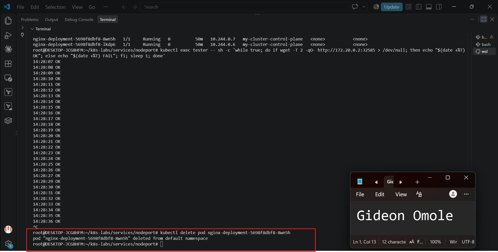

---

#### Screenshot 13 — Output showing the replacement Pod and two running, ready Pods

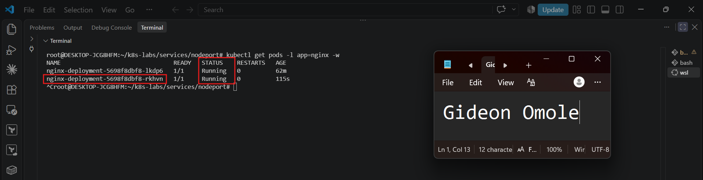

### Notes

**1. What happened after you deleted one Pod?**

The selected NGINX Pod moved to `Terminating` and was removed. Almost immediately, a new Pod appeared with a different name, went from `Pending` to `ContainerCreating` to `Running`, and became `1/1 READY` once its readiness probe passed. After a short time, `kubectl get pods -l app=nginx -o wide` showed two Running and Ready Pods again, and the EndpointSlice listed both addresses with `ready: true`. The repeated requests kept returning `OK` through the remaining Pod, with only a brief failure, if any, during the switchover.

**2. Which Kubernetes resource created the replacement Pod?**

The ReplicaSet created by `nginx-deployment` created the replacement Pod. The Deployment declares `replicas: 2`, and its ReplicaSet continuously compares the desired number of Pods with the actual number. When I deleted one Pod, the count dropped to one, so the ReplicaSet created a new Pod to restore the desired state of two.

**3. Why can the NodePort Service continue working during Pod churn?**

The Service does not depend on any single Pod. It routes traffic to whichever Pods are listed as ready in its EndpointSlice, selected by the label `app: nginx`. When one Pod was deleted, it was removed from the endpoints, but the other Pod stayed ready and kept serving requests. When the replacement Pod passed its readiness probe, it was added to the endpoints automatically. Because the selector matches labels rather than specific Pod names, the Service adapts to Pods being replaced without any change to the Service itself.

---

# Task 7 — Share Your NodePort Learning on LinkedIn

## Goal

Share what you learned about NodePort Services, backend Pods, and network access in your Kubernetes environment.

### Evidence

#### Screenshot 14 — Published LinkedIn post about your NodePort Service lab

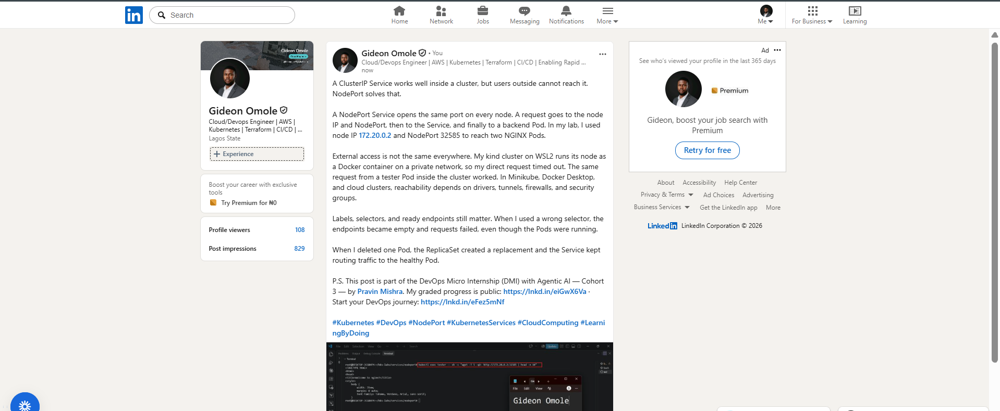

#### Linkedin post link

[Add your Linkdin post link.](https://www.linkedin.com/posts/gideon-omole-5ba318180_kubernetes-devops-nodeport-share-7517958266098982912-m9LF/?rcm=ACoAACrC7l4BK-z0pGwSRQMO8ZJ5pFZyqybbIk4)

---

# Submission Instructions

- Include the completed YAML manifests created during the lab.
- Add all required screenshots: Screenshots 1–8 and 12–14.
- Include Screenshots 9–11 only if you attempted optional Task 5.
- Complete the Notes for Tasks 1–4 and Task 6.
- Complete Task 5 Notes only if you attempted that task.
- Use clear, readable screenshots showing the relevant commands and outputs.
- Ensure your full name is visible in the required screenshots.
- If NodePort access is restricted by your environment, include the failed request output, ready endpoint evidence, and an explanation.
- Do not expose passwords, access tokens, private keys, kubeconfig contents, or account IDs.

---

# Completion Checklist

- [ ] Created and entered `~/k8s-labs/services/nodeport` (Screenshot 1)
- [ ] Created and applied the NGINX Deployment manifest (Screenshot 2)
- [ ] Confirmed successful rollout and two ready NGINX Pods (Screenshot 3)
- [ ] Created the NodePort Service manifest (Screenshot 4)
- [ ] Verified the Service and its endpoints or EndpointSlices (Screenshot 5)
- [ ] Recorded the assigned or selected NodePort
- [ ] Identified a node IP (Screenshot 6)
- [ ] Confirmed that the `tester` Pod is running (Screenshot 7)
- [ ] Tested NodePort access, or documented the environment limitation with evidence (Screenshot 8)
- [ ] Optional: Tested and restored the Service selector (Screenshots 9–11)
- [ ] Deleted one NGINX Pod (Screenshot 12)
- [ ] Confirmed the replacement Pod and two running, ready Pods (Screenshot 13)
- [ ] Completed all required Notes
- [ ] Published the LinkedIn post (Screenshot 14)
- [ ] No sensitive data exposed

---

## 📌 About DMI & CloudAdvisory

DevOps Micro Internship (DMI) is a project-based DevOps program run by Pravin Mishra (The CloudAdvisory) focused on real-world execution, systems thinking, and career readiness.

It helps learners build strong DevOps foundations with hands-on experience.

---

## 📌 Resources

- 🌐 DMI Official Website: https://dmi.pravinmishra.com?utm_source=github&utm_medium=readme  
- 🎓 University: https://university.pravinmishra.com?utm_source=github&utm_medium=readme  
- 💬 Discord Community: https://discord.pravinmishra.com?utm_source=github&utm_medium=readme  
- 📝 Blog: https://dmi.pravinmishra.com/blog?utm_source=github&utm_medium=readme  
- ▶️ YouTube Playlist: https://www.youtube.com/playlist?list=PLFeSNDtI4Cho  
- 🔗 Pravin Mishra (LinkedIn): https://www.linkedin.com/in/pravin-mishra-aws-trainer/  
- 🏢 CloudAdvisory (LinkedIn): https://www.linkedin.com/company/thecloudadvisory/

---

*This submission is part of DevOps Micro Internship (DMI) — Agentic AI Track.*
