# Assignment 09 — Kubernetes Services: LoadBalancer on AKS

Part of the DevOps Micro Internship (DMI) with Agentic AI

---

## Purpose

Deploy a healthy NGINX application to Azure Kubernetes Service (AKS), expose it publicly using a LoadBalancer Service, observe readiness behavior, and scale the application behind the same public endpoint.

---

# Task 1 — Create or Connect to an AKS Cluster

## Goal

Create a small AKS cluster for this lab, or connect to an existing approved AKS lab cluster.

### Evidence

#### Screenshot 1 — Output of `kubectl get nodes` showing ready AKS node(s)

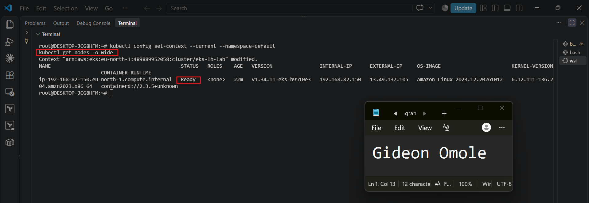

### Notes

**1. Why does this lab use a cloud-capable Kubernetes environment such as AKS for the LoadBalancer Service?**

A LoadBalancer Service asks the cloud provider to create an external load balancer and public address. Local clusters (Minikube, kind) have no cloud controller to do that, so the external address would stay pending. EKS has the AWS integration built in.

**2. What Azure resources can Kubernetes provision when a LoadBalancer Service is created?**

An AWS Elastic Load Balancer (by default a Classic Load Balancer with a DNS name ending in .elb.amazonaws.com), its listener on port 80, health checks and the security group rules that allow the traffic to reach the nodes.

**3. Why is it important to delete unused AKS resources after the lab?**

The EKS control plane, the EC2 node, the NAT gateway and the load balancer are all billed by the hour while they exist, even when idle. Deleting the cluster removes them and avoids unexpected charges.

---

# Task 2 — Set Up Your Lab Directory

## Goal

Create and enter a dedicated directory for the LoadBalancer Service manifests.

### Evidence

#### Screenshot 2 — Terminal showing the output of `pwd` confirming that you are working inside `~/k8s-labs/services/loadbalancer`

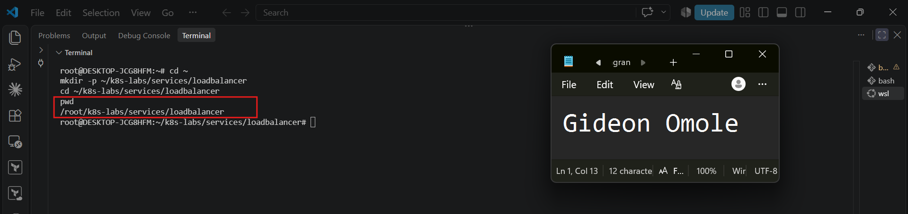

### Notes

**1. Why is it useful to keep Kubernetes manifests organized in dedicated directories?**

 It keeps related files together, makes them easy to find, version-control and reuse, avoids mixing labs, and makes team handover and cleanup simpler.

**2. What are the names of the main Deployment and LoadBalancer Service YAML files you will create in this assignment?**

1. File names: 00-nginx-deploy.yaml (Deployment) and 01-nginx-svc-loadbalancer.yaml (LoadBalancer Service). A third patch file, 02-readiness-broken.yaml, is used in Task 5.

---

# Task 3 — Deploy a Healthy NGINX Application

## Goal

Create a healthy NGINX Deployment with readiness and liveness probes.

### Evidence

#### Screenshot 3 — Completed `00-nginx-deploy.yaml` manifest

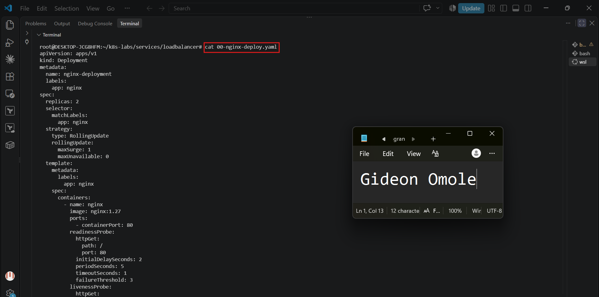

---

#### Screenshot 4 — Output showing successful rollout and two ready NGINX Pods

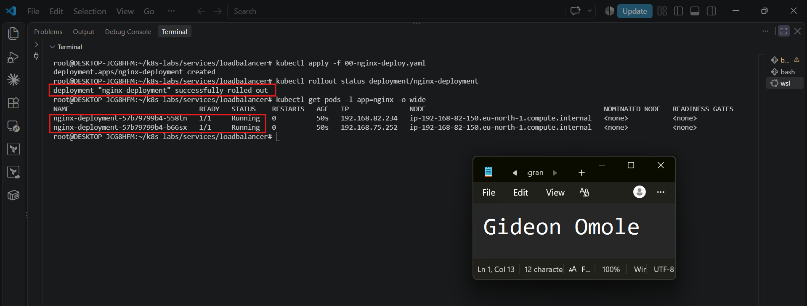

### Notes

**1. Why must Pods be ready before they should receive public traffic?**

A running container may still be starting, loading config or failing. Sending users to it would cause errors or timeouts. Readiness makes sure only Pods that can actually answer receive requests.

**2. What is the role of the readiness probe in this Deployment?**

it calls GET / on port 80 every 5 seconds. While it fails, the Pod is marked not Ready and removed from the Service's ready endpoints. The container is not restarted.

**3. What is the role of the liveness probe in this Deployment?**

it calls GET / every 10 seconds. If it fails 3 times in a row, the kubelet restarts the container, which recovers it from a hung or broken state.

---

# Task 4 — Create and Test the LoadBalancer Service

## Goal

Create a public LoadBalancer Service and verify that the NGINX application is reachable from the internet.

### Evidence

#### Screenshot 5 — Completed `01-nginx-svc-loadbalancer.yaml` manifest

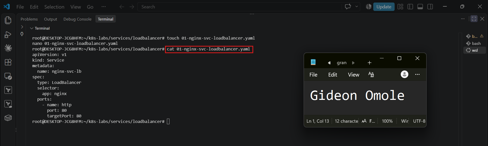

---

#### Screenshot 6 — Output showing the Service with an assigned EXTERNAL-IP

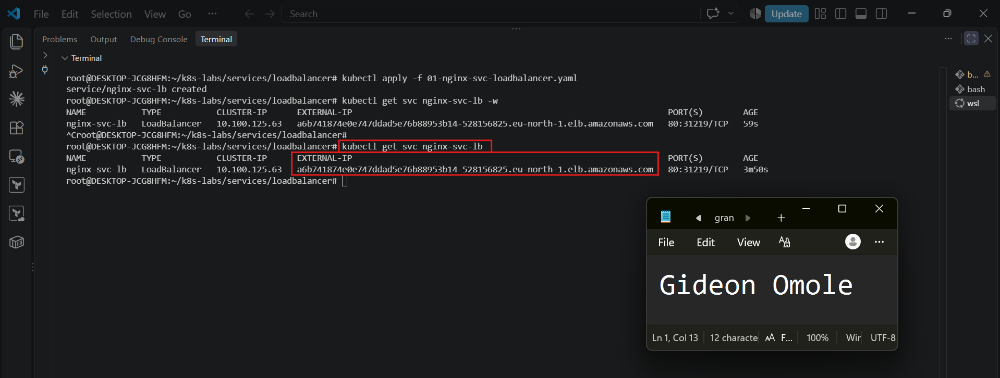

---

#### Screenshot 7 — Successful curl output from the public IP

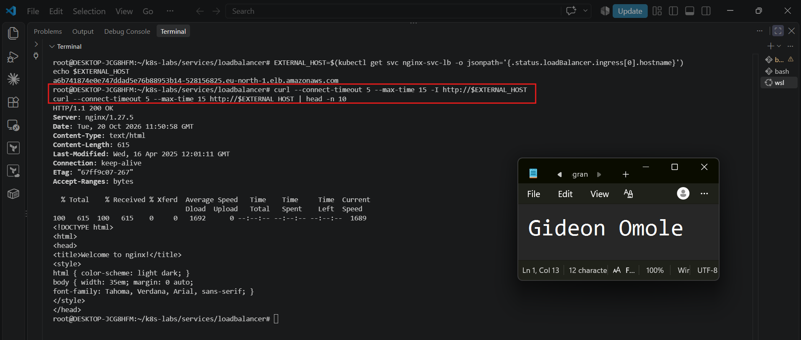

### Notes

**1. What does `type: LoadBalancer` instruct AKS to do?**

 It tells EKS to create an AWS load balancer with a public DNS name and rules forwarding the Service port into the cluster, so the app is reachable from the internet.

**2. What public IP was assigned to your Service?**

The assigned address was a6b741874e0e747ddad5e76b88953b14-528156825.eu-north-1.elb.amazonaws.com. The assignment says IP; on AWS it is a DNS name.

**3. How does the public request eventually reach the NGINX Pods?**

1. Request path: user, then the AWS load balancer hostname, then a worker node, then the Service (port 80), which selects ready endpoints with label app: nginx, then targetPort 80 of an NGINX Pod, which answers.

**4. Why should you wait for EXTERNAL-IP before testing the Service?**

Until AWS finishes provisioning there is no public address, and right after it appears DNS and health checks need a minute, so earlier requests fail or time out.

---

# Task 5 — Observe How Readiness Protects Public Traffic

## Goal

Intentionally break readiness and observe how Kubernetes excludes unready Pods from ready Service backends while existing healthy Pods continue serving public traffic.

### Evidence

#### Screenshot 8 — Completed `02-readiness-broken.yaml` patch file

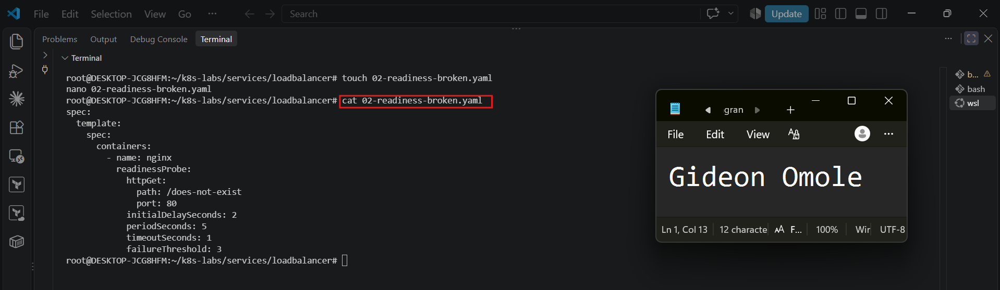

---

#### Screenshot 9 — Output showing the expected incomplete rollout or readiness failure

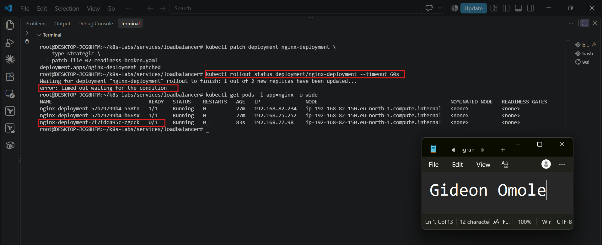

---

#### Screenshot 10 — EndpointSlice output showing ready healthy backends and the effect of the readiness failure

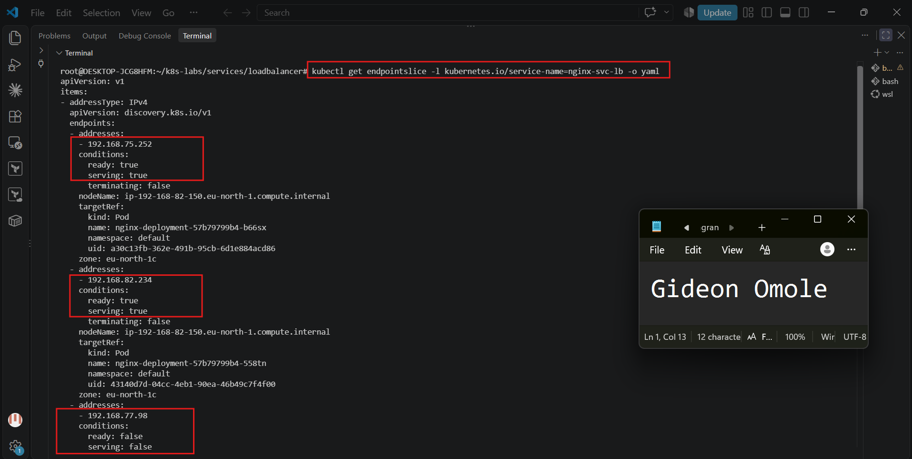

---

#### Screenshot 11 — Successful public curl response after recovery

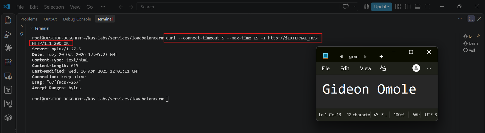

### Notes

**1. Why did the rollout not complete?**

The patched readiness probe checks /does-not-exist, which NGINX answers with 404. The new Pod never became Ready, so the Deployment could not finish replacing the old Pods.

**2. Why can the public endpoint still work while new Pods fail readiness?**

maxUnavailable: 0 stops Kubernetes from removing old Pods until a new one is Ready. The two old, healthy Pods stay in the Service endpoints and keep answering requests.

**3. What would happen if Kubernetes routed traffic to Pods before they were ready?**

Users would get errors, timeouts or incomplete responses during startup or failure, causing downtime on every deployment.

**4. How did you restore the Deployment successfully?**

I reapplied the original manifest with kubectl apply -f 00-nginx-deploy.yaml, which put back the correct readiness probe (/), waited for rollout status, and verified two ready Pods, ready endpoints and a working curl.

---

# Task 6 — Scale the Deployment Behind the Load Balancer

## Goal

Scale the NGINX Deployment and confirm that more ready Pods become available behind the same public endpoint.

### Evidence

#### Screenshot 12 — Two ready NGINX Pods verified initially; four ready Pods verified after scaling

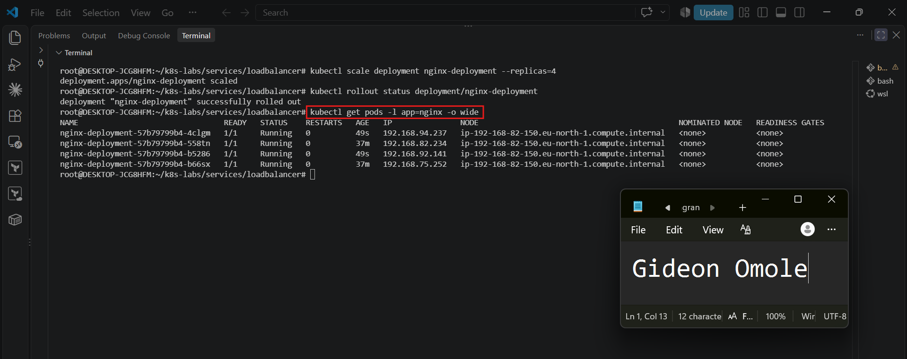

---

#### Screenshot 13 — Successful public curl response after scaling

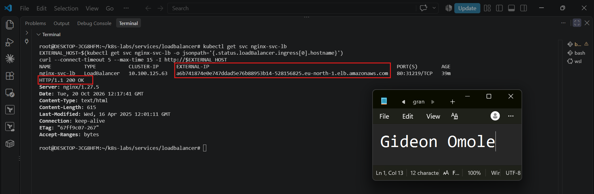

### Notes

**1. What changed after scaling the Deployment from two to four replicas?**

The Deployment now runs four Pods instead of two, and the Service has four ready endpoints to share traffic.

**2. Did the public IP change after scaling? Explain why or why not.**

No. The hostname belongs to the Service and the AWS load balancer, not to individual Pods. Scaling only changes the backends behind it.

**3. Why does scaling behind a LoadBalancer Service not require users to change the URL or IP they use?**

Clients talk to the stable Service IP; the Service selector automatically picks up new Pods that match app: nginx and are ready, so scaling is invisible to users.

---

# Task 7 — Share Your LoadBalancer Lab on LinkedIn

## Goal

Share what you learned about exposing an NGINX application publicly through a LoadBalancer Service on AKS.

### Evidence

#### Screenshot 14 — Published LinkedIn post about your LoadBalancer lab on AKS

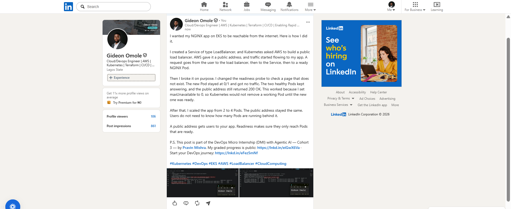

#### LinkedIn post link

[Add your link here.](https://www.linkedin.com/posts/gideon-omole-5ba318180_kubernetes-devops-eks-ugcPost-7518294439585366016-p1G4/?rcm=ACoAACrC7l4BK-z0pGwSRQMO8ZJ5pFZyqybbIk4)

---

# Submission Instructions

- Include the completed YAML files:
  - `00-nginx-deploy.yaml`
  - `01-nginx-svc-loadbalancer.yaml`
  - `02-readiness-broken.yaml`
- Add all required screenshots, numbered 1–14, under their corresponding Evidence sections.
- Use clear, readable screenshots showing the relevant commands, configuration, and outputs.
- Ensure your full name is visible in the required screenshots.
- Complete the Notes for Tasks 1–6 in your own words.
- Capture all required evidence before cleaning up Azure resources.
- Plan or complete Azure cleanup according to your lab ownership and reuse arrangements.
- Do not expose passwords, tokens, private keys, cluster credentials, kubeconfig contents, subscription IDs, account IDs, or infrastructure details you are not permitted to share.

---

# Completion Checklist

- [ ] Created or connected to an approved AKS lab cluster
- [ ] Confirmed ready AKS node(s) (Screenshot 1)
- [ ] Created and entered the LoadBalancer lab directory (Screenshot 2)
- [ ] Created the NGINX Deployment manifest (Screenshot 3)
- [ ] Verified successful rollout and two ready NGINX Pods initially (Screenshot 4)
- [ ] Created the LoadBalancer Service manifest (Screenshot 5)
- [ ] Verified the assigned external IP (Screenshot 6)
- [ ] Verified successful public access using curl (Screenshot 7)
- [ ] Created the broken readiness patch (Screenshot 8)
- [ ] Observed the expected incomplete rollout or readiness failure (Screenshot 9)
- [ ] Inspected EndpointSlices during the readiness failure (Screenshot 10)
- [ ] Restored the healthy Deployment and verified public access (Screenshot 11)
- [ ] Scaled the Deployment to four ready Pods and verified updated Service backends (Screenshot 12)
- [ ] Verified public access after scaling (Screenshot 13)
- [ ] Completed the Notes for Tasks 1–6
- [ ] Published the LinkedIn post (Screenshot 14)
- [ ] Included all required YAML files and screenshots
- [ ] Planned or completed Azure cleanup
- [ ] No sensitive data exposed

---

## 📌 About DMI & CloudAdvisory

DevOps Micro Internship (DMI) is a project-based DevOps program run by Pravin Mishra (The CloudAdvisory) focused on real-world execution, systems thinking, and career readiness.

It helps learners build strong DevOps foundations with hands-on experience.

---

## 📌 Resources

- 🌐 DMI Official Website: https://dmi.pravinmishra.com?utm_source=github&utm_medium=readme  
- 🎓 University: https://university.pravinmishra.com?utm_source=github&utm_medium=readme  
- 💬 Discord Community: https://discord.pravinmishra.com?utm_source=github&utm_medium=readme  
- 📝 Blog: https://dmi.pravinmishra.com/blog?utm_source=github&utm_medium=readme  
- ▶️ YouTube Playlist: https://www.youtube.com/playlist?list=PLFeSNDtI4Cho  
- 🔗 Pravin Mishra (LinkedIn): https://www.linkedin.com/in/pravin-mishra-aws-trainer/  
- 🏢 CloudAdvisory (LinkedIn): https://www.linkedin.com/company/thecloudadvisory/

---

*This submission is part of DevOps Micro Internship (DMI) — Agentic AI Track.*
