# Assignment 10 — Capstone: Deploy the Book Review App to Kubernetes

Part of the DevOps Micro Internship (DMI) with Agentic AI

---

## Purpose

Deploy the Book Review App as a production-style three-tier application using Kubernetes manifests or Helm charts, with an accessible frontend, an internal backend, and a managed or persistent MySQL database.

---

## Submission Details

**Full Name:** Gideon Omole

**Kubernetes Platform:** Amazon EKS

**Namespace:** book-review

**Frontend URL or IP:** http://ae260b588b6974050ac42d0d0c327efb-1491935220.eu-north-1.elb.amazonaws.com

**Access Method:** Public LoadBalancer

**GitHub Manifests or Helm Chart URL:** https://github.com/Gideon-Omole/book-review-app

**Architecture Diagram:** 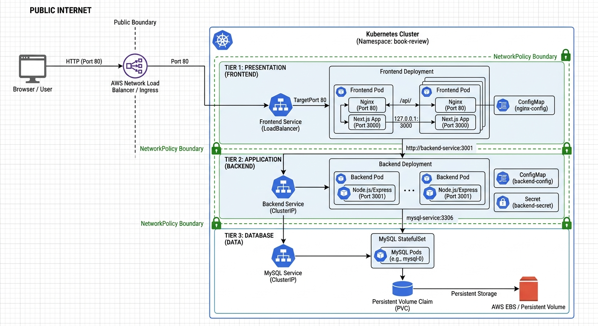

---

# Task 1 — Prepare the Kubernetes Cluster and Project

## Goal

Prepare the cluster, application source, container images, and tooling needed for the deployment.

### Evidence

#### Screenshot 1 — Active Kubernetes context and Ready nodes

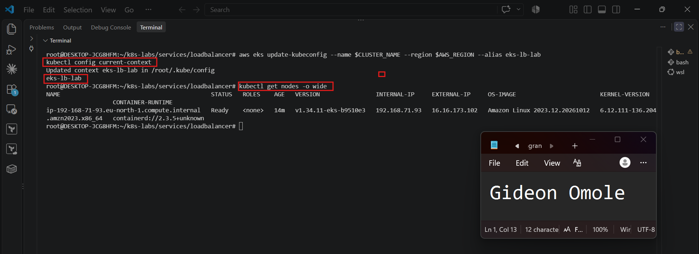

---

#### Screenshot 2 — If using Helm: Output of `helm version`

Required only if you choose Helm. Skip this screenshot if using YAML manifests.

Not applicable — using YAML manifests

---

# Task 2 — Design the Three-Tier Kubernetes Architecture

## Goal

Document the workloads, networking, configuration, storage, and permitted communication paths before deployment.

### Evidence

#### Screenshot 3 — Completed Kubernetes architecture diagram

---

# Task 3 — Create ConfigMaps and Secrets

## Goal

Provide application configuration and credentials without embedding sensitive values in images or committing them to Git.

### Evidence

#### Screenshot 4 — ConfigMap configuration or describe output showing non-sensitive values

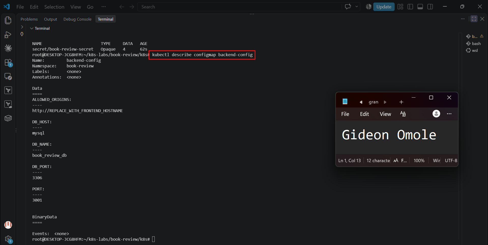

---

#### Screenshot 5 — Secret references or describe output showing names and keys without sensitive values

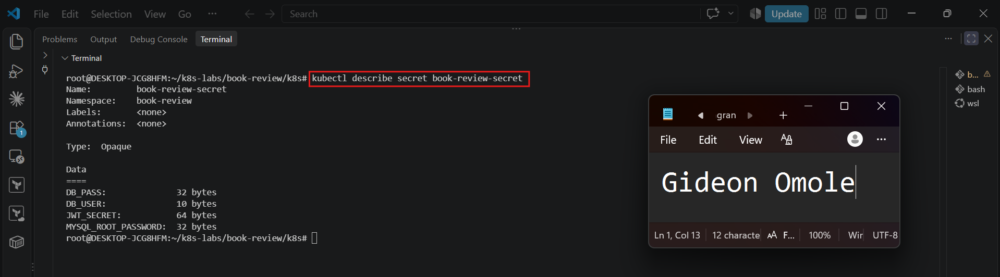

---

# Task 4 — Deploy and Configure the MySQL Data Tier

## Goal

Provide persistent MySQL storage and allow the backend to connect without exposing the database publicly.

### Evidence

#### Screenshot 6 — Managed MySQL status or MySQL StatefulSet and PVC status

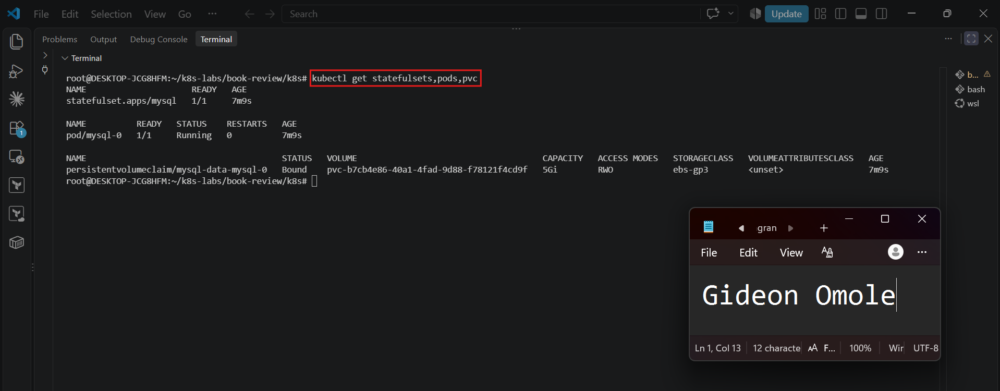

---

#### Screenshot 7 — Successful database connectivity or schema verification with credentials hidden

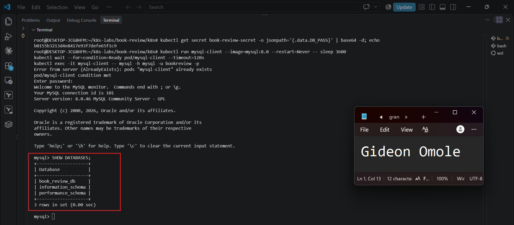

---

# Task 5 — Deploy the Backend Application Tier

## Goal

Run one or two Node.js/Express backend replicas on port 3001 and expose them through an internal ClusterIP Service.

### Evidence

#### Screenshot 8 — Backend Deployment, ready Pods, and internal Service

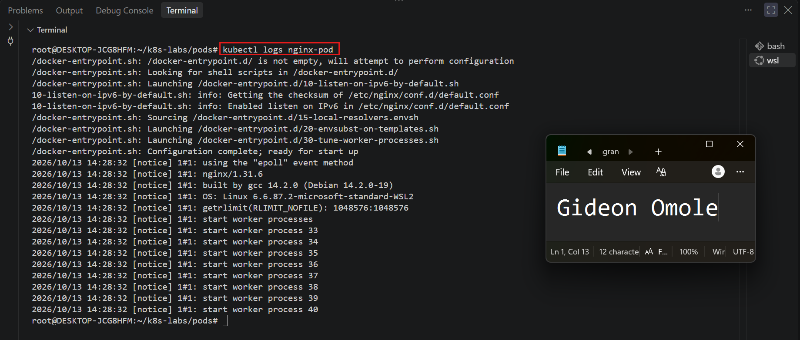

---

#### Screenshot 9 — Backend startup logs and database connectivity evidence

If the application does not log successful database connections, provide a successful database-backed request alongside the startup logs.

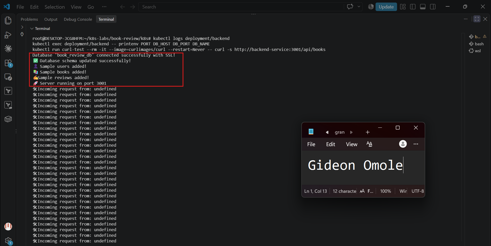
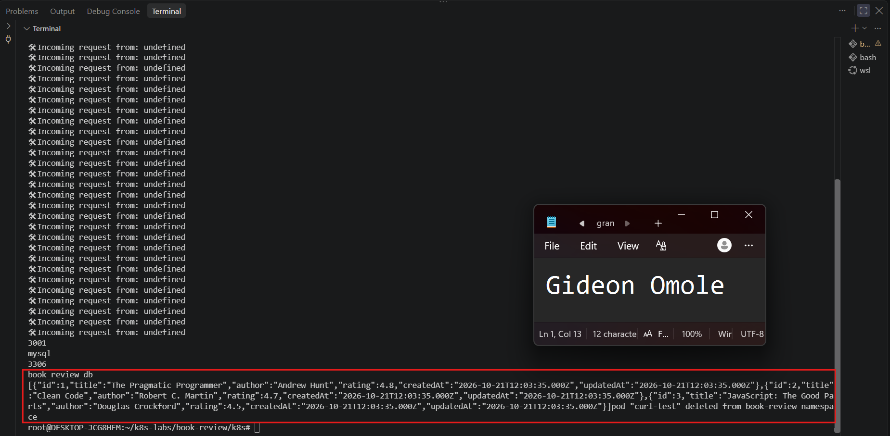

---

# Task 6 — Deploy the Frontend and Configure Nginx

## Goal

Run the Next.js frontend behind Nginx on port 80 and proxy API requests to the internal backend Service.

### Evidence

#### Screenshot 10 — Frontend Deployment and Ready Pods

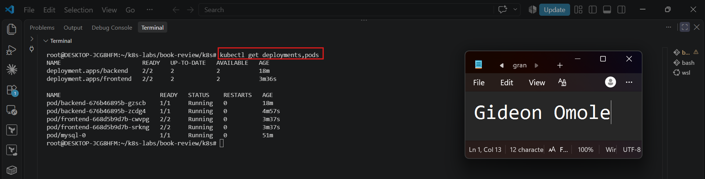

---

#### Screenshot 11 — Nginx reverse-proxy configuration showing the internal backend Service name and port 3001

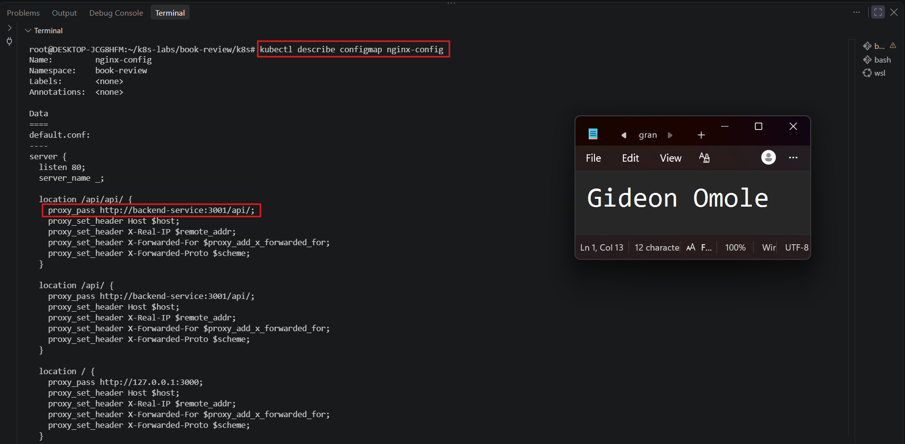

---

# Task 7 — Configure External and Internal Networking

## Goal

Expose the frontend and enforce the intended communication path between application tiers.

### Evidence

#### Screenshot 12 — Frontend LoadBalancer or Ingress configuration and assigned endpoint, or documented local access method

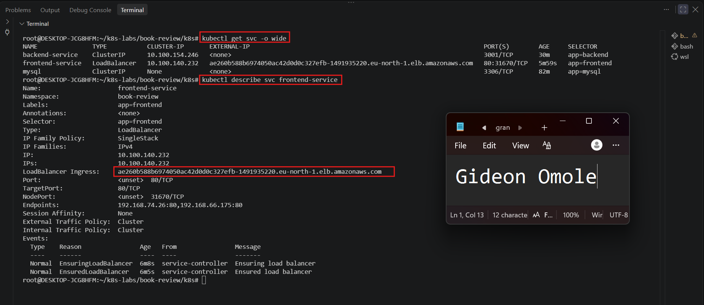

---

#### Screenshot 13 — Internal backend Service and NetworkPolicy or equivalent restriction, with access-test evidence

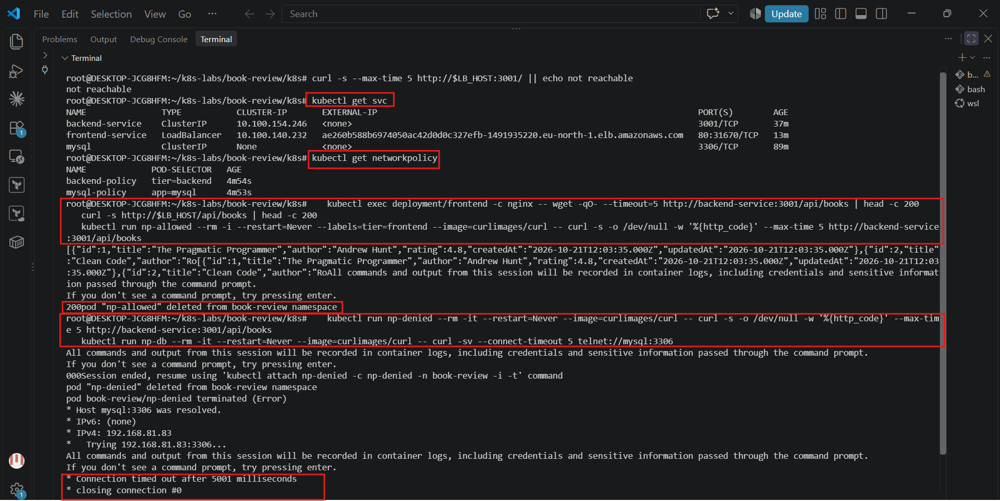

---

# Task 8 — Validate the Application End to End

## Goal

Prove that the frontend, backend, and MySQL database work together and collect operational evidence.

### Evidence

#### Screenshot 14 — `kubectl get all` output for the book-review namespace

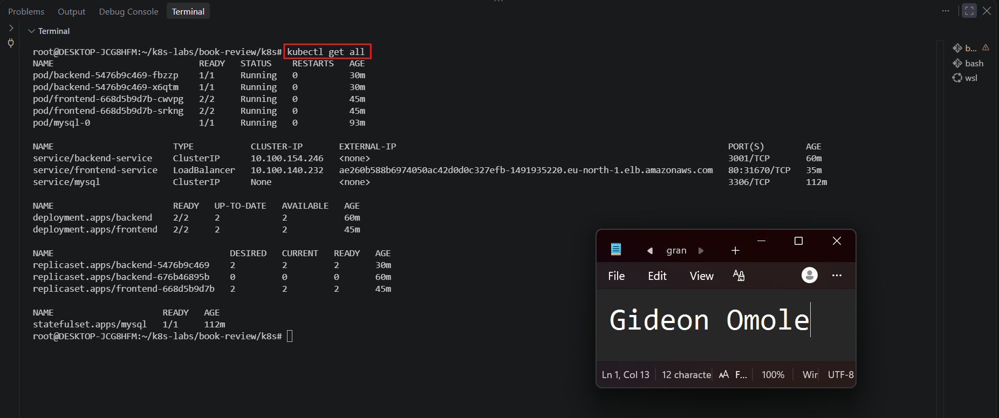

---

#### Screenshot 15 — Functional Book Review App in the browser with the URL visible, including evidence of a successful user flow

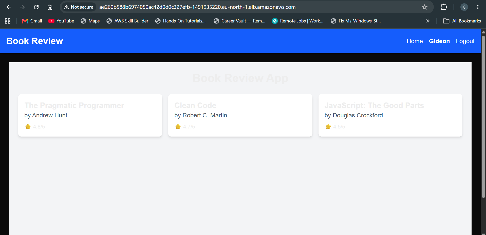

---

#### Screenshot 16 — Frontend or Nginx container logs

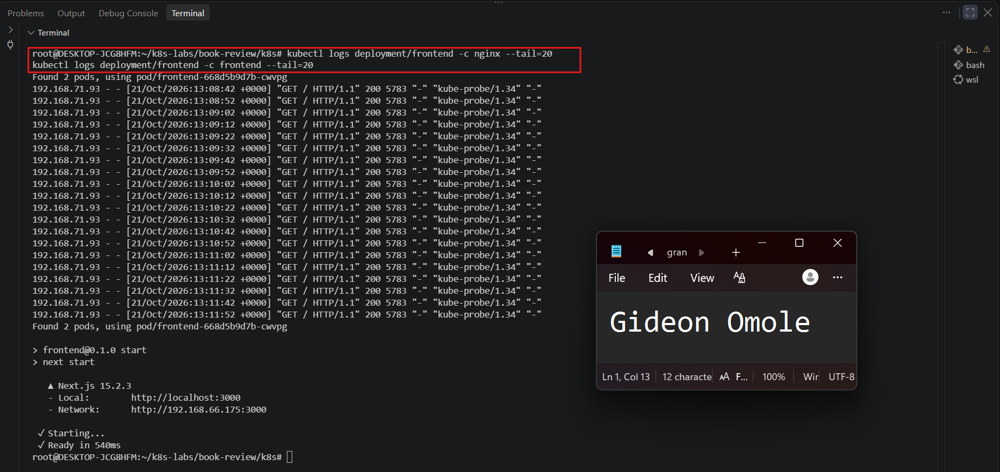

---

#### Screenshot 17 — Backend logs and evidence of a successful database-backed operation

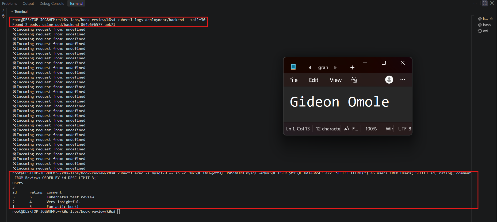

---

#### Screenshot 18 — Optional: Kubernetes dashboard

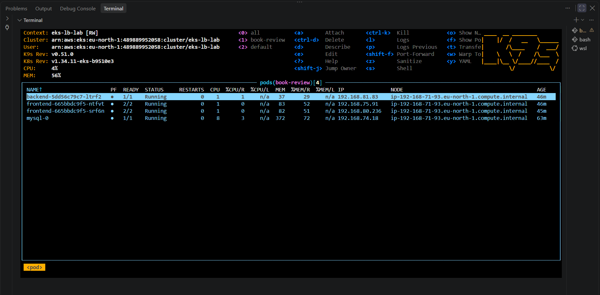

Multiple images may be included under a screenshot number when needed to demonstrate the complete user flow.

---

# Task 9 — Optional: Implement Production Improvements

## Goal

Add selected improvements without breaking the required three-tier architecture.

### Evidence

#### Screenshot 19 — Optional: Evidence of selected Helm, HPA, probe, or TLS improvements

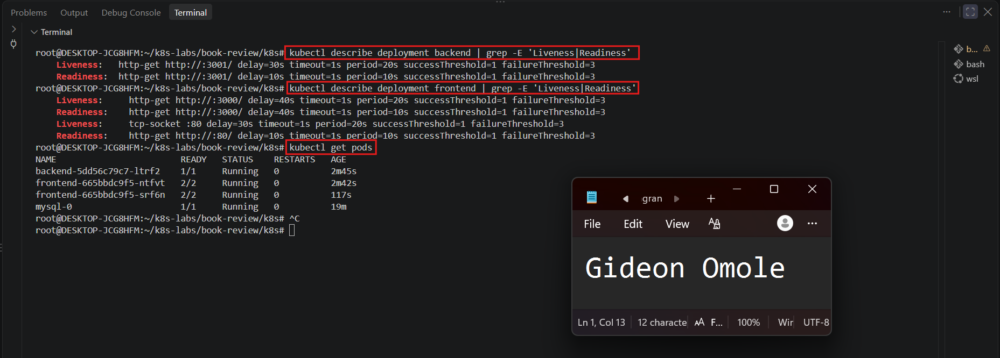

---

# Task 10 — Publish Your Book Review App Deployment on LinkedIn

## Goal

Explain your three-tier architecture, demonstrate the working application, and share what you learned.

### Evidence

#### Screenshot 20 — Published LinkedIn post about your Book Review App deployment on Kubernetes

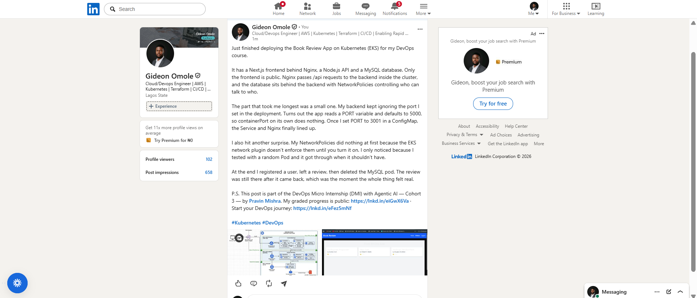

### LinkedIn Post URL

https://www.linkedin.com/posts/gideon-omole-5ba318180_kubernetes-devops-ugcPost-7518678141289295872-ZVQw/?rcm=ACoAACrC7l4BK-z0pGwSRQMO8ZJ5pFZyqybbIk4

---

# Final Summary

## What Worked

I deployed the Book Review App as a three-tier application on Amazon EKS (eu-north-1) in the `book-review` namespace. Docker Hub images (`giddyvibes/book-review-backend:v1` and `giddyvibes/book-review-frontend:v1`) were built from the app repo and used by the cluster.

- **Database:** MySQL runs as a StatefulSet with a 5 GiB EBS gp3 volume, provisioned through the EBS CSI driver and a `ebs-gp3` StorageClass. A headless Service exposes it internally. I proved persistence by deleting `mysql-0` and confirming the test row and later my review survived.
- **Backend:** Node.js/Express runs on port 3001 (set with `PORT` in a ConfigMap) behind an internal ClusterIP Service, `backend-service`. It reads non-sensitive settings from the `backend-config` ConfigMap and credentials from the `book-review-secret` Secret. It created its tables and sample data at startup and served a database-backed `/api/books` response. After the first Pod loaded the data, I scaled it to two replicas.
- **Frontend:** Each of the two frontend Pods runs Next.js on port 3000 with an Nginx sidecar on port 80. Nginx proxies `/api/` and `/api/api/` to `backend-service:3001`, so the browser only talks to one public address.
- **Networking:** Only `frontend-service` (type LoadBalancer) is public. NetworkPolicies allow only `tier: frontend` Pods to reach the backend on 3001 and only `tier: backend` Pods to reach MySQL on 3306. Allowed requests returned 200, and denied requests timed out.
- **End-to-end test:** In the browser I opened the home page, viewed a book, registered a test user, logged in, posted a review and refreshed to confirm it persisted. I confirmed the review row in MySQL. I then restarted the backend and deleted the MySQL Pod, and the review survived.
- **Security practice:** Real Secret values stayed outside the Git folder. Only a placeholder `02-secret.example.yaml` is committed, and no account ID or kubeconfig appears in the evidence.

## Issues and Fixes

- **Commands that lost their variables (cluster name, region, account ID, MySQL user):** The shell did not expand them. I re-set the variables in the terminal and retyped the commands.
- **No EBS storage for the StatefulSet:** The cluster needed the EBS CSI driver add-on and an IAM role. I associated the OIDC provider, created the `AmazonEKS_EBS_CSI_DriverRole` role and installed the add-on.
- **Small node running out of memory:** Pods could stay Pending on the single node. I reduced replicas where needed and set `maxSurge: 0` so rolling updates stop the old Pod before starting a new one.
- **NetworkPolicy had no effect at first:** Enforcement was not enabled. I turned on `enableNetworkPolicy` for the VPC CNI add-on and confirmed `aws-node` showed 2/2.
- **Backend defaulted to port 5000:** I fixed it by setting `PORT=3001` in the ConfigMap.
- **Home page requested `/api/api/books`:** I added a second Nginx location so both `/api/` and `/api/api/` reach the backend.
- **Duplicate `resources:` key when adding probes:** While editing `05-backend-deployment.yaml`, a stray extra `resources:` line was left in the container spec, which is invalid YAML. I rewrote both Deployment files in full with the probes in the correct place, checked with `grep -c 'resources:'`, and applied them.
- **EKS console "Unauthorized" on the Resources tab:** The console could not show Kubernetes resources even though an access entry with admin policies existed for `user/Gideon`, and kubectl worked from the CLI as the same user. [Describe what fixed it, or write that I used terminal views instead.]
- **k9s install on WSL:** `snap install k9s` reported success, but no binary was created. [Describe the fix, for example installing the k9s binary directly from the GitHub release, or write that I used `kubectl get` output as the dashboard evidence.]

## Tools and Sources Used

- Amazon EKS, `eksctl`, AWS CLI v2, `kubectl`
- Docker and Docker Hub
- Kubernetes: Deployments, StatefulSets, Services, ConfigMaps, Secrets, NetworkPolicies, PersistentVolumeClaims
- AWS EBS CSI driver and VPC CNI add-ons
- Nginx and Next.js; Node.js/Express and MySQL 8.0
- draw.io for the architecture diagram
- [k9s or the EKS console for the dashboard view]
- The assignment step-by-step guide and the `book-review-app` repository
- The Kubernetes and AWS EKS documentation
- Claude (Anthropic) for step-by-step guidance and troubleshooting

## Optional Improvements

- **Liveness and readiness probes:** I added liveness probes to the backend (port 3001), the Next.js container (port 3000, with a matching readiness probe) and a `tcpSocket` liveness probe to Nginx on port 80. I used long initial delays and verified with `kubectl describe deployment`. All Pods stayed at 0 restarts.
- **Dashboard view (Screenshot 18):** [Describe what you captured, or write "Not completed".]
- **Helm (Screenshot 2):** Not attempted. I used plain Kubernetes manifests.

## Cleanup or Reuse Plan

- **Cleaned up:** After capturing all evidence, I deleted `frontend-service` and the `book-review` namespace (removing the load balancer and EBS volume), and [deleted the cluster with `eksctl delete cluster`]. I checked EC2 Load Balancers, EC2 Volumes and CloudFormation for leftovers and removed the `AmazonEKS_EBS_CSI_DriverRole` IAM role. The Docker Hub images remain.

---

# Submission Instructions

- Include your Kubernetes manifests or Helm chart in the linked repository.
- Submit Secret examples containing placeholders only.
- Include Screenshot 1, Screenshots 3–17, and Screenshot 20.
- Include Screenshot 2 only if using Helm.
- Screenshots 18–19 are optional.
- Keep screenshot numbering consistent with the guidelines.
- Use clear, readable screenshots showing relevant configuration, commands, and outputs.
- Make your full name visible in required screenshots.
- Complete the submission details and Final Summary.
- Include your published LinkedIn post URL.
- Capture required evidence before cleanup.
- Do not expose passwords, tokens, JWT secrets, actual Secret values, kubeconfig contents, cloud credentials, or confidential account information.

---

# Completion Checklist

- [ ] Selected and configured a supported Kubernetes platform
- [ ] Confirmed the context and Ready nodes (Screenshot 1)
- [ ] Created and selected the book-review namespace
- [ ] Inspected the application repository
- [ ] Prepared images accessible to the cluster
- [ ] Confirmed Helm if using charts (Screenshot 2, conditional)
- [ ] Created the architecture diagram (Screenshot 3)
- [ ] Created ConfigMaps and Secrets (Screenshots 4–5)
- [ ] Excluded actual Secret values from Git and screenshots
- [ ] Provisioned private managed MySQL or persistent Kubernetes MySQL (Screenshot 6)
- [ ] Initialized the required database and schema
- [ ] Verified database connectivity or schema (Screenshot 7)
- [ ] Deployed one or two backend replicas listening on port 3001
- [ ] Created the backend ClusterIP Service (Screenshot 8)
- [ ] Verified backend-to-database connectivity (Screenshot 9)
- [ ] Deployed one or two frontend replicas behind Nginx (Screenshot 10)
- [ ] Configured API proxying through the internal backend Service (Screenshot 11)
- [ ] Configured and documented frontend access (Screenshot 12)
- [ ] Enforced backend access restrictions (Screenshot 13)
- [ ] Confirmed that the backend and database are not publicly exposed
- [ ] Captured resource status for book-review (Screenshot 14)
- [ ] Tested application functionality and database writes (Screenshots 15 and 17)
- [ ] Verified saved data after application restart
- [ ] Captured frontend and backend logs (Screenshots 16–17)
- [ ] Included optional dashboard or improvement evidence if attempted (Screenshots 18–19)
- [ ] Published the LinkedIn post (Screenshot 20)
- [ ] Included the LinkedIn post URL
- [ ] Documented issues, fixes, and useful sources
- [ ] Recorded cleanup status or reuse plans
- [ ] No sensitive data exposed

---

## 📌 About DMI & CloudAdvisory

DevOps Micro Internship (DMI) is a project-based DevOps program run by Pravin Mishra (The CloudAdvisory) focused on real-world execution, systems thinking, and career readiness.

It helps learners build strong DevOps foundations with hands-on experience.

---

## 📌 Resources

- 🌐 DMI Official Website: https://dmi.pravinmishra.com?utm_source=github&utm_medium=readme  
- 🎓 University: https://university.pravinmishra.com?utm_source=github&utm_medium=readme  
- 💬 Discord Community: https://discord.pravinmishra.com?utm_source=github&utm_medium=readme  
- 📝 Blog: https://dmi.pravinmishra.com/blog?utm_source=github&utm_medium=readme  
- ▶️ YouTube Playlist: https://www.youtube.com/playlist?list=PLFeSNDtI4Cho  
- 🔗 Pravin Mishra (LinkedIn): https://www.linkedin.com/in/pravin-mishra-aws-trainer/  
- 🏢 CloudAdvisory (LinkedIn): https://www.linkedin.com/company/thecloudadvisory/

---

*This submission is part of DevOps Micro Internship (DMI) — Agentic AI Track.*
