# Assignment 11 — AI-Assisted Kubernetes Incident Triage

Part of the DevOps Micro Internship (DMI) with Agentic AI

---

## Purpose

Configure a read-only Bash triage script for your Book Review App, connect it to Claude Code through `/k8s-triage`, simulate one controlled failure, recover the application manually, and verify recovery.

**Workflow: Gather → Analyze → Human Act → Verify**

---

## Submission Details

**Full Name:** Gideon Omole

**Kubernetes Platform:** Amazon EKS

**Selected Workload:** backend (Deployment, container `backend`, Service `backend-service`)

**Namespace:** book-review

**GitHub Repository URL:** (https://github.com/Gideon-Omole/book-review-app)

**Simulated Incident:** Invalid image (backend image tag changed to a non-existent tag, then restored to giddyvibes/book-review-backend:v1)

**Baseline Status:** HEALTHY

**Recovery Status:** WARN (exit code 1; 5 PASS, 0 FAIL. Backend Pod is 1/1 Ready with 0 restarts, and backend-service has a ready backend. The remaining Warning events are historical, left over from the failed image pull during the incident.)

---

# Task 1 — Discover the Application and Capture a Healthy Baseline

## Goal

Identify the actual application configuration and prove that the selected workload is healthy before incident simulation.

### Evidence

#### Screenshot 1 — Healthy Pods and ready Service backends

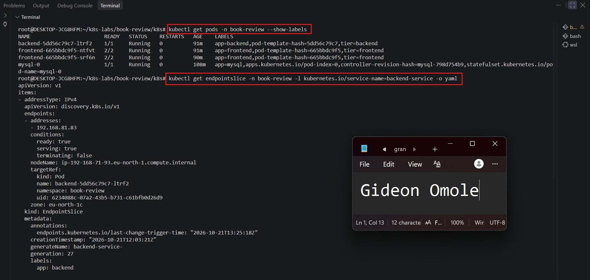

---

#### Screenshot 2 — Workspace directory structure

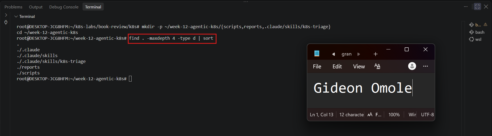

### Notes

**1. What proves the selected Pods are ready, not merely running?**

The `STATUS` column only says the Pod is `Running`, which means its containers have started. The `READY` column is what proves readiness. The backend Pod shows `1/1`, meaning its container passed the readiness probe (HTTP GET on port 3001) and Kubernetes considers it able to receive traffic. A Pod can be `Running` with `0/1` if the probe is failing, so I checked `READY` and not just `STATUS`.

**2. What proves the Service has ready backends?**

The EndpointSlice for `backend-service` lists the backend Pod's IP address under `endpoints` with `conditions.ready: true`. That IP matches the Pod IP shown by `kubectl get pods -o wide`. Only Pods that pass readiness are marked ready in the EndpointSlice, so this shows the Service has at least one backend that can receive traffic.

**3. Why must the original image be recorded before incident simulation?**

The incident changes the Deployment's image to a tag that does not exist, which overwrites the working value. If I did not save the exact original image (`giddyvibes/book-review-backend:v1`), I would have to guess it during recovery, and a wrong repository or tag would fail again. Recording it in `lab-config.md` beforehand lets me restore the exact known-good image with `kubectl set image` and verify a clean recovery.

---

# Task 2 — Configure CLAUDE.md

## Goal

Define the project configuration, incident workflow, and safety boundary for Claude Code.

### Evidence

#### Screenshot 3 — CLAUDE.md showing application configuration, workflow, safety rules, and output rules

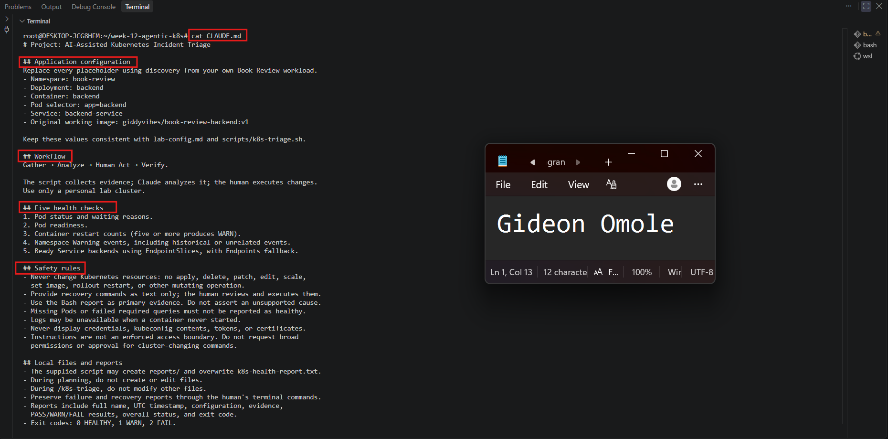

### Notes

**1. Why does Claude need project-specific cluster rules?**

Claude does not know which cluster, namespace, workload or Service I am investigating, and a generic request like "check my app" could lead it to inspect the wrong resources or run broad commands. `CLAUDE.md` gives it the exact configuration (namespace `book-review`, Deployment `backend`, container `backend`, selector `app=backend`, Service `backend-service`, original image `giddyvibes/book-review-backend:v1`). It also sets the workflow (Gather → Analyze → Human Act → Verify) and the safety boundary: read-only diagnosis, no credential disclosure, and reports written only through the supplied script. This makes Claude's behaviour consistent, focused on the right workload, and easier to review.

**2. Why must a human execute recovery commands?**

Recovery commands change the cluster, and a change can cause an outage or data loss if it targets the wrong namespace, Deployment or image. The engineer has the full context (what is safe to restart, what is business-critical, whether the diagnosis is actually supported) and carries the accountability. Claude only sees the evidence in the report, which may be incomplete or misleading, for example historical Warning events that do not need action. Keeping the human in the loop means every change is reviewed first, and the second triage run then verifies the result.

**3. Which rule prevents an unsupported diagnosis?**

The evidence-based conclusions rule in `CLAUDE.md`: Claude may state a cause only when the report or a read-only Kubernetes query supports it. If a required query fails or the evidence is missing, it must report the failure or say it cannot confirm the cause instead of guessing. In my recovery run this is why Claude said it could not confirm what the Warning events were, because the report did not list them, rather than naming a cause.

---

# Task 3 — Plan the Read-Only Triage Workflow

## Goal

Ask Claude Code to explain the five health checks before running the supplied script.

### Evidence

#### Screenshot 4 — Claude Code showing the five-check read-only plan

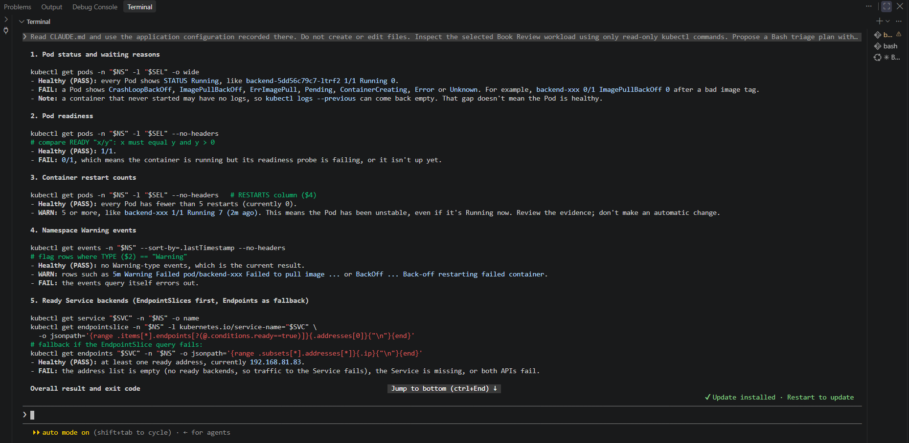

### Notes

**1. Which part represents the Gather phase?**

The read-only `kubectl` inspection that Claude proposed in the five-check plan represents the Gather phase: Pod status, Pod readiness, restart counts, namespace Warning events, and ready Service backends (via the EndpointSlice). These commands only read cluster state and collect facts, with no analysis or changes. Later, the supplied `k8s-triage.sh` script performs the same Gather step in a repeatable way and writes the evidence to `reports/k8s-health-report.txt`.

**2. How did you verify that Claude did not change anything?**

I reviewed Claude's tool activity during the session and confirmed that every command it proposed or ran was a read-only `kubectl get` or `describe` style query, with no `apply`, `delete`, `patch`, `scale`, `rollout restart` or `set image`. I also confirmed that no file was created or edited, using `ls` in the workspace, and that the Deployment was unchanged by checking `kubectl get pods -n book-review` and that the backend image was still `giddyvibes/book-review-backend:v1`. Claude's own summary also stated that it ran no cluster-changing commands.

**3. Why is planning before coding useful for incident triage?**

During an incident, a wrong or overly broad command can make things worse or hide evidence. Reviewing a plan first lets me check that each command is read-only, targets the right namespace, Deployment and Service, and has a clear healthy versus failed result before anything runs. It also defines what counts as evidence, so the script I build afterwards is deliberate and repeatable, and it avoids writing code that checks the wrong things or changes the cluster by accident.

---

# Task 4 — Configure and Validate the Bash Script

## Goal

Configure the supplied triage script for the selected workload and validate its syntax.

### Evidence

#### Screenshot 5 — Script configuration variables and checks array

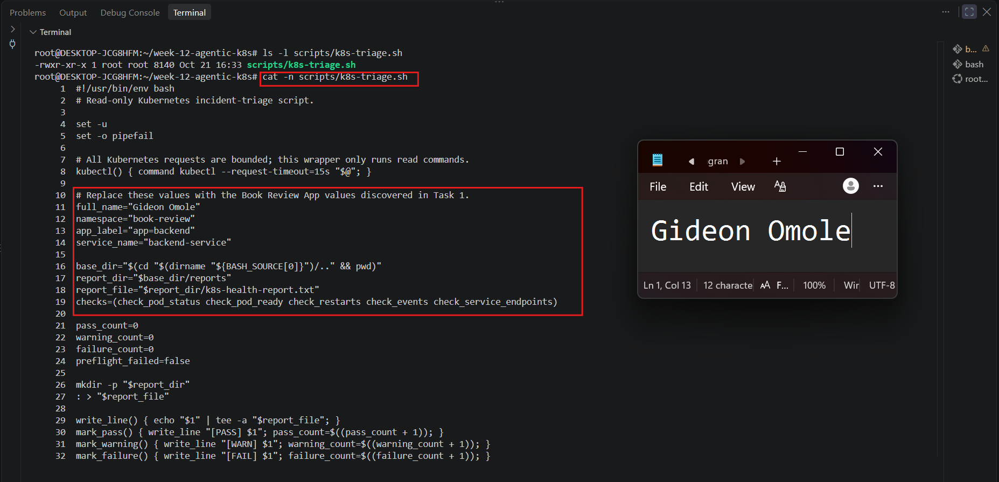

---

#### Screenshot 6 — Functions for status, readiness, restarts, events, and Service backends

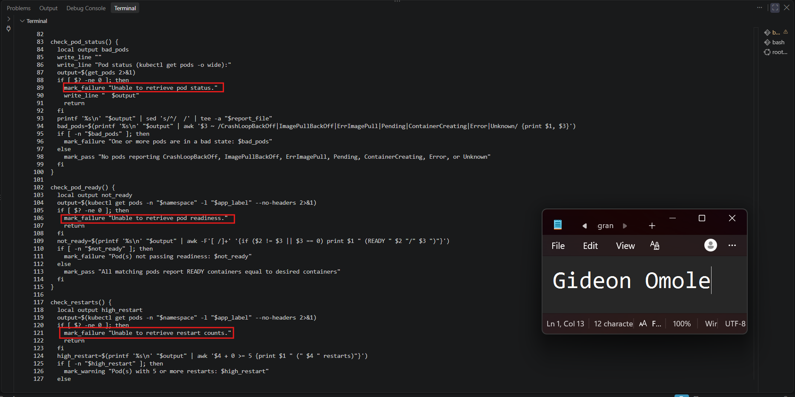

---

#### Screenshot 7 — Preflight, summary, and exit-code logic

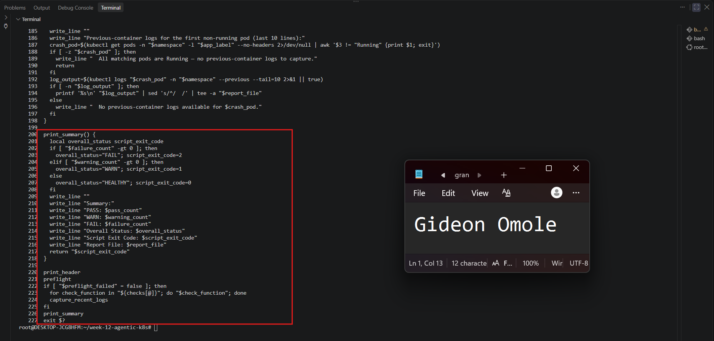

---

#### Screenshot 8 — Successful syntax validation and executable permission

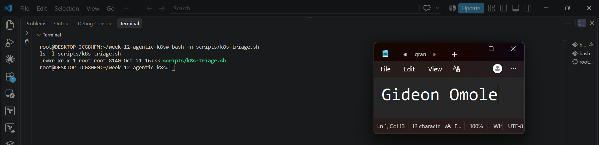

### Notes

**1. Why must the script fail when no Pods match the configured selector?**

If no Pods match the selector, there is nothing to inspect, so every Pod-level check would pass by default (no unhealthy Pods, no restarts) and the report would falsely say HEALTHY. That could mean the selector or namespace is wrong, or that the Deployment has no Pods at all, which is a serious problem in itself. Failing with exit code 2 makes "I could not find the workload" an explicit failure rather than a silent pass, and it fits the rule that a failed or empty required query must be reported as a failure, not guessed around.

**2. How does the readiness check detect a running but unready Pod?**

A Pod can have `STATUS: Running` while its readiness probe is failing. The check reads the Pod's ready container count (the `READY` column, or the `Ready` condition and `containerStatuses[].ready`) and compares ready containers to total containers. If the count is lower than the total, for example `0/1`, the Pod is running but not ready, and the check reports a failure or warning. This catches a broken readiness probe even though the container process is alive.

**3. Why are Service backends checked separately from Pod health?**

Pod health and Service routing are different things. A Pod can look healthy while the Service does not send traffic to it, for example if the Service selector does not match the Pod labels or the Pod is not marked ready in the EndpointSlice. In the other direction, during a bad rollout, older healthy Pods can keep the Service backends ready even though the new Pod is failing. Checking the EndpointSlice for addresses with `conditions.ready: true` confirms that users can actually be served, which Pod status alone cannot prove.

**4. What do exit codes 0, 1, and 2 represent?**

- **0 (HEALTHY):** all checks passed.
- **1 (WARN):** no required check failed, but there are warnings that need review, such as historical Warning events.
- **2 (FAIL):** at least one required check failed, such as no matching Pods, an unready Pod, no ready Service backends, or a failed kubectl query.

These codes let the script be used in automation and let me compare the captured exit code with the report's overall status.

---

# Task 5 — Run the Healthy Baseline Report

## Goal

Run the script on the healthy application and confirm that it contains no failed checks.

### Evidence

#### Screenshot 9 — Baseline report showing your full name and all checks

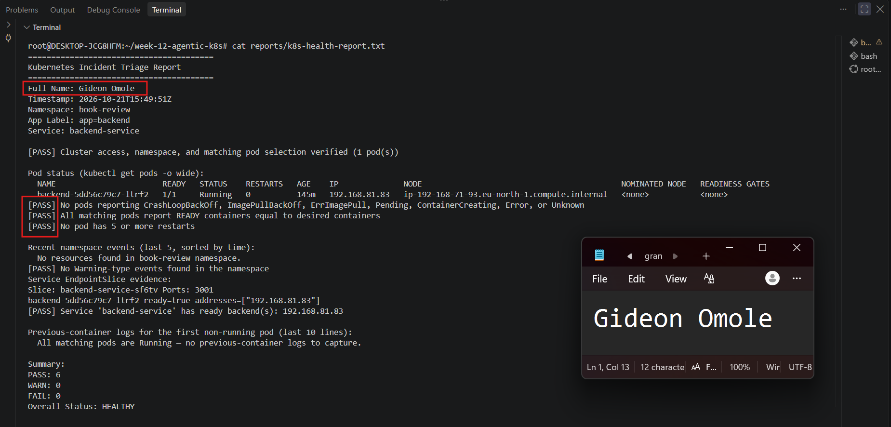

---

#### Screenshot 10 — Captured exit code and final summary

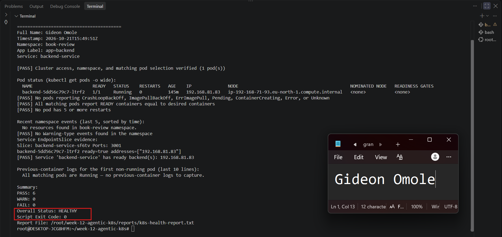

### Notes

**1. What is the baseline status?**

The baseline was HEALTHY (exit code 0) with 6 PASS, 0 WARN and 0 FAIL. The backend Pod `backend-5dd56c79c7-ltrf2` was `1/1 Running` with 0 restarts. The namespace had no Warning events, and `backend-service` had a ready backend, so it was safe to start the incident from this state.

**2. Which evidence proves the Service has a ready backend?**

The report's EndpointSlice section shows slice `backend-service-sf6tv` on port 3001 with `backend-5dd56c79c7-ltrf2 ready=true addresses=["192.168.81.83"]`. The report also records `[PASS] Service 'backend-service' has ready backend(s): 192.168.81.83`. That IP matches the Pod IP in the Pod status table.

**3. What is the difference between a warning and a failure?**

A failure (FAIL, exit code 2) means a required check did not pass: a Pod in a bad state such as ImagePullBackOff, a Pod not ready, no ready Service backends, or a kubectl query that failed. A warning (WARN, exit code 1) means nothing required failed, but a human should look, for example Warning events (which may be historical) or a Pod with 5 or more restarts. A warning alone does not justify changing the cluster.

---

# Task 6 — Configure and Run the Claude Code Skill

## Goal

Connect the Bash script to a manually invoked Claude Code evidence-analysis workflow.

### Evidence

#### Screenshot 11 — SKILL.md showing frontmatter and safety rules

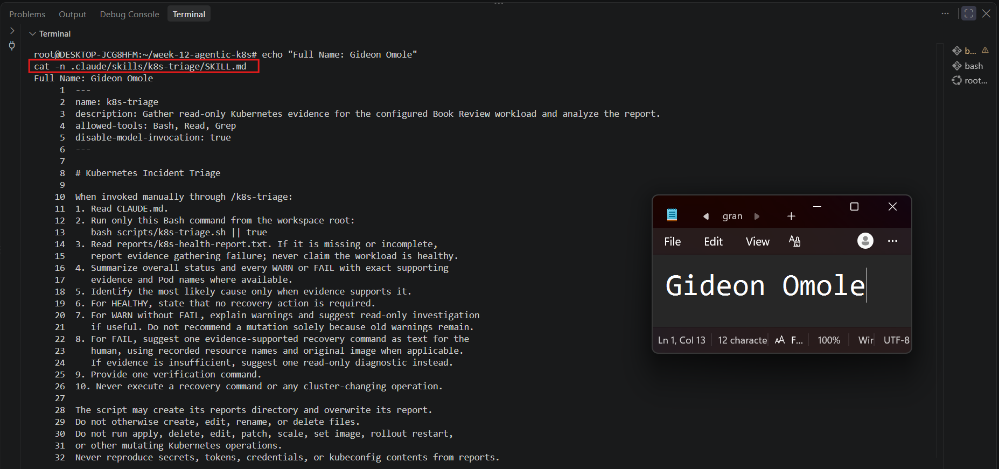

---

#### Screenshot 12 — Baseline `/k8s-triage` analysis

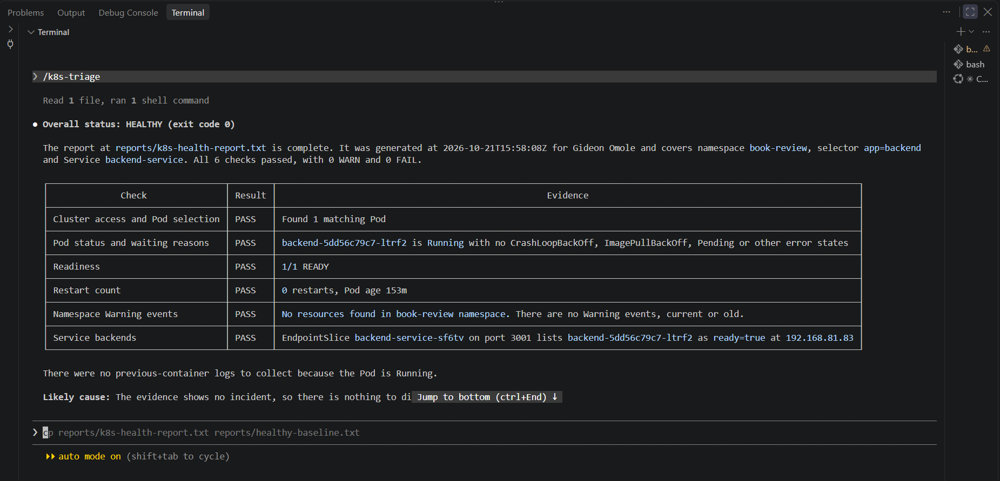

### Notes

**1. What does Bash do in this workflow?**

Bash does the Gather step. `scripts/k8s-triage.sh` runs the same read-only `kubectl` queries every time: Pod status, Pod readiness, restart counts, namespace Warning events and ready Service backends from the EndpointSlice. It records each result as PASS, WARN or FAIL, writes the evidence to `reports/k8s-health-report.txt`, and returns exit code 0, 1 or 2. It is deterministic and repeatable. It reports a failure if no Pods match or a required query fails, and it is the same tool I used for the baseline, the incident and the recovery check.

**2. What does Claude do in this workflow?**

Claude does the Analyze step. When I invoke `/k8s-triage`, it reads `CLAUDE.md`, runs the supplied script, reads the report and summarizes the evidence. It identifies which checks passed, warned or failed, names the affected Pod, states the most likely cause only when the evidence supports it, and suggests a recovery command or a read-only follow-up as text. For a HEALTHY result it says no recovery is needed. It does not change the cluster. I perform the recovery myself and then run the workflow again to verify.

**3. Why are instructions alone insufficient to guarantee read-only access?**

`CLAUDE.md` and `SKILL.md` only describe the behaviour I expect. They do not technically limit what Claude can do. My `SKILL.md` lists `allowed-tools: Bash, Read, Grep`, and Bash can run any shell command, including `kubectl delete` or `kubectl set image`, if Claude were misled, made a mistake, or if a tool request were approved by accident. Claude can also misread evidence or follow unexpected text in logs or events. The real guarantees are technical: Kubernetes credentials restricted to read operations (RBAC), narrower tool permissions, and a human reviewing each tool request and not approving cluster-changing commands. That is why I ran the incident and recovery commands myself in a separate terminal.

---

# Task 7 — Simulate One Controlled Incident

## Goal

Create one controlled failure, save its evidence, and let Claude analyze it without executing recovery.

### Evidence

#### Screenshot 13 — Failed or unready Pod evidence and current Service backends

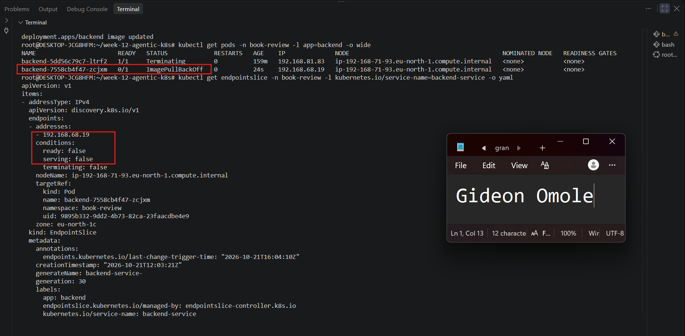

---

#### Screenshot 14 — Failed `/k8s-triage` analysis with evidence and a suggested manual recovery command

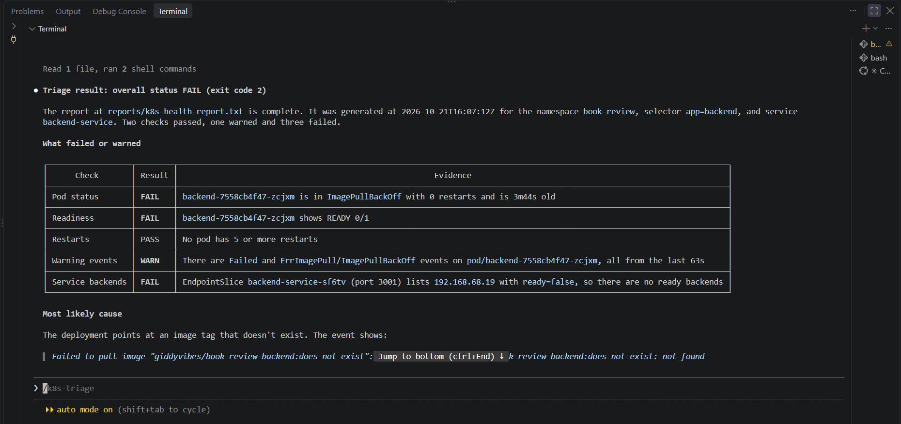

---

#### Screenshot 15 — Saved `incident-failure-report.txt`

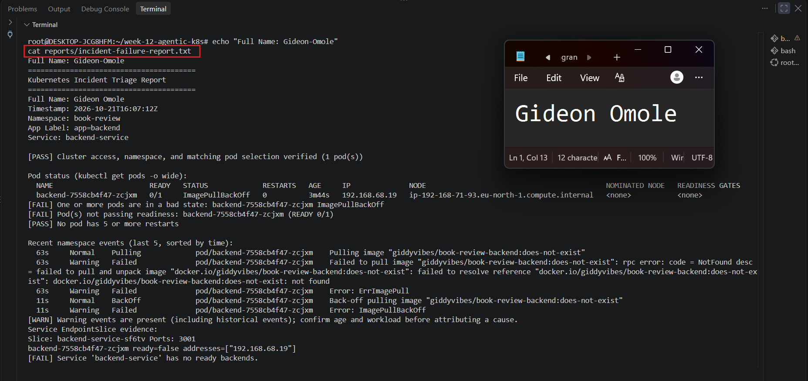

### Notes

**1. Which failure did you choose?**

An invalid image. I ran `kubectl set image` on the `backend` Deployment to change the `backend` container to `giddyvibes/book-review-backend:does-not-exist`. I recorded the original working image, `giddyvibes/book-review-backend:v1`, in `lab-config.md` before making the change.

**2. Which checks failed, and what evidence proved it?**

The overall result was FAIL (exit code 2).
- **Pod status: FAIL.** `backend-7558cb4f47-zcjxm` was in `ImagePullBackOff`.
- **Readiness: FAIL.** The same Pod showed `READY 0/1`.
- **Service backends: FAIL.** EndpointSlice `backend-service-sf6tv` listed `192.168.68.19` with `ready=false` and `serving=false`, so `backend-service` had no ready backends.
- **Warning events: WARN.** There were `Failed`, `ErrImagePull` and `ImagePullBackOff` events for the Pod, saying the image `giddyvibes/book-review-backend:does-not-exist` was not found.
- **Restarts: PASS.** The count was 0 because the container never started.

Together this supports the cause: the Deployment pointed at an image tag that does not exist.

**3. Did Claude execute recovery? Why is that important?**

No. Claude read the report, explained the evidence and suggested the recovery command as text. I ran the recovery myself in a regular terminal. This matters because recovery changes a live workload. A human has to confirm the namespace, Deployment, container and image are correct, and that the diagnosis is supported by evidence, before anything changes. Otherwise a wrong or misunderstood command could make the incident worse.

**4. Why might the Service retain ready backends during the incident?**

During a rolling update, the old Pods stay ready until the new Pod passes readiness, so the Service keeps routing traffic to them. If the new Pod is broken, the old healthy Pods can keep serving. In my run this did not happen. The backend had one replica with `maxSurge: 0` and `maxUnavailable: 1`, so Kubernetes stopped the old Pod before starting the new one, and the Service had no ready backend. With more replicas, or with `maxSurge` above 0, the older Pods would have kept serving.

---

# Task 8 — Recover Manually and Verify

## Goal

Restore the healthy configuration yourself and verify recovery using a second triage report.

### Evidence

#### Screenshot 16 — Recovered Pods and ready Service backends

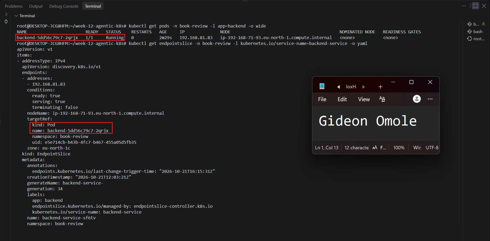

---

#### Screenshot 17 — Recovered `/k8s-triage` analysis

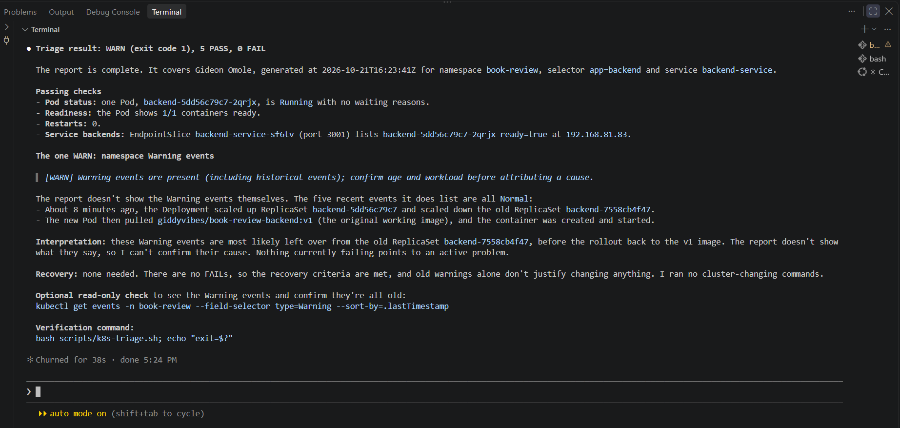

---

#### Screenshot 18 — Reports directory showing failure and recovery reports

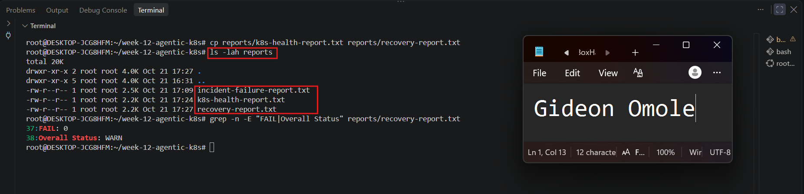

---

#### Screenshot 19 — `incident-summary.md` with all required sections

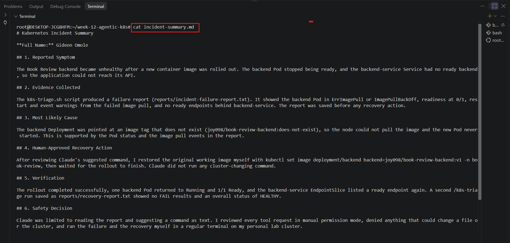

### Notes

**1. What manual recovery action did you execute?**

After confirming the context was `eks-lb-lab`, I restored the original image myself in a regular terminal:

`kubectl set image deployment/backend backend=giddyvibes/book-review-backend:v1 -n book-review`

I then waited for the rollout with `kubectl rollout status deployment/backend -n book-review --timeout=180s` and checked the Pods and EndpointSlice. I used the exact image recorded in `lab-config.md`, so I did not have to guess it.

**2. What proves the workload recovered?**

- The new backend Pod `backend-5dd56c79c7-2qrjx` was `1/1 Running` with 0 restarts, and the failed `ImagePullBackOff` Pod was gone.
- EndpointSlice `backend-service-sf6tv` listed `192.168.81.83` with `ready: true` and `serving: true`.
- The recovery report showed WARN (exit code 1) with 5 PASS and 0 FAIL, so no required check failed.
- Claude's analysis of that report agreed, and the Normal events showed the new Pod pulling `giddyvibes/book-review-backend:v1` and starting.

**3. Why is the second triage run necessary?**

A successful `kubectl set image` or rollout only shows that the command was accepted. It does not prove the application is healthy. Running the same script again checks the same five conditions that failed during the incident and gives evidence that can be compared directly with the failure report. It also confirms there is no new problem, such as a Pod that is still unready or a Service with no backend. This completes the Verify step and gives a saved recovery report.

**3b. (optional extra detail)** The first and second reports use the same script and the same checks, so the only thing that changed between them is the state of the cluster.

**4. Why should AI not automatically restart every failing production workload?**

A restart changes a live system and often does not fix the cause. In this incident, restarting the Pod would have failed again, because the problem was a bad image tag. A restart can also hide evidence such as logs and events, interrupt users, trigger a cascade across dependent services, or cause data loss for stateful workloads like MySQL. The AI sees only the evidence in the report, which can be incomplete or misleading, while the engineer knows the business context and who is accountable. A human therefore reviews each recovery action first, and AI should work with restricted, read-only access.

### Remaining WARN Results

The recovery report was WARN (exit code 1) with 0 FAIL. The one warning is the namespace Warning events check, which fires when any Warning-type event exists, including historical ones. The remaining events are left over from the failed rollout during the incident (`Failed`,

# Task 9 — Publish Your Kubernetes Incident-Triage Workflow on LinkedIn

## Goal

Share the incident-triage workflow you completed and explain the role of human control.

### Evidence

#### Screenshot 20 — Published LinkedIn post about your Kubernetes incident-triage workflow

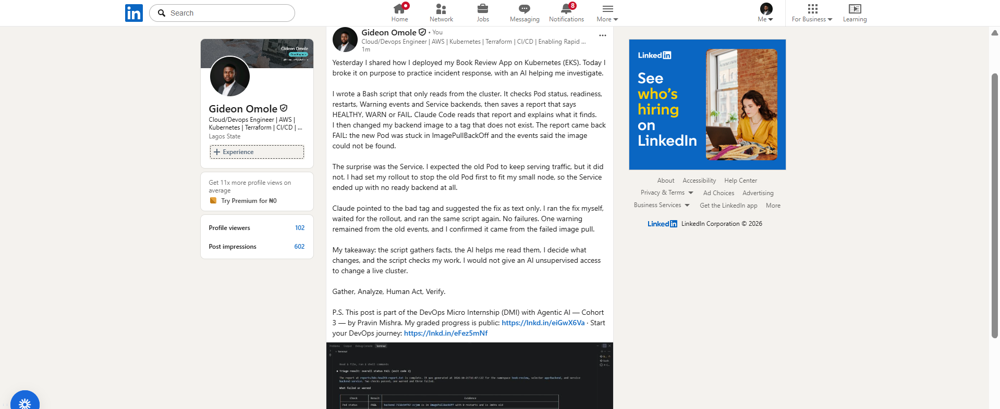

### LinkedIn Post URL

https://www.linkedin.com/posts/gideon-omole-5ba318180_yesterday-i-shared-how-i-deployed-my-book-share-7518997358328594432--oeg/?rcm=ACoAACrC7l4BK-z0pGwSRQMO8ZJ5pFZyqybbIk4

---

# Required Project Files

Include these files in your project repository:

- `CLAUDE.md`
- `lab-config.md`
- `scripts/k8s-triage.sh`
- `.claude/skills/k8s-triage/SKILL.md`
- `reports/incident-failure-report.txt`
- `reports/recovery-report.txt`
- `incident-summary.md`

Your `incident-summary.md` must contain:

1. Reported Symptom
2. Evidence Collected
3. Most Likely Cause
4. Human-Approved Recovery Action
5. Verification
6. Safety Decision
7. Agentic Loop Mapping

---

# Final Summary

## Evidence and Cause

The healthy baseline was HEALTHY (exit code 0, 6 PASS, 0 WARN, 0 FAIL). After I changed the `backend` container image to `giddyvibes/book-review-backend:does-not-exist`, the triage report became FAIL (exit code 2). The new Pod `backend-7558cb4f47-zcjxm` was in `ImagePullBackOff` and showed `READY 0/1`. EndpointSlice `backend-service-sf6tv` listed `192.168.68.19` with `ready=false`, so `backend-service` had no ready backends. The Warning events (`Failed`, `ErrImagePull`, `ImagePullBackOff`) said the image `giddyvibes/book-review-backend:does-not-exist` was not found. The restart count was 0 because the container never started. The supported cause is a Deployment that pointed at an image tag that does not exist. The Service lost all backends because the rollout used `maxSurge: 0` and `maxUnavailable: 1` with one replica, so the old Pod stopped before the new one became ready.

## Manual Recovery

After confirming the context was `eks-lb-lab`, I restored the original image in a regular terminal:

`kubectl set image deployment/backend backend=giddyvibes/book-review-backend:v1 -n book-review`

I waited for the rollout with `kubectl rollout status deployment/backend -n book-review --timeout=180s`. I used the exact image recorded in `lab-config.md`. Before recovery I saved the failure report as `reports/incident-failure-report.txt`.

## Verification

The new backend Pod `backend-5dd56c79c7-2qrjx` was `1/1 Running` with 0 restarts, and the failed Pod was gone. EndpointSlice `backend-service-sf6tv` listed `192.168.81.83` with `ready: true`. I ran `/k8s-triage` again and saved the result as `reports/recovery-report.txt`. It showed WARN (exit code 1) with 5 PASS and 0 FAIL. The one warning is the namespace Warning events check, which also counts historical events. These are left over from the failed image pull and do not point to an active problem, so no further change was needed.

## Safety Decision

Claude's role was limited to evidence gathering and analysis. `CLAUDE.md` and `SKILL.md` told it to stay read-only, to show recovery commands as text only, and to avoid unsupported conclusions. The Bash script was the only tool that gathered evidence, and it only runs read commands. Claude read the report, explained the failed checks and suggested the fix as text. I ran the incident and recovery commands myself in a separate terminal and checked that they targeted the right namespace, Deployment and container. I also know instructions alone are not a technical guarantee, because `SKILL.md` allows Bash, so I did not approve any cluster-changing command from Claude. A stronger control would be Kubernetes credentials restricted to read operations.

---

# Submission Instructions

- Include all 20 required screenshots under their corresponding Evidence sections.
- Complete all Notes questions in your own words.
- Include the required project files in your linked repository.
- Include your published LinkedIn post URL.
- Use clear, readable screenshots showing relevant commands, configuration, and outputs.
- Display your full name before taking required terminal screenshots.
- Preserve the failure report before recovery.
- Ensure the baseline and recovery reports contain no FAIL results.
- Explain any WARN results remaining after recovery.
- Review reports, logs, configuration records, and screenshots before publishing.
- Do not expose credentials, kubeconfig contents, tokens, certificates, JWT secrets, or confidential account information.

---

# Completion Checklist

- [ ] Confirmed the personal lab context
- [ ] Discovered and recorded application configuration
- [ ] Recorded the original working image
- [ ] Captured healthy Pods and ready Service backends (Screenshot 1)
- [ ] Created the workspace (Screenshot 2)
- [ ] Configured CLAUDE.md (Screenshot 3)
- [ ] Reviewed the five-check triage plan (Screenshot 4)
- [ ] Configured and reviewed the supplied script (Screenshots 5–7)
- [ ] Passed Bash syntax validation and set executable permission (Screenshot 8)
- [ ] Captured a baseline report with no FAIL (Screenshot 9)
- [ ] Captured the correct exit code (Screenshot 10)
- [ ] Configured and invoked `/k8s-triage` (Screenshots 11–12)
- [ ] Simulated one controlled incident manually (Screenshot 13)
- [ ] Reviewed Claude’s failed-state analysis (Screenshot 14)
- [ ] Saved failure evidence before recovery (Screenshot 15)
- [ ] Executed recovery manually and waited for rollout completion
- [ ] Confirmed recovered Pods and ready Service backends (Screenshot 16)
- [ ] Captured recovery analysis with no FAIL (Screenshot 17)
- [ ] Explained any remaining warnings
- [ ] Saved failure and recovery reports (Screenshot 18)
- [ ] Completed the seven-section incident summary (Screenshot 19)
- [ ] Answered all Notes questions
- [ ] Published the LinkedIn post (Screenshot 20)
- [ ] Included the LinkedIn post URL
- [ ] Included all required project files
- [ ] Checked that no sensitive information is exposed

---

## 📌 About DMI & CloudAdvisory

DevOps Micro Internship (DMI) is a project-based DevOps program run by Pravin Mishra (The CloudAdvisory) focused on real-world execution, systems thinking, and career readiness.

It helps learners build strong DevOps foundations with hands-on experience.

---

## 📌 Resources

- 🌐 DMI Official Website: https://dmi.pravinmishra.com?utm_source=github&utm_medium=readme  
- 🎓 University: https://university.pravinmishra.com?utm_source=github&utm_medium=readme  
- 💬 Discord Community: https://discord.pravinmishra.com?utm_source=github&utm_medium=readme  
- 📝 Blog: https://dmi.pravinmishra.com/blog?utm_source=github&utm_medium=readme  
- ▶️ YouTube Playlist: https://www.youtube.com/playlist?list=PLFeSNDtI4Cho  
- 🔗 Pravin Mishra (LinkedIn): https://www.linkedin.com/in/pravin-mishra-aws-trainer/  
- 🏢 CloudAdvisory (LinkedIn): https://www.linkedin.com/company/thecloudadvisory/

---

*This submission is part of DevOps Micro Internship (DMI) — Agentic AI Track.*
